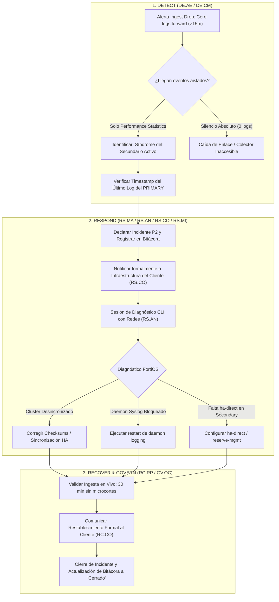

# 🛡️ TECHNOMA SOC — PLAYBOOK 6.5
# GESTIÓN Y RESPUESTA A INCIDENTES: PÉRDIDA DE TELEMETRÍA EN FIREWALLS PERIMETRALES Y CLUSTERS HA
### Alineado a NIST SP 800-61 Rev. 3 (A CSF 2.0 Community Profile) & MITRE ATT&CK

```
========================================================================================
[DATOS GENERALES DE CONTROL - TECHNOMA SOC]
ID: PB-6.5 | Código Interno: PB-RES-HA-01
Título: Pérdida de Telemetría en Firewalls Perimetrales y Clusters HA (FortiGate / UTM)
Prioridad: P2 (Media/Alta - Compromiso de Visibilidad y Detección)
Taxonomía CSF 2.0: DE.AE, DE.CM, RS.MA, RS.AN, RS.CO, RS.MI, RC.RP, RC.CO, GV.OC, ID.AM
Modalidad Operativa: MD, MDR, MSSP | Estado: Homologado / En Producción
Propietario: SOC Technoma / Ingeniería de Ciberseguridad y Detección
========================================================================================
```

---

## 🏛️ 1. Marco Normativo: NIST SP 800-61 Rev. 3 (CSF 2.0 Community Profile)

Este playbook adopta íntegramente la estructura del **NIST SP 800-61 Rev. 3** (*Incident Response Recommendations and Considerations for Cybersecurity Risk Management: A CSF 2.0 Community Profile*), organizando la respuesta no como fases aisladas, sino mediante la integración de las funciones del **NIST Cybersecurity Framework (CSF) 2.0**:

```
+----------------------------------------------------------------------------------------------------+
|                                 NIST CSF 2.0 INCIDENT RESPONSE PROFILE                            |
+----------------------------------------------------------------------------------------------------+
|  GOVERN (GV)  | Definición de SLAs, responsabilidades compartidas (RACI) y gobernanza de custodia.|
|  IDENTIFY (ID)| Inventario estricto de nodos del cluster (Primario/Secundario) y criticidad de red.|
|  PROTECT (PR) | Salvaguarda de la ruta de logs, canales cifrados/aislados y buffers locales.       |
|  DETECT (DE)  | Monitoreo continuo de ingesta (DE.CM) y análisis de cese de eventos (DE.AE).       |
|  RESPOND (RS) | Triaje (RS.MA), análisis técnico CLI (RS.AN), contención/mitigación (RS.MI).       |
|  RECOVER (RC) | Restablecimiento de flujo continuo (RC.RP) y validación de línea base (RC.CO).    |
+----------------------------------------------------------------------------------------------------+
```

### Mapeo de Categorías CSF 2.0 y Controles Específicos:
* **DE.CM-01 / DE.CM-06 (Continuous Monitoring):** Monitoreo en tiempo real del flujo de eventos de red y detección de interrupción en la recepción de logs de seguridad.
* **DE.AE-02 / DE.AE-04 (Adverse Event Analysis):** Detección y análisis del cese súbito de telemetría de tráfico (`subtype=forward`) y análisis del comportamiento asimétrico en clusters HA.
* **RS.MA-01 / RS.MA-02 (Incident Management):** Triaje, apertura de ticket formal y categorización de la pérdida de visibilidad como incidente de salud operativa P2.
* **RS.AN-03 / RS.AN-06 (Incident Analysis):** Diagnóstico de causa raíz a nivel de capa de red, interfaz de sincronización (`hbdev`), demonios de logging y estado del cluster.
* **RS.CO-02 / RS.CO-03 (Incident Response Communication):** Comunicación formal, oportuna y deslindada hacia el equipo de Infraestructura/Redes del cliente según matriz de escalado.
* **RS.MI-01 / RS.MI-02 (Incident Mitigation):** Aplicación de contingencias (reinicio de demonio `syslogd`, conmutación de interfaz de gestión, activación de `ha-direct`).
* **RC.RP-01 / RC.RP-03 (Recovery Plan Execution):** Confirmación de ingesta sostenida de tráfico por 30 minutos sin pérdida de paquetes.
* **GV.OC-03 / ID.AM-02 (Governance & Asset Management):** Registro fehaciente en la Bitácora de 18 columnas para respaldo ante auditorías externas y SLAs contractuales.

### Mapeo MITRE ATT&CK:
* **T1562.001 (Impair Defenses: Disable or Modify Tools):** Acciones adversariales o accidentales que inhabilitan el reenvío de logs perimetrales para generar puntos ciegos.
* **T1565.001 (Data Manipulation: Stored Data Manipulation / Log Suppression):** Supresión o alteración de registros de auditoría en el appliance.

---

## 🎯 2. Objetivos y Alcance Operativo

1. **Eliminación Inmediata de Puntos Ciegos:** Identificar y diagnosticar en menos de **15 minutos** cualquier interrupción en el flujo de eventos de tráfico perimetral de clientes bajo contrato SOC.
2. **Desarticulación del "Síndrome del Secundario Activo":** Evitar falsos diagnósticos de "servicio operativo" provocados por la recepción exclusiva de *keep-alives* o estadísticas de rendimiento de un nodo secundario pasivo, mientras el nodo activo no remite tráfico.
3. **Respaldo Legal y Operativo:** Documentar mediante la Bitácora de 18 columnas y tickets formales la contingencia, salvaguardando la responsabilidad del SOC ante incidentes no detectados durante la ventana ciega.

---

## 📋 3. Matriz de Roles y Responsabilidades (RACI - CSF GV.RR)

| Actividad | Analista SOC N1 | Analista SOC N2 | Ingeniero Redes Cliente | Coordinador / Jefe SOC |
| :--- | :---: | :---: | :---: | :---: |
| Detección de caída de ingesta (>15m) | **R / A** | C | I | I |
| Validación de nodo Primary vs Secondary | **R** | A | C | I |
| Creación de ticket P2 y registro en Bitácora | **R / A** | C | I | I |
| Diagnóstico técnico por CLI en FortiOS | C | **R / A** | **R** (Ejecutor) | I |
| Reconfiguración / Reinicio de demonios | I | C | **R / A** | I |
| Validación de recuperación y cierre | **R** | **A** | C | I |

*(R = Responsable de ejecutar, A = Aprobador final, C = Consultado, I = Informado)*

---

## 🔄 4. Flujo Operativo de Incident Response (NIST SP 800-61 Rev. 3)



---

### ETAPA 1: DETECCIÓN Y ANÁLISIS (NIST CSF DE.AE / RS.AN)

#### Paso 1.1: Confirmación de Alerta y Análisis de Telemetría
El analista debe inspeccionar en **Security Onion** (`logs-fortinet_fortigate.log-*`) y en el Data Lake de **Stellar Cyber** el comportamiento del logsource:

1. **Consulta de Verificación en Security Onion:**
   ```lucene
   log.source.address: "192.168.40.254" AND @timestamp: [now-1h TO now]
   ```
2. **Evaluación de Síntomas:**
   * **Caso A (Caída Total):** `0` hits totales en los últimos 60 minutos. Indica caída de interfaz WAN, túnel VPN caído o fallo en el colector del SOC.
   * **Caso B (El Síndrome del Secundario Activo):** Se observan hits constantes pero espaciados (1 log cada 5 minutos) con mensajes como:
     ```text
     Observer: FGT-60F-VALORES-HA-SECONDARY | Msg: Performance statistics: average CPU: 0, memory: 54, concurrent sessions: 558, setup-rate: 0
     ```
     **Dictamen Técnico:** El cluster sufrió un evento de desincronización, apagado del nodo activo o corte de la ruta del nodo primario hacia el SOC. El nodo pasivo reporta salud local pero **no procesa tráfico de clientes ni genera logs de políticas/UTM**.

#### Paso 1.2: Auditoría del "Último Aliento"
Determinar con precisión de segundo cuándo se recibió el último paquete `subtype=forward` del nodo `PRIMARY`:
```lucene
observer.name: "*PRIMARY*" AND message: "*subtype=forward*"
```
*Anotar fecha, hora exacta, número de secuencia y política de firewall del último log para el informe.*

---

### ETAPA 2: GESTIÓN Y COMUNICACIÓN (NIST CSF RS.MA / RS.CO)

#### Paso 2.1: Registro Inmediato en Bitácora (18 Columnas)
Registrar el evento en la Bitácora Oficial del SOC utilizando el código **`PB-6.5`** para dejar constancia de que el punto ciego fue detectado y gestionado proactivamente por el analista.

#### Paso 2.2: Emisión del RFA (Request for Action) Interno al Equipo de Redes
Cuando el firewall del cliente es administrado y operado directamente por Technoma (modelo MSSP / Servicio Gestionado de Firewall), **el procedimiento operativo estándar exige emitir formalmente un RFA (Request for Action) vía correo electrónico / ticket interno** dirigido al Equipo de Redes / Infraestructura de Technoma con copia a la Jefatura del SOC:

```markdown
# [RFA] SOLICITUD DE ACCIÓN TÉCNICA — RESTABLECIMIENTO DE TELEMETRÍA FIREWALL
**Para:** Equipo de Infraestructura y Redes / Soporte de Conectividad (Technoma)
**De:** Centro de Operaciones de Seguridad (SOC)
**Fecha:** 29/10/2026
**Asunto:** [URGENTE - P2] RFA - Pérdida de Telemetría Perimetral y Desincronización en Cluster FortiGate Valores
**Prioridad:** Alta (P2 - Punto Ciego Perimetral)
**Tenant Afectado:** VALORES (Valores Casa de Bolsa)
**Activo:** Cluster Fortinet FortiGate 60F (IP Gateway: 192.168.40.254)

---

### 1. Solicitud de Acción (RFA Requerida)
Por requerimiento de visibilidad del SOC bajo estándar NIST SP 800-61 Rev. 3 / CSF 2.0 (DE.AE-02 / RS.CO-02), se solicita al equipo de Redes de Technoma la ejecución y verificación de los siguientes puntos en el cluster de Valores:

1. **Inspección de Estado y Roles de Alta Disponibilidad:**
   - Ejecutar en consola CLI: `get system ha status` y `diagnose sys ha status`.
   - Confirmar si el nodo activo actual es el PRIMARY o si hubo un failover hacia el SECONDARY.
   - Verificar si el cluster indica `Synchronized: yes` o si existe desincronización de checksums (`diagnose sys ha checksum cluster`).

2. **Revisión del Demonio de Reenvío Syslog:**
   - En la unidad que esté operando como Master, verificar la configuración: `get log syslogd setting`.
   - Asegurar que el reenvío esté activo (`status: enable`) apuntando a nuestro colector del SOC en `172.17.10.25:514`.
   - Comprobar que el parámetro `source-ip` no haya quedado atado a una interfaz caída.

3. **Habilitación de Syslog Directo en caso de Failover:**
   - Si el tráfico fue conmutado al nodo secundario, validar si requiere la instrucción de reenvío por interfaz de gestión:
     ```bash
     config system ha
         set ha-direct enable
     end
     ```

4. **Prueba de Transmisión en Tiempo Real:**
   - Confirmar salida de paquetes mediante: `diagnose sniffer packet any "port 514" 4`.

---

### 2. Justificación Técnica y Evidencia Forense (SOC)
* **Cese del Nodo PRIMARY:** Las consultas en el Data Lake de Security Onion confirman que el nodo `FGT-60F-VALORES-HA-PRIMARY` dejó de remitir logs de tráfico (`subtype=forward`) el **23/10/2026 a las 05:39:13-03:00**.
* **El Síndrome del Secundario Activo:** Actualmente el colector únicamente recibe paquetes de estadísticas de rendimiento del nodo `FGT-60F-VALORES-HA-SECONDARY` (1 log cada 5 minutos, CPU 0%, 558 sesiones) que no cursa tráfico de usuarios por ser un nodo pasivo.
* **Impacto Operativo:** Pérdida total de visibilidad perimetral (navegación, denegaciones de firewall e inspección UTM) durante los últimos 6 días para el cliente Valores.

Favor confirmar respuesta sobre este RFA una vez que se hayan verificado los comandos o restablecido el servicio para que el SOC valide la entrada de logs y proceda al cierre del ticket.

Atentamente,
**Equipo SOC Technoma**
```

---

### ETAPA 3: DIAGNÓSTICO TÉCNICO Y MITIGACIÓN (NIST CSF RS.AN / RS.MI)

*(Guía para ejecución directa por analista N2 o asistencia remota con el cliente)*

#### Paso 3.1: Comandos de Diagnóstico en FortiOS CLI
1. **Comprobar la Integridad del Cluster HA:**
   ```bash
   get system ha status
   ```
   * *Verificación Clave:* La línea `Synchronized` debe decir `yes`.
   * *Verificar Master:* Identificar si el master cambió de unidad recientemente por tiempo de uptime (`uptime`) o prioridad (`priority`).

2. **Auditar la Sincronización de Checksums:**
   ```bash
   diagnose sys ha status
   diagnose sys ha checksum cluster
   ```
   * Si los hashes difieren entre los números de serie de los firewalls, existe una desincronización de configuración que suspende el daemon de logging.

3. **Inspeccionar Parámetros de Syslog:**
   ```bash
   get log syslogd setting
   ```
   * Confirmar:
     * `status: enable`
     * `server: 172.17.10.25` (IP del colector SOC)
     * `mode: udp` (o reliable)
     * `port: 514`
     * `facility: local7`
     * `source-ip:` Si está configurado, asegurar que corresponda a una interfaz activa y enrutada.

4. **Captura de Paquetes en Vivo (Sniffer):**
   ```bash
   diagnose sniffer packet any "port 514" 4
   ```
   * *Diagnóstico:* Si no se ven paquetes salientes con destino a la IP del SOC mientras los usuarios navegan, el problema reside en el generador de logs local del FortiGate.

#### Paso 3.2: Mitigación Rápida
1. **Reinicio no destructivo del demonio de logs:**
   ```bash
   diagnose test application updated 2
   ```
2. **Garantizar emisión desde el nodo secundario en caso de Failover:**
   Si el secundario pasó a ser activo pero no enruta logs por la interfaz de gestión:
   ```bash
   config system ha
       set ha-direct enable
   end
   ```

---

### ETAPA 4: RECUPERACIÓN Y MEJORA CONTINUA (NIST CSF RC.RP / RC.CO / GV.OC)

#### Paso 4.1: Validación de Recuperación (RC.RP)
* Comprobar la reanudación inmediata de paquetes `subtype=forward` en Security Onion y Stellar Cyber.
* Monitorear durante **30 minutos consecutivos** que el flujo mantenga una tasa normal de eventos por segundo (EPS) acorde a la hora comercial.

#### Paso 4.2: Comunicación de Cierre (RC.CO)
* Enviar respuesta formal en el ticket de Odoo confirmando la normalización de la telemetría.
* Actualizar el estado en la Bitácora de Turno de `En Seguimiento` a **`Cerrado`**.

#### Paso 4.3: Lecciones Aprendidas (NIST ID.IM-03)
* Documentar la Causa Raíz (RCA): Falla de hardware, reinicio por corte eléctrico, bug de sincronización de firmware o corte de enlace del ISP.
* Si la desincronización fue recurrente, recomendar al cliente la unificación de firmwares y revisión de cables dedicados de latido (`hbdev`).

---

## 📋 5. Control de Registro Oficial
* **Código de Playbook:** `PB-6.5`
* **Estándar:** NIST SP 800-61 Rev. 3 (A CSF 2.0 Community Profile)
* **Fecha de Emisión:** 29 de Octubre de 2026
* **Aprobado por:** Jefatura / SOC Technoma
