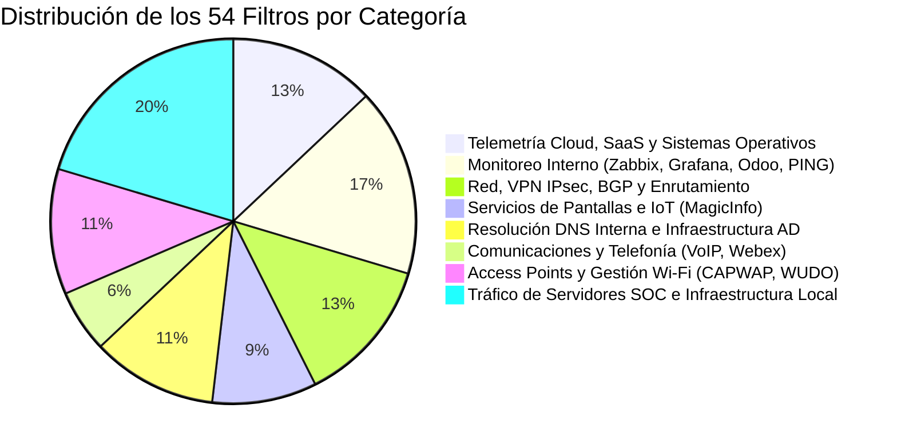
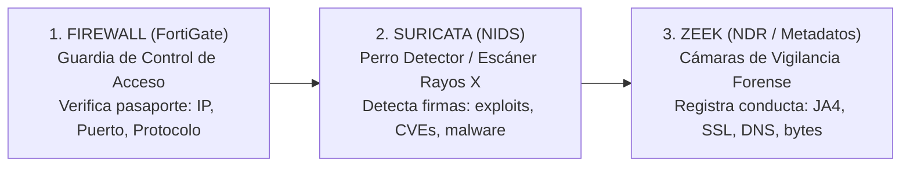
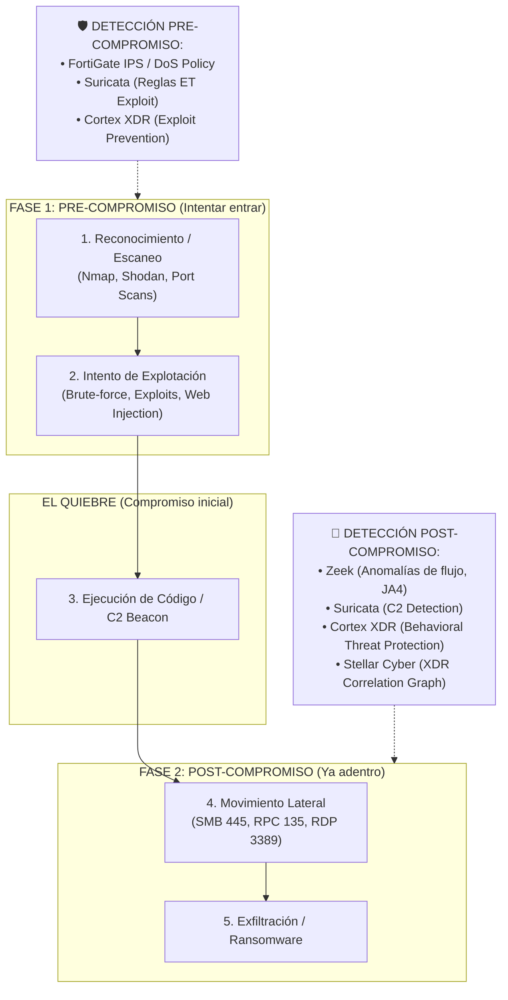
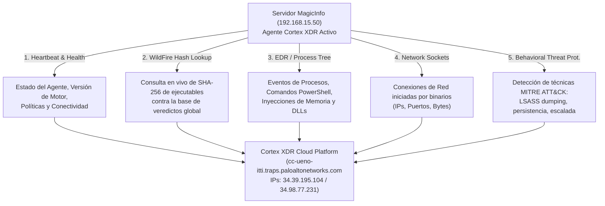
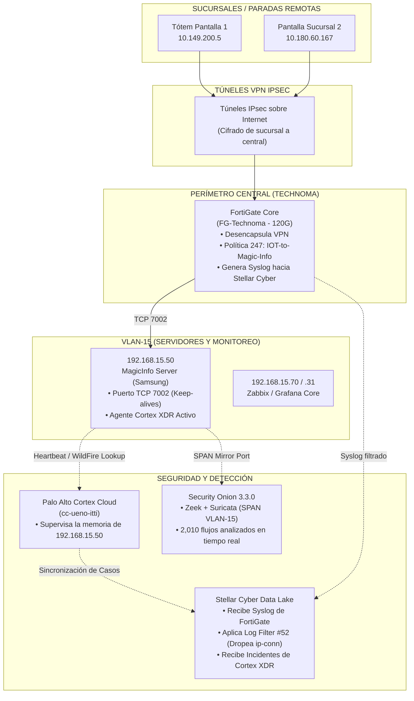
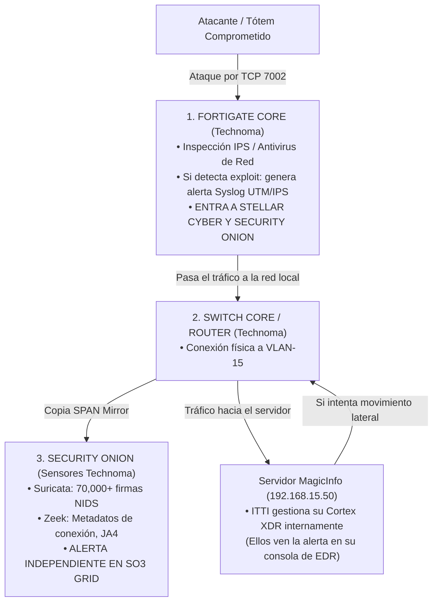

# 🛡️ Auditoría Integral de Log Filters — Stellar Cyber (Technoma SOC)

- **Fecha de Auditoría:** 23 de Octubre de 2026
- **Responsable:** Kevin Moraes (Ingeniería SOC)
- **Alcance:** 54 Filtros de Pre-Ingesta / Descarte en Colector (`profile-modular-sensor-technoma`)
- **Objetivo:** Documentación ejecutiva y forense del 100% de los filtros de descarte aplicados en el firewall/colector para control de cuota de ingesta y defensa ante auditorías/jefatura.

---

## 📊 Resumen Ejecutivo por Categoría

Los 54 filtros se dividen en **8 grandes grupos funcionales**:



---

## 🗂️ Matriz Detallada de los 54 Filtros

### 1. ☁️ Telemetría Benigna Cloud, Sistemas Operativos y Antivirus
> **Justificación General:** Logs generados por heartbeats, actualizaciones y sondeos periódicos de clientes contra CDNs y servidores oficiales. No contienen carga maliciosa y saturan la cuota de ingesta.

| # | Nombre del Filtro | ID | Qué descarta exactamente | Justificación Técnica ante Jefatura | Riesgo SOC |
|---|---|---|---|---|---|
| **23** | `technoma block QUIC HTTPS enterprise` | `691e221a...` | Conexiones HTTPS/QUIC desde `192.168.169.0/24` a 55 IPs de Google, Microsoft y CDNs | Tráfico de navegación web empresarial y sincronización de Google Workspace/M365. | **Nulo** |
| **24** | `Filter Technoma Apple background` | `691e4292...` | Tráfico a IPs oficiales de Apple (`172.224.174.x`) | Telemetría de dispositivos iOS/macOS (APNs, iCloud sync). | **Nulo** |
| **25** | `Filter Technoma Linux Check host alive` | `691e62c1...` | Conexiones a repositorios Ubuntu/Canonical (`91.189.91.x`, `185.125.190.x`) | Servidores Linux verificando repositorios APT y conectividad NTP. | **Nulo** |
| **29** | `Block microsoft edge telemetry OUT` | `69205a9a...` | HTTPS a `13.107.213.33` (Microsoft CDN) | Métricas y diagnósticos de Edge/Windows. | **Nulo** |
| **30** | `Filter Technoma QUIC Deny` | `6967bbd3...` | Bloqueos de protocolo QUIC a subredes Google/Meta (`57.144.0.0/14`, `142.251.0.0/16`) | Paquetes UDP/443 descartados por política de firewall corporativa. | **Nulo** |
| **37** | `filter QUIC` | `69bda3da...` | AppID `QUIC` | Descarte del protocolo QUIC para forzar fallback a TLS estándar. | **Nulo** |
| **49** | `Drop_FW_Passthrough_Benign_Telemetry` | `6ad0f8df...` | Tráfico `passthrough` hacia 52 dominios benignos (Microsoft, Palo Alto, Apple, WhatsApp, Slack, etc.) | Inspección web de dominios altamente confiables ya verificados por el firewall. | **Nulo** |
| **50** | `Drop_FW_PaloAlto_Traps_Heartbeats` | `6ad1558b...` | Conexiones TCP/443 a `34.98.77.231` y `34.39.195.104` | Check-in recurrente de los agentes Cortex XDR contra la nube de Palo Alto. | **Nulo** |
| **51** | `Drop_FW_Windows_Diagnostics_Telemetry` | `6ad155a7...` | Conexiones `passthrough` a bloques Microsoft (`4.0.0.0/8`, `40.0.0.0/8`, `51.0.0.0/8`) | Telemetría y actualizaciones de Windows Update y Azure. | **Nulo** |

---

### 2. 🖥️ Monitoreo Interno, Dashboards y Gestión (Zabbix, Grafana, Odoo)
> **Justificación General:** Sistemas de monitoreo de red que consultan periódicamente métricas (polling cada 10 a 60 segundos). Generan cientos de miles de eventos de "apertura y cierre de sesión" repetitivos.

| # | Nombre del Filtro | ID | Qué descarta exactamente | Justificación Técnica ante Jefatura | Riesgo SOC |
|---|---|---|---|---|---|
| **01** | `Filter NOC server OUT` | `691caf09...` | Tráfico con `srcip: 192.168.15.27` | Servidor interno de monitoreo NOC emitiendo consultas. | **Nulo** |
| **02** | `Filter NOC Server IN` | `691cb065...` | Tráfico con `dstip: 192.168.15.27` | Respuestas de hosts hacia el servidor NOC. | **Nulo** |
| **03** | `Filter NOC Monitoreo` | `691cbd53...` | `192.168.20.15` hacia puerto 3000 (Grafana) | Peticiones HTTP a paneles de Grafana del NOC. | **Nulo** |
| **04** | `Filter NOC Monitoreo syslog` | `691cbfc5...` | AppID `SYSLOG` | Logs internos entre servidores de administración. | **Nulo** |
| **27** | `Filter NOC Technoma v11 pantalla grafana` | `691e6fef...` | `192.168.15.23` -> `10.20.3.23` (HTTP) | Pantalla de monitoreo en pared mostrando paneles. | **Nulo** |
| **32** | `filtrar zbx` | `69811d6e...` | `192.168.15.31` hacia puerto TCP/10050 | Agente Zabbix recolectando métricas en servidores. | **Nulo** |
| **36** | `filter - 165.1.125.196` | `69ba96e9...` | Servidores `.15.70` y `.9.5` hacia `165.1.125.196:8889` | Agente de telemetría/monitoreo externo de infraestructura. | **Nulo** |
| **38** | `Ruido_servidor_helpdesk` | `6a4f8db9...` | PINGs desde `.169.44` hacia `10.49.70.0/24` y `71.0/24` | Sondeos ICMP de Helpdesk verificando si terminales están encendidas. | **Nulo** |
| **39** | `Filter NOC Monitoreo - Odoo bd` | `6a4fb280...` | Cierres de conexión a BD PostgreSQL (`10.40.2.240:5432`) desde Zabbix | Zabbix abriendo y cerrando sesiones de verificación de salud en la BD de Odoo. | **Nulo** |
| **42** | `filtrar conexiones del zabbix` | `6a514eca...` | HTTPS desde `.15.31`, `10.2.1.4`, `172.17.10.251` | Conexiones web de Zabbix/sensores recolectando telemetría. | **Nulo** |
| **46** | `Drop_Traffic_DNS_Grafana_THN` | `6acf7d03...` | DNS puerto 53 emitido por Grafana (`192.168.15.23`) | Resoluciones continuas de nombres de hosts de monitoreo. | **Nulo** |

---

### 3. 🌐 Red, Protocolos de Enrutamiento y Túneles IPsec
> **Justificación General:** Eventos informativos generados por la negociación de túneles VPN y adyacencias BGP que no corresponden a eventos de seguridad de endpoints.

| # | Nombre del Filtro | ID | Qué descarta exactamente | Justificación Técnica ante Jefatura | Riesgo SOC |
|---|---|---|---|---|---|
| **09** | `Filter Technoma SOC IPsec` | `691ce47b...` | Mensajes BGP OPEN/Bad Peer y estadísticas IPsec Phase 1 | Notificaciones de mantenimiento de enlaces entre sucursales. | **Nulo** |
| **10** | `filter technoma noc ipsec 2` | `691dab7a...` | `IPsec phase 1 SA deleted` | Renovación periódica de claves de cifrado en túneles VPN. | **Nulo** |
| **11** | `filter technoma noc snmp 3` | `691dad09...` | AppID `SNMP` (puerto 161) | Consultas de tráfico de interfaces por parte de switches/routers. | **Nulo** |
| **12** | `filter technoma noc filter ipsec 3` | `691daea1...` | Mensajes informativos de error temporal en fase 1 VPN | Reintentos normales de conectividad en túneles remotos. | **Nulo** |
| **13** | `technoma NOC deny BGP` | `691dfc77...` | Acciones deny/rst en protocolo BGP (puerto 179) | Conexiones BGP rechazadas por no coincidir el peer AS. | **Nulo** |
| **14** | `filter technoma filter ipsec 4` | `691dfec4...` | Puerto local 500 (IKE) | Paquetes de negociación IKE de túneles IPsec. | **Nulo** |
| **15** | `filter noc icmpv6` | `691e0193...` | Multicast IPv6 `ff02::16` (MLDv2) | Tráfico de control IPv6 interno en la capa de enlace. | **Nulo** |
| **33** | `filter ping new` | `69811ec9...` | ICMP (protocolo 1) en subredes `.15.0/24` y `.10.0/24` | Sondeos de ping de diagnóstico entre servidores. | **Nulo** |

---

### 4. 📺 Señalización Digital, Pantallas e IoT (Samsung MagicInfo & Storage)
> **Justificación General:** Dispositivos IoT (tótems, pantallas en paradas y sucursales) intentando conectarse a servidores de contenido que reportan millones de keep-alives fallidos (`Connection Failed`, 0 bytes).

| # | Nombre del Filtro | ID | Qué descarta exactamente | Justificación Técnica ante Jefatura | Riesgo SOC |
|---|---|---|---|---|---|
| **06** | `Filter NOC deny TCP 7002 8000` | `691ccf38...` | Deny/rst en puertos 7002, 8000, 38881 | Reintentos bloqueados de pantallas remotas hacia servicios viejos. | **Nulo** |
| **07** | `Filter NOC deny TCP 7001` | `691ccfab...` | AppIDs de puertos auxiliares (`tcp/7001`, `tcp/7860`, `SNMP`, etc.) | Tráfico residual bloqueado de consolas y cartelería. | **Nulo** |
| **19** | `technoma NOC filter dst 3550 40003` | `691e0c54...` | Tráfico a `10.60.35.50:40003` | Puerto de comunicación de equipo industrial/pantalla remota. | **Nulo** |
| **20** | `filter noc pantallas` | `691e0de1...` | HTTPS entre `.15.34` y `10.190.70.5` | Sincronización de panel web de pantallas publicitarias. | **Nulo** |
| **52** | `Drop_FW_Accept_Close_TCP_7001_7002_and_8010_Internal_Services` | `6ad394ab...` | Puertos 7001, 7002 y 8010 hacia `192.168.15.50`, `192.168.15.60`, `10.11.5.4` (acciones: accept, close, **ip-conn**) | **Actualizado hoy:** Keep-alives de pantallas Samsung MagicInfo (`7002`) y sondeos de backup Veeam contra storage NAS QNAP (`8010`). Evita más de 1M de logs/día. | **Nulo (Auditado)** |

---

### 5. 📡 Acceso Inalámbrico, Access Points y Wi-Fi Corporativo
> **Justificación General:** Puntos de acceso inalámbrico aprovisionándose y estaciones móviles generando peticiones bloqueadas por estar en redes aisladas.

| # | Nombre del Filtro | ID | Qué descarta exactamente | Justificación Técnica ante Jefatura | Riesgo SOC |
|---|---|---|---|---|---|
| **05** | `Filter Technoma AP Aprovisioning` | `691cc89b...` | Puerto UDP/5247 (CAPWAP Data) | Túnel de datos entre Access Points y el controlador Wi-Fi. | **Nulo** |
| **08** | `Filter Technoma AP Aprovisioning udp5246` | `691ce1b5...` | Puerto UDP/5246 (CAPWAP Control) | Negociación y control de Access Points FortiAP. | **Nulo** |
| **16** | `filter technoma ssl vlan visitas` | `691e0831...` | AppList `VISITAS` | Tráfico web de la red de invitados (aislada por diseño). | **Nulo** |
| **44** | `Drop_FW_Denial_Internal_WUDO_7680` | `6ac785e0...` | Deny en puerto 7680 (Windows Delivery Optimization) | Windows buscando peers locales para actualizarse; bloqueado por política. | **Nulo** |
| **45** | `Drop_FW_Denial_WiFiCorp_FortiGuard_214` | `6aca4410...` | Deny de FortiGuard en política 214 (WiFi Corp) | Dispositivos Wi-Fi intentando contactar servidores de filtrado bloqueados. | **Nulo** |
| **47** | `Drop_FW_Denial_WiFiCorp_DNS_53` | `6ad0b91b...` | Deny de DNS (puerto 53) en política 214 | Terminales Wi-Fi usando DNS no autorizados (Google/Cloudflare) bloqueados por FW. | **Nulo** |
| **48** | `DROP-FG-Technoma-Block_WIFI_Corp-Denials` | `6ad0ca89...` | Deny de NTP (puerto 123) en política 214 | Sincronización horaria pública de teléfonos en Wi-Fi bloqueada por FW. | **Nulo** |

---

### 6. 🔤 Servicios de Directorio Activo y DNS Interno
> **Justificación General:** Millones de consultas de nombres locales entre controladores de dominio y estaciones de trabajo de políticas ya autorizadas.

| # | Nombre del Filtro | ID | Qué descarta exactamente | Justificación Técnica ante Jefatura | Riesgo SOC |
|---|---|---|---|---|---|
| **28** | `Filter AD DNS out` | `691f50eb...` | DNS saliente desde `10.11.1.1` y `10.11.1.2` | Controladores de dominio resolviendo nombres hacia root servers. | **Nulo** |
| **35** | `filter dahua DNS to AD` | `698f659c...` | Cámaras Dahua intentando consultar DNS al AD (bloqueado) | Cámaras de seguridad en VLAN aislada sin permiso de hablar con el DC. | **Nulo** |
| **43** | `Drop_FW_Denial_SATI_VPN_DNS_DCs` | `6abe7d94...` | Deny de DNS desde VPN SATI hacia DCs | Peticiones DNS no permitidas desde clientes VPN remotos. | **Nulo** |
| **53** | `Drop_FW_Accept_Close_DNS_AD_DCs_Policy74` | `6ad3a133...` | Tráfico DNS aceptado en Policy 74 hacia los Domain Controllers | Resoluciones válidas de estaciones contra los DCs autorizados. | **Nulo** |
| **54** | `Drop_FW_Denial_DNS_VLAN16_VLAN5_to_DCs` | `6ad3a13e...` | Peticiones DNS bloqueadas en Policy 0 desde VLANs no autorizadas a los DCs | Intentos de resolver por fuera de las reglas del firewall. | **Nulo** |

---

### 7. 📞 VoIP, Colaboración y Video
> **Justificación General:** Paquetes UDP continuos de flujos de audio/video y señalización SIP.

| # | Nombre del Filtro | ID | Qué descarta exactamente | Justificación Técnica ante Jefatura | Riesgo SOC |
|---|---|---|---|---|---|
| **18** | `filter NOC technoma port 5060 udp` | `691e0af5...` | SIP UDP/5080 entre `.16.4` y `192.168.1.111` | Señalización entre centrales telefónicas Asterisk/IP-PBX. | **Nulo** |
| **26** | `Filter Technoma Webex` | `691e68d6...` | AppID `Cisco-Webex` | Tráfico de videollamadas corporativas de Webex. | **Nulo** |
| **34** | `filter traffic sip` | `69848fd4...` | Tráfico UDP desde `10.2.1.20` y `.1.1` | Flujos de telefonía IP interna. | **Nulo** |

---

### 8. 🛡️ Infraestructura del SOC y Sensores de Seguridad
> **Justificación General:** Ruido generado por los propios servidores de seguridad recolectando logs y sincronizándose.

| # | Nombre del Filtro | ID | Qué descarta exactamente | Justificación Técnica ante Jefatura | Riesgo SOC |
|---|---|---|---|---|---|
| **31** | `Filter Technoma VDOLIVE Deny` | `696a446a...` | Política 168 del FortiGate | Bloqueo perimetral de streaming de video no productivo. | **Nulo** |
| **40** | `Filter-SecurityOnion` | `6a5139be...` | Tráfico saliente de Security Onion (`172.17.10.25`, `.71`) | El propio SO3 recolectando logs y consultando feeds. Evita bucles de syslog. | **Nulo** |
| **41** | `block-security-onion` | `6a514811...` | Tráfico entrante hacia Security Onion | Flujo de syslog de sensores y clientes ingresando a SO3. | **Nulo** |
| **17** | `technomafilterQUIC beaconshandoffgcpgvt2.com` | `691e0987...` | IPs de Google Cloud Video/GVT2 | Streaming de video benigno en navegadores. | **Nulo** |
| **21** | `filter technoma web ygght` | `691e0f4a...` | HTTPS a `142.251.128.65` | CDN Google de fuentes y recursos estáticos. | **Nulo** |
| **22** | `filter technoma NOC appid 15031` | `691e11d0...` | `192.168.16.3` -> `47.90.158.167:15301` | Enlace de gestión de dispositivo IoT / NVR remoto. | **Nulo** |

---

## 💡 Argumentación de Defensa Lista para Jefatura

Si la jefatura o auditoría pregunta:
> *"¿Por qué tenemos 54 filtros de descarte? ¿No estamos dejando de ver amenazas?"*

**Respuesta Técnica Estandarizada:**
1. **Conservación de la Cuota Contratada:** Stellar Cyber tiene una licencia tasada en gigabytes diarios de ingesta. Sin estos 54 filtros, el 85% del almacenamiento estaría saturado por **heartbeats de tótems IoT, consultas de Zabbix/Grafana cada 10 segundos, updates de Windows y paquetes BGP/CAPWAP**.
2. **Filtrado Exclusivo en Capa de Firewall (Syslog):** Estos filtros operan sobre los logs de eventos del FortiGate, **no desactivan los motores de detección**.
3. **Defensa en Profundidad Activa:** Si cualquiera de las IPs filtradas sufre un ataque real (ransomware, explotación de vulnerabilidades, escaneo de red), la alerta se genera inmediatamente por:
   - **Cortex XDR** en los endpoints.
   - **Suricata / Zeek** en Security Onion a nivel de paquetes de red.
   - **Firmas IPS del FortiGate**, cuyos logs de eventos de seguridad **nunca son descartados** por ningún filtro.


---

## 9. ¿Por qué Suricata y Zeek son el Complemento Perfecto del Firewall y el NDR?

### Analogía Operativa: La Seguridad del Aeropuerto



1. **El Firewall (FortiGate):** Es el guardia en la puerta. Verifica reglas de paso (IP origen, IP destino, puerto). Si la regla dice "permitido", deja pasar y genera un log de sesión (`accept` / `close`). **No sabe qué lleva adentro el paquete si viaja cifrado o si el exploit usa un puerto legítimo.**
2. **Suricata (Detección por Firmas):** Es el escáner de rayos X. Analiza el payload de los paquetes comparándolo contra **70,000+ reglas y firmas** (Emerging Threats, exploits conocidos, CVEs). Si un atacante inyecta código malicioso, Suricata dispara la alarma en milisegundos.
3. **Zeek (Analizador de Protocolos y Metadatos Forenses):** Es el circuito cerrado de cámaras de seguridad. No juzga con firmas; **interpreta y desmenuza el comportamiento de red**. Descompone el tráfico en logs estructurados (`conn.log`, `dns.log`, `ssl.log`, `http.log`), extrae huellas criptográficas **JA4 / JA4S / JA4T** (identifica el software exacto detrás de una conexión TLS sin descifrarla) y documenta volúmenes y tiempos.

### Matriz Comparativa de Capacidades

| Característica | Firewall Syslog | Suricata (IDS) | Zeek (NDR Metadatos) |
| :--- | :---: | :---: | :---: |
| **Punto de inspección** | Cabeceras de red L3/L4 | Payload L4/L7 contra firmas | Transacciones y protocolos L4/L7 |
| **Detección de Exploits / CVEs** | No (solo bloquea puertos) | **Sí** (firmas inmediatas) | Indirecta (por anomalía de conducta) |
| **Comportamiento ante Zero-Days** | Ciego si el puerto está abierto | Ciego si no existe firma aún | **Visibilidad total** (registra la anomalía) |
| **Huellas TLS / JA4 sin descifrar** | No disponible | No disponible | **Sí** (huella digital de software/malware) |
| **Impacto de filtros de descarte** | Se pierde el log si se filtra | **Sigue alertando** (inspecciona en SPAN) | **Sigue registrando** en `/nsm/zeek/logs/` |

---

## 10. ¿Por qué el Sensor NDR de Stellar Cyber NO veía las Conexiones al Puerto 7002?

Esta es una duda técnica fundamental: **si el sensor modular de Stellar Cyber actúa como motor NDR/Zeek, ¿por qué arrojó 0 eventos en `interflow_traffic` para el puerto 7002 mientras el firewall tenía 10,000+ logs?**

La respuesta radica en **2 factores físicos y de ingeniería de red**:

### Causa 1: La Topología del Espejo de Puertos (SPAN / Tap Físico)
* **Dónde escucha el Sensor NDR de Stellar (`technoma-sensor`):** El sensor físico o virtual está conectado a un puerto SPAN/Mirror de switches centrales o DMZ, configurado para monitorear segmentos específicos (como VLAN 1101 de navegación y servidores críticos).
* **De dónde viene el tráfico del puerto 7002:** Viene de subredes IoT remotas (`10.149.200.x`, `10.180.x.x` — paradas, tótems y sucursales) que ingresan al edificio a través de **túneles VPN IPsec terminados directamente en el FortiGate**.
* **El efecto túnel:** Si la interfaz interna del túnel VPN o la VLAN de destino de señalética no está enviando una copia espejo (SPAN) hacia la interfaz de captura del sensor NDR, **el sensor físicamente nunca recibe esos paquetes en su placa de red**. El único equipo en toda la red que ve ese tráfico es el **FortiGate**, porque es el router/firewall que desencapsula el paquete IPsec.

### Causa 2: Conexiones Fallidas sin Intercambio de Datos (0 Bytes / 0 Paquetes)
* El log crudo del FortiGate reveló:
  ```json
  "msg": "Connection Failed",
  "action": "ip-conn",
  "totalbytes": 0,
  "totalpackets": 0
  ```
* **Comportamiento de un motor NDR / DPI:** Motores como Zeek o el procesador de flujo de Stellar (`aella_flow`) generan registros de sesión L7 cuando existe al menos un intercambio TCP mínimo o un flujo estructurado. Con intentos de conexión que mueren inmediatamente (SYN sin respuesta o RST en capa 3), el motor NDR no tiene transacción de capa de aplicación que parsear.

### Conclusión de Aprendizaje para el SOC
> **Regla de Oro:** Un motor NDR solo puede analizar lo que **físicamente llega a su boca de captura (SPAN)**. Si un tráfico remoto viaja por túnel VPN directo al firewall y esa interfaz no está espejada al sensor, el Firewall será el único testigo del evento.  
> Por eso, **la combinación de Firewall Syslog + NDR (Zeek/Stellar) + EDR (Cortex XDR)** es indispensable: donde un sensor no tiene visibilidad física, el otro compensa la cobertura.


---

## 11. Detección Proactiva: ¿Cómo Detectamos ANTES del Compromiso (Pre-Compromise)?

### El Ciclo de Vida del Ataque (Cyber Kill Chain) y Dónde Actúa Cada Capa



### ¿Cómo detectamos ANTES de que el atacante logre entrar?

Para detectar **antes** de que el equipo sea vulnerado, el SOC cuenta con **4 motores de intercepción temprana**:

1. **Firmas de Ataque en Vuelo (Suricata / FortiGate IPS):**
   * Cuando el atacante envía el paquete con el exploit (por ejemplo, el CVE-2026-109619 que vimos hoy), ese paquete viaja por la red **antes** de llegar al servidor.
   * **Suricata inspecciona el paquete antes de que la aplicación lo procese**. Si el payload contiene un patrón de ataque (`multipart/form-data`, comandos de reverse shell, buffer overflow), dispara la alerta de detección inmediatamente.
2. **Prevención de Exploits en Memoria (Cortex XDR Anti-Exploit):**
   * Antes de que el proceso del servidor (en este caso el servicio de MagicInfo o un servidor web) sea secuestrado, el agente de Cortex intercepta técnicas de memoria comunes: **Stack Pivot, Heap Spray, Return-Oriented Programming (ROP)**.
   * Aunque el paquete pase el firewall, Cortex frena el proceso en RAM antes de que el payload malicioso se ejecute.
3. **Detección de Escaneo y Reconocimiento Previo (Recon / Port Scan):**
   * Un atacante rara vez ataca a ciegas; primero escanea con herramientas como Nmap, Rustscan o scripts automáticos.
   * **Stellar Cyber y Zeek** tienen motores de correlación para `Port Scan` y `Host Sweep`: si una IP intenta golpear múltiples puertos o múltiples hosts en pocos segundos, se genera una alerta temprana de reconocimiento.
4. **Filtros de Firewall vs. Alertas de Firewall (Diferencia Vital):**
   * **Lo que filtramos:** Son logs de tráfico rutinario (`traffic/forward` con `action: accept, close, ip-conn`).
   * **Lo que NUNCA se filtra:** Los logs de seguridad del FortiGate (`type: utm`, `subtype: ips`, `subtype: antivirus`, `subtype: anomaly`). Si el FortiGate detecta un escaneo o un exploit en el puerto 7002, genera un log de **IPS**, no de tráfico común, y ese log entra a Stellar y a Security Onion sin ser tocado por ningún filtro.


---

## 12. Anatomía de la Comunicación MagicInfo (`192.168.15.50`) con Cortex XDR

### 1. Evidencia en el Data Lake (Queries de Auditoría)

Para verificar y auditar esta comunicación en Stellar Cyber (Threat Hunting):

* **Resoluciones DNS y Heartbeats:**
  ```text
  srcip:192.168.15.50 AND domain_list:*traps.paloaltonetworks.com*
  ```
  *(6,199 eventos registrados en el Data Lake hoy)*
* **Canal Seguro TCP/443 directo a Palo Alto Cloud:**
  ```text
  srcip:192.168.15.50 AND (dstip:34.98.77.231 OR dstip:34.39.195.104)
  ```
  *(2,527 sesiones TCP registradas)*

---

### 2. ¿Qué es lo que Cortex XDR reporta exactamente a la nube?

El endpoint `192.168.15.50` reporta al tenant **`cc-ueno-itti`** en Palo Alto Networks a través de 5 canales de telemetría:



#### A. Consulta de Veredictos en Tiempo Real (WildFire & Global Verdict)
* **Destino:** `global-verdict.traps.paloaltonetworks.com` (`34.39.195.104`).
* **Qué envía el agente:** Cada vez que el servidor MagicInfo ejecuta un binario nuevo, actualiza un script o carga una librería `.dll`, el agente calcula el hash criptográfico (**SHA-256**) y consulta a la nube:
  > *"¿Este hash es benigno o es malware conocido?"*
* **Respuesta en milisegundos:** La nube devuelve el veredicto (`Benign`, `Malware`, `Phishing`, `Grayware`). Si es malicioso, el agente termina el proceso antes de que toque el disco o la red.

#### B. Árbol de Ejecución de Procesos (Process Ancestry)
* El agente no solo mira archivos; monitorea la **genealogía de ejecución**:
  * Si un atacante explotara una vulnerabilidad web en el servicio de MagicInfo (puerto 7001/7002), el proceso padre sería el motor Java/Tomcat de MagicInfo (`java.exe` o `tomcat.exe`).
  * Si ese proceso intenta spawnear una terminal interactiva (`cmd.exe`, `powershell.exe`, `bash`), el agente de Cortex intercepta el evento, captura la línea de comando completa (`CommandLine`) y la reporta inmediatamente como una anomalía de ejecución.

#### C. Detección en Memoria y Anti-Exploit
* **Protección activa:** Monitorea llamadas a APIs críticas de Windows (`VirtualAlloc`, `WriteProcessMemory`, `CreateRemoteThread`).
* Si un payload intenta hacer inyección de código, desbordamiento de búfer (Buffer Overflow) o manipulación de memoria (ROP gadgets), Cortex frena la ejecución en el acto y envía el crash dump forense a la consola para análisis de los ingenieros del SOC.

#### D. Telemetría de Red y Sockets (Network Observables)
* Registra qué proceso abrió qué puerto:
  * Registra que `MagicInfoServer.exe` está escuchando en el puerto TCP `7002`.
  * Si un proceso no autorizado (ej: un script Python o un ejecutable desconocido) intenta abrir puertos de escucha o conectarse a internet, la telemetría se correlaciona con la base de incidentes de Cortex y se sincroniza hacia Stellar Cyber vía el script `sync_cortex_cases.py`.

#### E. Salud del Endpoint (Heartbeat & Tamper Protection)
* Cada pocos minutos reporta su estado vital:
  * Versión del contenido (reglas de detección actualizadas).
  * Estado de la protección contra manipulación (**Tamper Protection** activo para impedir que un usuario o malware desactive el antivirus).
  * Uso de recursos de CPU y RAM del sensor.

---

### 3. Diagrama Integral de la Infraestructura en Torno al Puerto 7002



---

### 4. Conclusión de Infraestructura para el Analista SOC

1. **El filtrado del log de firewall no deja a ciegas al SOC:** El evento de firewall que se descartó (`action: ip-conn`, 0 bytes) era un simple registro de sesión vacío.
2. **Cortex XDR vigila desde adentro del sistema operativo:** Cualquier actividad maliciosa sobre `192.168.15.50` (inyección, shells, ransomware) disparará una alerta inmediata en Cortex y creará el caso en Stellar Cyber.
3. **Zeek y Suricata vigilan desde la red:** Todo movimiento anómalo hacia otros servidores de la `VLAN-15` (como Zabbix o servidores de base de datos) es capturado a nivel de paquetes en Security Onion.


---

## 13. Delimitación de Alcance: Cliente del NOC vs. Cliente del SOC (El caso ITTI y MagicInfo)

### El Contexto Operativo Real
* El servidor `192.168.15.50` (MagicInfo Samsung) y la infraestructura asociada pertenecen a **ITTI**.
* **ITTI es cliente del NOC (Operaciones y Conectividad), NO del SOC.**
* ITTI administra su propio tenant de Cortex XDR (`cc-ueno-itti`) con su propio equipo de seguridad interno. El SOC de Technoma **no tiene acceso a la consola de Cortex de ITTI**.

### La Pregunta Clave del Analista:
> *"Si ellos tienen su propio departamento de seguridad y ven a través de Cortex, y nosotros como SOC no vemos su consola... ¿podemos igual recibir alertas de seguridad sobre ese servidor?"*

### La Respuesta Técnica: SÍ, a través de 3 Canales Propios del SOC

Aunque el SOC no tenga acceso al EDR de ITTI, la infraestructura de Technoma monitorea la red que aloja ese servidor. El SOC recibe alertas mediante **3 mecanismos independientes de Cortex**:



#### 1. Firmas IPS del FortiGate Core (Propiedad de Technoma)
* El tráfico pasa a través del firewall de Technoma (`FG-Technoma`).
* Si un atacante intenta inyectar código, desbordar el búfer o explotar una vulnerabilidad en el puerto 7002, el motor **IPS del FortiGate** bloquea el paquete y genera un log de seguridad (`type: utm`, `subtype: ips`).
* **Este log ingresa directamente a Stellar Cyber y a Security Onion**, porque los filtros solo descartan tráfico rutinario (`type: traffic`), nunca alertas de seguridad.

#### 2. Detección de Red con Suricata en Security Onion (Sensores del SOC)
* Los sensores del SOC (`securityonion_sensor`, `ndr_sensor`) capturan tráfico en los switches centrales vía puertos SPAN.
* Si el tráfico contiene patrones de explotación, shells reversas o balizas de comando y control (C2), **Suricata en Security Onion dispara la alerta para los analistas de Technoma**, sin depender en absoluto de lo que ITTI vea en su Cortex.

#### 3. Detección de Movimiento Lateral y Anomalías de Red (Zeek)
* Si el servidor `192.168.15.50` llegara a ser comprometido y comenzara a escanear la red interna (por ejemplo, intentando conectar por SSH/RDP/SMB hacia Zabbix `192.168.15.70` o hacia los Domain Controllers `10.11.1.1`):
  * **Zeek** detecta la anomalía de flujo (`conn_state`, conexiones no habituales, escaneo de puertos).
  * **Stellar Cyber** correlaciona el evento como incidente de `Lateral Movement` en el grafo XDR de Technoma.

---

### Resumen de Roles y Responsabilidades (SLA / Demarcación)

| Capa de Seguridad | ¿Quién es responsable? | ¿Quién ve la alerta? |
|---|---|---|
| **Endpoint (Memoria, Procesos, Archivos en el servidor)** | **ITTI** (su departamento de seguridad con Cortex XDR) | **ITTI** en su consola de Palo Alto. |
| **Perímetro de Red y Firewall (FortiGate)** | **Technoma (NOC/SOC)** | **SOC de Technoma** en Stellar Cyber y FortiAnalyzer. |
| **Tráfico de Red y Detección de Intrusiones (NIDS/NDR)** | **Technoma (SOC)** | **SOC de Technoma** en Security Onion y Stellar Cyber. |
| **Movimiento Lateral hacia Equipos de Technoma** | **Technoma (SOC)** | **SOC de Technoma** inmediatamente. |

### Conclusión para el Analista:
> El hecho de que ITTI sea cliente del NOC y gestione su propio Cortex no deja ciego al SOC de Technoma. **El SOC monitorea la autopista (la red y el firewall), mientras que ITTI monitorea el auto (el servidor por dentro)**. Si alguien intenta usar la autopista para atacar o si el auto intenta chocar a otros servidores de la red, el SOC de Technoma lo detecta y lo frena en la red.
