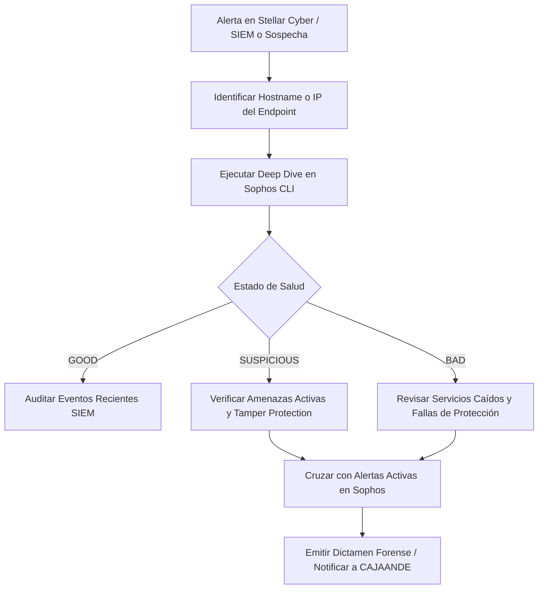

# 🛡️ PROCEDIMIENTO OPERATIVO ESTÁNDAR: MDR / DFIR READ-ONLY EN SOPHOS CENTRAL (CAJAANDE)

> **CÓDIGO:** SOP-SOC-MDR-001  
> **CLASIFICACIÓN:** USO INTERNO SOC TECHNOMA  
> **VERSIÓN:** 1.0 (Octubre 2026)  
> **HERRAMIENTA:** [`sophos_mdr_cli.py`](file:///g:/Hermes%20+%20Antigravity/soar/sophos_mdr_cli.py)  
> **ALCANCE:** CAJAANDE / Tenants Multi-Tenant Sophos Central  

---

## 1. OBJETIVO Y FILOSOFÍA OPERATIVA

Este procedimiento establece la metodología estándar para que los analistas del SOC de Technoma realicen **detección, monitoreo, triaje forense e investigación de endpoints (MDR casero)** en la plataforma **Sophos Central** del cliente **CAJAANDE**, utilizando la API oficial de Sophos y la herramienta CLI de auditoría.

> [!CAUTION]
> ### REGLA DE ORO: POLÍTICA ESTRICTA DE SOLO LECTURA (READ-ONLY)
> Por política de seguridad y alcance de servicio acordado con el cliente, **ESTÁ ESTRICTAMENTE PROHIBIDO ejecutar acciones automáticas o intrusivas de respuesta** a través de la API (tales como aislamiento de red `/endpoints/{id}/isolate`, escaneo forzado interactivo, eliminación de archivos o reinicios forzados de máquinas).  
> **Toda acción activa debe ser validada previamente con el cliente y canalizada vía ticket o consola administrativa oficial.**

---

## 2. ARQUITECTURA DE INTEGRACIÓN Y CREDENCIALES

La integración opera consumiendo la suite oficial de APIs REST de Sophos Central:
- **Autenticación:** OAuth 2.0 Client Credentials (`https://id.sophos.com/api/v2/oauth2/token`).
- **Endpoint Regional:** `https://api-br01.central.sophos.com` (Región Brasil / LatAm).
- **Control de Inquilino:** Header HTTP obligatorio `X-Tenant-ID: 37a6c0dc-b2ea-4fda-b641-456560f40ef1`.
- **Almacenamiento Seguro:** Las credenciales están centralizadas en el archivo local [`g:\Hermes + Antigravity\soar\.env`](file:///g:/Hermes%20+%20Antigravity/soar/.env) (protegido por `.gitignore`).

---

## 3. MATRIZ DE CASOS DE USO Y WORKFLOW DE INVESTIGACIÓN



---

## 4. GUÍA DE EJECUCIÓN PASO A PASO

### Paso 1: Verificación de Postura General del Parque (Inicio de Turno)
Permite conocer el estado global de los 123 endpoints, verificar que Tamper Protection esté al 100% y dimensionar anomalías.
```powershell
python sophos_mdr_cli.py --summary
```
* **Criterio de Aceptación:** Tamper Protection debe ser `123/123`. Si algún host tiene `tamperProtectionEnabled = False`, se debe escalar de inmediato como anomalía de seguridad grave.

---

### Paso 2: Detección y Triaje de Endpoints Comprometidos o Ruidosos
Filtra rápidamente equipos cuyo estado sea `suspicious` (sospechoso) o `bad` (crítico/dañado).
```powershell
python sophos_mdr_cli.py --suspicious
```
* **Acción del Analista:** Identificar qué hosts requieren atención inmediata (ej: `NBCJPPA087`, `CJPPA082`, `CJPPA158`).

---

### Paso 3: Triaje de Alertas Activas Pendientes
Extrae las alertas de seguridad sin resolver que Sophos tiene registradas para el tenant.
```powershell
python sophos_mdr_cli.py --alerts
```
* **Severidades:**
  * `HIGH`: Requiere análisis prioritario (ej: fallo crítico del motor o bypass de seguridad).
  * `MEDIUM`: Amenazas contenidas o PUAs (ej: `Generic ML PUA` en carpetas temporales o de instaladores).

---

### Paso 4: Ficha Forense y Deep Dive por Equipo (Host / IP)
Cuando una IP o Hostname aparezca en una alerta de Stellar Cyber, FortiGate o Security Onion, se debe obtener su ficha técnica completa en Sophos:
```powershell
# Por Nombre de Host:
python sophos_mdr_cli.py --host NBCJPPA087

# O por Dirección IP:
python sophos_mdr_cli.py --ip 172.16.202.108
```
**Puntos clave a inspeccionar en la salida:**
1. **Estado de Servicios de Seguridad:** Comprobar que los servicios esenciales estén `RUNNING` (`Sophos Endpoint Defense`, `Sophos File Scanner`, `Sophos Network Threat Protection`, `HitmanPro.Alert`).
2. **Interfaces y MACs:** Verificar si el equipo tiene múltiples adaptadores de red o tunneling activo.
3. **Usuario Asignado y Última Conexión:** Validar si el equipo sigue transmitiendo telemetría en tiempo real o si está desactualizado/desconectado.

---

### Paso 5: Auditoría de Eventos de Seguridad SIEM (Hunting Forense Avanzado)
Permite inspeccionar la secuencia cronológica de eventos según el estándar OpenAPI 3.0 de Sophos SIEM. Soporta filtrado de ruido, delimitación temporal y extracción automática de artefactos forenses (AMSI, IPS, SHA-256).
```powershell
# 1. Flujo de eventos filtrando ruido rutinario (solo malware, bloqueos web y detecciones):
python sophos_mdr_cli.py --events --only-threats

# 2. Eventos ocurridos en las últimas 6 horas:
python sophos_mdr_cli.py --events --since 6

# 3. Filtrado por equipo específico con aislamiento de amenazas:
python sophos_mdr_cli.py --events --host NBCJPPA087 --only-threats

# 4. Volcado crudo JSON con telemetría profunda (SHA256, AMSI, certificados y remediación):
python sophos_mdr_cli.py --events --only-threats --json
```

---

## 5. MATRIZ DE ESCALAMIENTO Y ACCIÓN RECOMENDADA

| Hallazgo en Sophos | Causa Común | Acción del Analista SOC (Sin Respuesta Intrusiva) |
| :--- | :--- | :--- |
| **`Generic ML PUA` en instaladores** | Aplicación potencialmente no deseada descargada o almacenada en red/descargas. | Identificar ruta del archivo, verificar usuario, y solicitar al administrador de CAJAANDE el saneamiento o borrado manual. |
| **`Failed to protect computer`** | Fallo en instalación de componentes de Sophos o conflicto de dependencias. | Abrir ticket de soporte técnico a infraestructura de CAJAANDE indicando el hostname para reinstalación. |
| **`Tamper Protection: DESACTIVADO`** | Desactivación manual por técnico o posible intento de evasión de malware. | Notificar de inmediato al referente de seguridad de CAJAANDE para verificar si fue autorizado. |
| **Servicios Sophos en `STOPPED`** | Servicio colgado o terminación anómala. | Verificar si coincide con reinicio programado; en caso contrario, solicitar revisión del endpoint. |

---

## 6. DOCUMENTOS Y REFERENCIAS VINCULADAS
- [**`sophos_mdr_cli.py`**](file:///g:/Hermes%20+%20Antigravity/soar/sophos_mdr_cli.py) — Script ejecutable de consulta MDR.
- [**`Sophos_Logs_Reference.md`**](file:///g:/Hermes%20+%20Antigravity/soar/Analista%20SOC/02_Base_de_Conocimiento/Sophos_Logs_Reference.md) — Referencia de logs locales de endpoints en Windows (`C:\ProgramData\Sophos\...`).
- [**`INDICE_MAESTRO_DOCUMENTACION_SOC.md`**](file:///g:/Hermes%20+%20Antigravity/soar/INDICE_MAESTRO_DOCUMENTACION_SOC.md) — Mapa de navegación central del SOC.
- [**`MAPA_MAESTRO_PROCEDIMIENTOS_SOAR.md`**](file:///g:/Hermes%20+%20Antigravity/soar/MAPA_MAESTRO_PROCEDIMIENTOS_SOAR.md) — Procedimientos operativos rápidos del SOAR.
