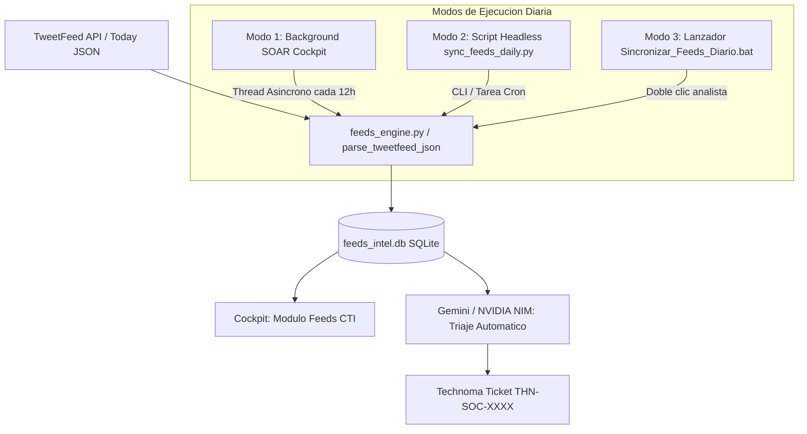

# Guía de Integración: Feeds de IOCs en Vivo (TweetFeed) en el SOAR

**Documento:** Arquitectura de Threat Intelligence (CTI) & Consumo Diario de IOCs  
**Fuente:** [TweetFeed Live (Twitter/X Threat Intelligence)](https://tweetfeed.live/)  
**Destino:** Technoma OpenXDR Master Cockpit SOAR (`feeds_engine.py` & `command_center.py`)  
**Base de Datos:** SQLite (`feeds_intel.db`)  
**Fecha de Implementación:** Septiembre 2026  
**Elaborado por:** Analista SOC / DFIR  

---

## 1. Resumen Ejecutivo

Para enriquecer la postura de detección temprana y anticipación a campañas de ciberataques, se integró el repositorio en tiempo real de **TweetFeed** dentro del subsistema de inteligencia de amenazas (CTI) del SOAR corporativo. 

TweetFeed recolecta y estructura continuamente los Indicadores de Compromiso (IOCs) compartidos en Twitter/X por analistas de seguridad, investigadores de malware, laboratorios de Threat Intelligence y grupos de respuesta a incidentes en todo el mundo.

---

## 2. Ficha Técnica de la Fuente (TweetFeed)

| Parámetro | Detalle Técnico |
| :--- | :--- |
| **Nombre Oficial** | TweetFeed (Live Twitter IOCs) |
| **Portal Web** | `https://tweetfeed.live/` |
| **Endpoint Principal (API REST)** | `https://api.tweetfeed.live/v1/today` |
| **Formato de Entrega** | JSON estructurado (Array de objetos de IOCs) |
| **Frecuencia de Actualización** | En tiempo real (cada 15 minutos en origen) |
| **Tipos de Indicadores (IOCs)** | `IP`, `DOMAIN`, `URL`, `SHA256`, `MD5` |
| **Tier en Technoma SOAR** | `CTI Técnico / Avisos` (Tier Táctico - Accionable) |
| **Autenticación** | Open Access / Sin API Key (Cabecera User-Agent corporativa) |

---

## 3. Esquema de Datos y Normalización Forense

Cada indicador emitido por TweetFeed es capturado y normalizado al modelo inmutable `FeedItem` en `feeds_engine.py`:

```json
{
  "date": "2026-09-30 00:01:07",
  "user": "RansoMonitor",
  "type": "domain",
  "value": "dr5beljvyqljgq5ppro57pgetg4yeslcsexmuhvv3p46wod3odsh3fid.onion",
  "tags": ["#ransomware"],
  "tweet": "https://x.com/RansoMonitor/status/2105085494073966969"
}
```

### Mapeo a Campos del SOAR:
* **Título Normalizado:** `[{TIPO}] {VALOR_IOC} (@{INVESTIGADOR})`  
  *(Ejemplo: `[DOMAIN] dr5beljvyqljgq5ppro57pgetg4yeslcsexmuhvv3p46wod3odsh3fid.onion (@RansoMonitor)`)*
* **Enlace Canónico:** URL del Tweet oficial o fuente forense para trazabilidad.
* **Resumen Forense Estructurado:**
  ```text
  Indicador de Compromiso (IOC) en Vivo desde Twitter/X
  Valor IOC: <valor>
  Tipo: <IP/DOMAIN/URL/HASH>
  Etiquetas / Malware: #ransomware #cobaltstrike
  Investigador / Fuente: @investigador
  Fecha de Publicación: <fecha>
  Enlace Tweet: <url_x>
  ```
* **Heurística de Severidad Automática:**
  * **ALTA:** Si las etiquetas contienen malware crítico (`c2`, `cobaltstrike`, `ransomware`, `rat`, `stealer`, `apt`).
  * **MEDIA:** Indicadores de phishing, spam o escaneos generales.
* **Deduplicación:** Hash SHA-256 inmutable calculado sobre `feed_id|titulo|link|valor`.

---

## 4. Modos de Consumo Diario e Ingesta Automatizada

Para asegurar que los IOCs se consuman diariamente sin intervención manual del analista, se implementó una arquitectura de ingesta híbrida:



### Modo 1: Ingesta Automática en Background (SOAR Cockpit)
* Al iniciar `command_center.py` (`Lanzar_Cockpit_GUI.bat`), un temporizador dispara a los 8 segundos la sincronización de fondo (`_auto_sync_feeds_background()`).
* El proceso se ejecuta en un hilo daemon secundario (`SOAR_Feeds_Sync_Worker`), descargando y deduplicando los IOCs de TweetFeed y los otros 24 feeds CTI sin congelar la interfaz de usuario.
* El ciclo se repite automáticamente cada 12 horas mientras el panel esté abierto.

### Modo 2: Ejecución Headless / Programador de Tareas
Para sincronizar los feeds de forma desatendida cuando el Cockpit gráfico no esté abierto:
* **Script:** `c:\Users\kevinmoraes\Documents\soc-env\sync_feeds_daily.py`
* **Lanzador Batch:** `c:\Users\kevinmoraes\Documents\soc-env\Sincronizar_Feeds_Diario.bat`
* **Comando para Windows Task Scheduler (Consumo Diario a las 08:00 AM):**
  ```powershell
  schtasks /create /tn "Technoma_SOAR_Feeds_Daily" /tr "python c:\Users\kevinmoraes\Documents\soc-env\sync_feeds_daily.py --quiet" /sc daily /st 08:00 /ru "%USERNAME%"
  ```

---

## 5. Operación desde el Panel del Analista

1. En la consola principal del Cockpit, presione el botón **`📡 Feeds CTI`**.
2. En el filtro de fuentes, seleccione **`TweetFeed (Live Twitter IOCs)`**.
3. El analista podrá:
   * Visualizar los IOCs más recientes ordenados por fecha y severidad.
   * Hacer doble clic en el enlace para abrir el tweet de investigación en el navegador.
   * Ejecutar **Análisis con IA (Gemini / NIM)** para correlacionar el IOC con vectores de ataque y generar de inmediato un ticket de mitigación preventiva (`THN-SOC-XXXX`).

---

## 6. Verificación Forense de la Integración

* **Prueba de Ingesta Exitosa:** 134 IOCs en vivo ingeridos y deduplicados en `feeds_intel.db` durante la prueba de homologación.
* **Pruebas Unitarias:** 7 de 7 tests pasando exitosamente en `test_feeds_engine.py` (incluyendo `test_tweetfeed_json_parsing`).
