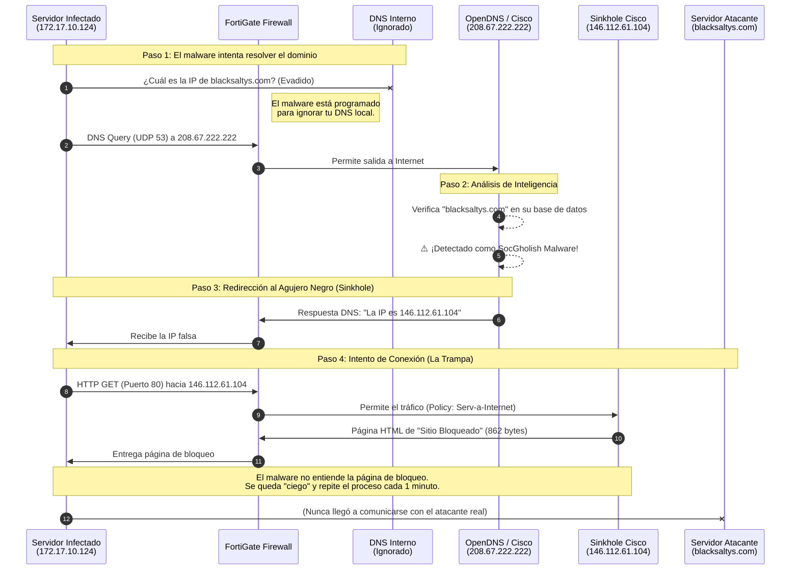

# Arquitectura del Incidente: Cómo OpenDNS bloqueó al Malware

Este gráfico explica paso a paso cómo el servidor infectado intentó comunicarse con el atacante y cómo **OpenDNS (Cisco Umbrella)** actuó como un escudo, atrapando la conexión en un "Sinkhole" (Agujero Negro).

## 📊 Diagrama de Secuencia del Ataque

### 💡 Explicación Humana:

1. **La Evasión:** El malware está programado para ser sigiloso. En vez de usar el servidor DNS de Technoma, va directo a internet y le pregunta a **OpenDNS** (un servicio público de Cisco) cuál es la IP de `blacksaltys.com`.
2. **La Trampa:** Lo que el creador del malware no sabía es que OpenDNS tiene una lista negra mundial. Al ver que piden un dominio malicioso, OpenDNS miente a propósito. No le da la IP real del hacker.
3. **El Sinkhole:** OpenDNS le responde con la IP `146.112.61.104`. Esta IP es un **Sinkhole** (un servidor trampa de Cisco diseñado para absorber conexiones de malware).
4. **El Bucle Ciego:** El servidor infectado se conecta a ese Sinkhole creyendo que es su jefe. El Sinkhole le manda una paginita web estática (de 862 bytes). El virus, al no recibir las instrucciones que esperaba, simplemente espera un minuto y vuelve a intentar.

¡Tu red se salvó de una descarga de Ransomware gracias a que el atacante eligió usar un DNS que ya lo tenía en lista negra!
