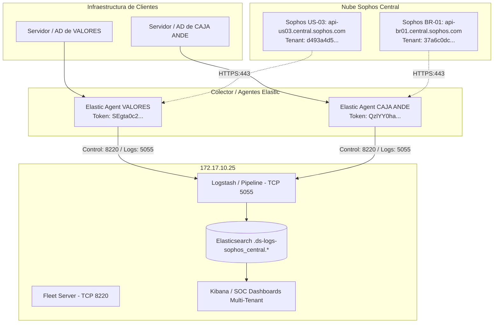

# Guía Maestra de Despliegue y Enrolamiento: Elastic Agent — Clientes VALORES & CAJA ANDE
### Ingesta Oficial de Eventos Sophos Central y Windows Logs en Security Onion 3.1.0

**Clasificación:** Uso Interno Exclusivo — Equipo SOC & Ingeniería de Detección  
**Clientes:** VALORES (Valores Casa de Bolsa) & CAJA ANDE (Caja de Jubilaciones de la ANDE)  
**Plataforma SIEM / XDR:** Security Onion 3.1.0  
**Manager Central (Fleet Server):** `soc-onion` (`172.17.10.25`)  
**Versión de Agente Homologada:** `9.3.3+build202604082258`  
**Objetivo:** Manual técnico operativo de referencia rápida para el despliegue de Elastic Agent en servidores y la ingesta de telemetría de Sophos Central de ambos clientes hacia la grilla del SOC.

---

## 1. Ficha Técnica Oficial — Cliente VALORES

| Parámetro | Configuración Validada | Propósito / Detalle |
| :--- | :--- | :--- |
| **Cliente / Tenant** | **VALORES** | Valores Casa de Bolsa |
| **Fleet Server URL** | `https://172.17.10.25:8220` | Servidor central de políticas y control |
| **Puerto Ingesta de Logs** | `TCP 5055` | Canal seguro Logstash / Elasticsearch |
| **Enrollment Token Oficial** | `SEgta0c2RUJEYmhzY1hGTkhZbUw6aXItN2hYOWtMc3ZCSEVNVE5OSDFrdw==` | Token exclusivo de la política para VALORES |
| **Instalador Físico Base** | `so-elastic-agent_windows_amd64.msi` (218 MB) | Ubicación local: `C:\so-elastic-agent_windows_amd64.msi` |
| **Versión de Upgrade Requerida** | **`9.3.3+build202604082258`** | **Regla de Oro:** Compilación interna exacta de SO |
| **Sophos Central API Host** | `https://api-us03.central.sophos.com` | **Datacenter US-03** asignado a VALORES |
| **Sophos Token URL** | `https://id.sophos.com` | Endpoint oficial de autenticación OAuth2 |
| **Sophos Tenant ID** | **`d493a4d5-2e37-45ee-86f4-7a02ac966cd3`** | Identificador del inquilino de VALORES |
| **Sophos Client ID** | `bce31dfb-d2b5-4ac7-88c5-621049275d94` | Clave pública de la API de VALORES |
| **Nombre Integración Fleet** | `sophos_central-valoresv2` | Input configurado en la política de Fleet |
| **Intervalo de Sondeo** | `5m` (con backfill inicial de `24h`) | Frecuencia de consulta a la API cloud |

---

## 2. Ficha Técnica Oficial — Cliente CAJA ANDE

| Parámetro | Configuración Validada | Propósito / Detalle |
| :--- | :--- | :--- |
| **Cliente / Tenant** | **CAJA ANDE** | Caja de Jubilaciones de la ANDE |
| **Fleet Server URL** | `https://172.17.10.25:8220` | Servidor central de políticas y control |
| **Puerto Ingesta de Logs** | `TCP 5055` | Canal seguro Logstash / Elasticsearch |
| **Enrollment Token Oficial** | `QzlYY0haOEItYmtXYW9HR0J0bEs6bFpIbHp4QjlkTEl3RjVFTjh5RzBIQQ==` | Token de enrolamiento para CAJA ANDE (AD/Endpoints) |
| **Instalador Físico Base** | `so-elastic-agent_windows_amd64.msi` (218 MB) | Ubicación local: `C:\so-elastic-agent_windows_amd64.msi` |
| **Versión de Upgrade Requerida** | **`9.3.3+build202604082258`** | **Regla de Oro:** Compilación interna exacta de SO |
| **Sophos Central API Host** | `https://api-br01.central.sophos.com` | **Datacenter BR-01** (Brasil / Sudamérica) |
| **Sophos Token URL** | `https://id.sophos.com` | Endpoint oficial de autenticación OAuth2 |
| **Sophos Tenant ID** | **`37a6c0dc-b2ea-4fda-b641-456560f40ef1`** | Identificador del inquilino de CAJA ANDE |
| **Sophos Client ID (Producción)** | `bf10b207-b32f-4f68-8b60-e162bfb2ec15` | Clave pública configurada en Fleet |
| **Sophos Client ID (Pruebas)** | `cf048799-dc76-4507-be68-ff390d0e715b` | Clave pública de test validada por script |
| **Nombre Integración Fleet** | `sophos_central-1` | Input configurado en la política de Fleet |
| **Intervalo de Sondeo** | `5m` (con backfill inicial de `24h`) | Frecuencia de consulta a la API cloud |

---

## 3. Matriz Comparativa Directa entre Clientes

| Parámetro | Cliente CAJA ANDE | Cliente VALORES |
| :--- | :--- | :--- |
| **Datacenter Regional Cloud** | `https://api-br01.central.sophos.com` (Brasil) | `https://api-us03.central.sophos.com` (EE.UU. 03) |
| **Tenant ID Único** | `37a6c0dc-b2ea-4fda-b641-456560f40ef1` | `d493a4d5-2e37-45ee-86f4-7a02ac966cd3` |
| **Client ID API** | `bf10b207-b32f-4f68-8b60-e162bfb2ec15` | `bce31dfb-d2b5-4ac7-88c5-621049275d94` |
| **Enrollment Token Fleet** | `QzlYY0haOEItYmtXYW9HR0J0bEs6bFpIbHp4QjlkTEl3RjVFTjh5RzBIQQ==` | `SEgta0c2RUJEYmhzY1hGTkhZbUw6aXItN2hYOWtMc3ZCSEVNVE5OSDFrdw==` |
| **Nombre en Agent Policy** | `sophos_central-1` | `sophos_central-valoresv2` |
| **Filtro Kibana Discover** | `sophos.customer.id : "37a6c0dc-b2ea-4fda-b641-456560f40ef1"` | `sophos.customer.id : "d493a4d5-2e37-45ee-86f4-7a02ac966cd3"` |

---

## 4. Diagrama de Arquitectura Multi-Tenant



---

## 5. Procedimiento de Despliegue en Servidores de Clientes (Paso a Paso)

---

### PASO 1: Habilitar la IP en Security Onion (Terminal SSH Linux)

> [!IMPORTANT]
> Security Onion 3.1.0 bloquea por defecto cualquier IP no autorizada a nivel de firewall de contenedores (`iptables-nft`).

1. Conéctate por SSH a la consola de Security Onion:
   ```bash
   ssh root@172.17.10.25
   ```
2. Agrega la dirección IP del servidor donde instalarás el agente:
   ```bash
   sudo so-firewall includehost elastic_agent_endpoint IP_DEL_SERVIDOR_DESTINO
   ```
3. Aplica y regenera las reglas de firewall:
   ```bash
   sudo so-firewall apply --apply
   ```

---

### PASO 2: Preparar el Instalador en el Servidor Destino

1. Conéctate por RDP o consola al servidor del cliente.
2. Copia el archivo instalador base oficial:
   * **Origen en máquina del analista:** `C:\Users\kevinmoraes\Downloads\so-elastic-agent_windows_amd64.msi` (218 MB).
   * **Destino en el servidor cliente:** Pégalo directamente en la raíz:  
     👉 **`C:\so-elastic-agent_windows_amd64.msi`**

---

### PASO 3: Instalación e Inscripción Silenciosa en Windows (PowerShell Admin)

Abre **PowerShell como Administrador** en el servidor del cliente y corre el comando correspondiente a la organización:

#### 👉 Si estás instalando en VALORES:
```powershell
Start-Process msiexec.exe -ArgumentList '/i "C:\so-elastic-agent_windows_amd64.msi" /qn FLEET_URL="https://172.17.10.25:8220" FLEET_ENROLLMENT_TOKEN="SEgta0c2RUJEYmhzY1hGTkhZbUw6aXItN2hYOWtMc3ZCSEVNVE5OSDFrdw==" FLEET_INSECURE="1"' -Wait
```

#### 👉 Si estás instalando en CAJA ANDE:
```powershell
Start-Process msiexec.exe -ArgumentList '/i "C:\so-elastic-agent_windows_amd64.msi" /qn FLEET_URL="https://172.17.10.25:8220" FLEET_ENROLLMENT_TOKEN="QzlYY0haOEItYmtXYW9HR0J0bEs6bFpIbHp4QjlkTEl3RjVFTjh5RzBIQQ==" FLEET_INSECURE="1"' -Wait
```

* *Duración estimada:* ~20 a 30 segundos. La consola esperará en silencio y devolverá el cursor al finalizar el registro del servicio.

Verifica que el servicio arrancó:
```powershell
Get-Service -Name "Elastic Agent"
```

---

### PASO 4: Aplicar la "Regla de Oro" — Upgrade a la Compilación Homologada (Web Fleet)

> [!CAUTION]
> **REGLA DE ORO DE SECURITY ONION 3.1.0:**  
> El instalador `.msi` instala la versión base 9.3.3. Si no aplicas de inmediato la actualización a la cadena de compilación interna de Fleet, el agente fallará con desconexiones intermitentes o errores `BadRequest 400` y `Open Pipe`.

1. Abre tu navegador e ingresa a Security Onion:  
   👉 `https://172.17.10.25` $\rightarrow$ **`Fleet`** $\rightarrow$ **`Agents`**.
2. Localiza el nuevo equipo en estado **`HEALTHY`** (verde).
3. Haz clic en los tres puntos verticales (**`...`**) a la derecha del servidor y selecciona **`Upgrade agent`**.
4. En el selector de versión, elige **OBLIGATORIAMENTE** la versión exacta de la grilla:  
   👉 **`9.3.3+build202604082258`**
5. Confirma la acción. En menos de 2 minutos se reiniciará el servicio en la versión correcta.

---

## 6. Auditoría y Verificación Forense de Telemetría

### A. Consultas SSH en Linux (`172.17.10.25`)

#### 1. Conteo de Eventos por Cliente:
* **Ver conteo de VALORES:**
  ```bash
  sudo so-elasticsearch-query .ds-logs-sophos_central.*/_count?q=*d493a4d5-2e37-45ee-86f4-7a02ac966cd3*
  ```
* **Ver conteo de CAJA ANDE:**
  ```bash
  sudo so-elasticsearch-query .ds-logs-sophos_central.*/_count?q=*37a6c0dc-b2ea-4fda-b641-456560f40ef1*
  ```

#### 2. Inspeccionar los últimos Eventos JSON en Tiempo Real:
* **Últimos eventos de VALORES:**
  ```bash
  sudo so-elasticsearch-query .ds-logs-sophos_central.*/_search?q=*d493a4d5-2e37-45ee-86f4-7a02ac966cd3* -d '{"size":2,"sort":[{"@timestamp":{"order":"desc"}}]}' | jq .
  ```
* **Últimos eventos de CAJA ANDE:**
  ```bash
  sudo so-elasticsearch-query .ds-logs-sophos_central.*/_search?q=*37a6c0dc-b2ea-4fda-b641-456560f40ef1* -d '{"size":2,"sort":[{"@timestamp":{"order":"desc"}}]}' | jq .
  ```

---

### B. Visualización en la Web (Kibana Discover)

Para separar los paneles en Kibana, aplica los filtros KQL según el cliente:

* **Para monitorear VALORES:**
  ```text
  data_stream.dataset : "sophos_central.*" and sophos.customer.id : "d493a4d5-2e37-45ee-86f4-7a02ac966cd3"
  ```
* **Para monitorear CAJA ANDE:**
  ```text
  data_stream.dataset : "sophos_central.*" and sophos.customer.id : "37a6c0dc-b2ea-4fda-b641-456560f40ef1"
  ```

---

## 7. Caja de Herramientas (Resolución de Problemas)

### A. Si el agente responde `BadRequest 400` o tuberías rotas (`Open Pipe`)
```powershell
Restart-Service -Name "Elastic Agent" -Force
```

### B. Si el instalador MSI no responde porque el servicio ya existe o está corrupto
```powershell
# 1. Matar procesos huérfanos
Stop-Process -Name "elastic-agent" -Force -ErrorAction SilentlyContinue
Stop-Process -Name "msiexec" -Force -ErrorAction SilentlyContinue

# 2. Desinstalación por GUID de producto de Security Onion
Start-Process msiexec.exe -ArgumentList '/x {942B1653-2B5A-44F4-815F-8549BFC193E1} /qn' -Wait

# 3. Forzar desinstalación por binario nativo
& "C:\Program Files\Elastic\Agent\elastic-agent.exe" uninstall -f

# 4. Eliminar directorios residuales
Remove-Item -Path "C:\Program Files\Elastic" -Recurse -Force -ErrorAction SilentlyContinue
```

---

## 8. Checklist de Salida Multi-Tenant

- [ ] IP del servidor destino agregada con `so-firewall includehost elastic_agent_endpoint`.
- [ ] Reglas aplicadas con `sudo so-firewall apply --apply`.
- [ ] Instalador `so-elastic-agent_windows_amd64.msi` copiado a `C:\` en el servidor cliente.
- [ ] Comando de instalación ejecutado con el Token del cliente respectivo (**VALORES** o **CAJA ANDE**).
- [ ] Servidor visible en Fleet Web en estado **HEALTHY**.
- [ ] Upgrade aplicado a la compilación exacta **`9.3.3+build202604082258`**.
- [ ] Política con credenciales de Sophos Central (US-03 para VALORES / BR-01 para CAJA ANDE) activa.
- [ ] Conteo verificado por SSH en `so-elasticsearch-query _count`.
- [ ] Registro final documentado en la Bitácora Oficial de Turno del SOC.
