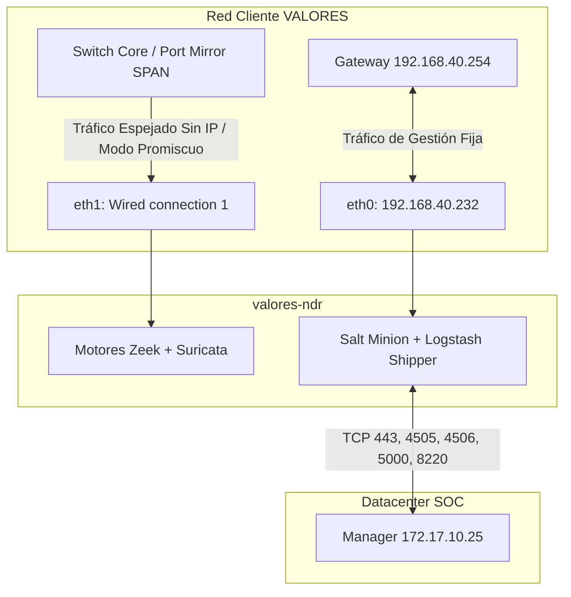
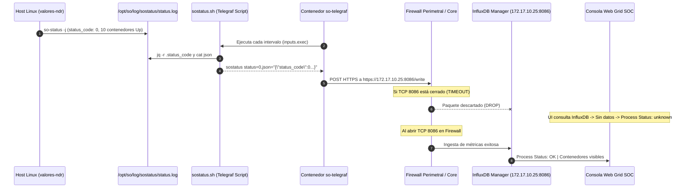

# Guía de Despliegue y Enrolamiento: Sensor NDR - Cliente VALORES

**Documento:** Guía de Ingeniería de Despliegue, Aprovisionamiento y Lecciones Aprendidas  
**Cliente:** VALORES  
**Hostname del Nodo:** `valores-ndr`  
**Rol de Arquitectura:** `SENSOR` (Network Detection and Response - Zeek / Suricata / Stenographer)  
**Manager Central:** `soc-onion` (`172.17.10.25`)  
**Fecha de Validación y Cierre:** Septiembre 2026  
**Elaborado por:** Analista SOC / DFIR  

---

## 1. Ficha Técnica del Nodo

| Parámetro | Detalle Técnico |
| :--- | :--- |
| **Cliente** | VALORES |
| **Hostname** | `valores-ndr` |
| **Sistema Operativo** | Oracle Linux Server 9.8 (Kernel UEK 6.12.0) |
| **Plataforma de Virtualización** | Microsoft Hyper-V |
| **CPU / Memoria / Almacenamiento** | 4 vCPUs (Intel Xeon Silver 4510) / 11 GB RAM / 74 GB `/nsm` |
| **Rol en Security Onion** | `SENSOR` (Inspección de tráfico pasivo, sin almacenamiento de shards Elasticsearch) |
| **Manager Central de Destino** | `172.17.10.25` (`soc-onion`) |
| **Credenciales de Acceso Base** | Usuario: `root` / Contraseña temporal: `tempoPass26` |

---

## 2. Topología y Asignación de Interfaces de Red

El sensor cuenta con dos interfaces de red virtuales asignadas en Hyper-V. Para evitar colisiones en la tabla de enrutamiento del kernel y asegurar la ingesta pasiva de paquetes sin contaminación de tráfico, sus funciones quedan estrictamente divididas:



### Tabla de Parámetros de Red Homologada

| Interfaz | Dispositivo SO | Función Oficial | Configuración IP | Gateway | DNS Primario | Search Domain |
| :--- | :--- | :--- | :--- | :--- | :--- | :--- |
| **`eth0`** | `eth0` | **Gestión (Management)** | Estática: `192.168.40.232/24` | `192.168.40.254` | `192.168.40.1` (Sec. `8.8.8.8`) | `VALORES.local` |
| **`eth1`** | `Wired connection 1` | **Captura (Mirror SPAN / TAP)** | **Sin IP** (`disabled`, Modo Promiscuo/NOARP) | N/A | N/A | N/A |

### 2.1. Arquitectura de Interconexión WAN: Túnel IPsec Technoma <-> Valores Casa de Bolsa

Aunque la sede de **Valores Casa de Bolsa** se encuentra físicamente contigua a las oficinas de **Technoma**, a nivel lógico ambas redes son infraestructuras corporativas completamente separadas e independientes:
* **Red del Cliente (Valores Casa de Bolsa):** Subred `192.168.40.0/24` (donde reside el sensor `valores-ndr` en la IP `192.168.40.232` y el gateway FortiGate en `192.168.40.254`).
* **Red del Datacenter SOC (Technoma):** Subred `172.17.10.0/24` (donde reside el servidor central `soc-onion` en la IP `172.17.10.25`).

Para interconectar ambos segmentos de forma segura, el **24 de septiembre de 2026** el equipo de Infraestructura y Redes de Technoma (**Ariel Prette**, con copia a Fernando Candia y Nardi Gabriaguez) configuró un **Túnel VPN IPsec de Sitio a Sitio (Site-to-Site)** entre el firewall perimetral de Technoma y el de Valores.

#### Minuta Histórica de Soporte (Correo del 25/09/2026 - Iván Centurión a Ariel Prette)
El liderazgo del SOC formalizó los requerimientos de conectividad mediante el siguiente alcance:
1. **Levantamiento del Túnel IPsec** y ruteo estático entre los segmentos `172.17.10.25` (Manager) y `192.168.40.232` (Sensor).
2. **Políticas de Acceso:** Grupo de seguridad perimetral `acceso-soc-onion`.
3. **Matriz de Puertos Permitidos en el Túnel:** Habilitación de la lista oficial de puertos (ICMP, 80, 443, 22, 4505, 4506, 5000, 5055, 8086, 8220, 8443, 9200).

#### Causa Raíz del Bloqueo del Puerto 8086/TCP (Telegraf)
* **Puertos Operativos:** Durante la implementación del túnel, el equipo de redes dio de alta exitosamente los puertos principales (`443`, `4505`, `4506`, `5000`, `8220`). Gracias a esto, el minion de Salt se sincronizó, los contenedores Docker se descargaron y la telemetría de Zeek, Suricata y Syslog de FortiGate fluye en tiempo real hacia el Manager.
* **Omisión Detectada:** Al cargar el grupo de servicios en la política de firewall del túnel IPsec, **se omitió incluir el puerto `TCP 8086` (InfluxDB)**.
* **Resolución Requerida:** La gestión no requiere coordinaciones externas con el cliente; corresponde solicitar internamente a **Ariel Prette** (Infraestructura Technoma) que incorpore el objeto de servicio `TCP 8086` dentro de la política de seguridad del túnel IPsec existente.

---


## 3. Fase Previa Obligatoria: Reglas de Firewall en el Manager

Antes de iniciar el instalador en el sensor cliente, el Manager (`soc-onion`) debe autorizar la IP de gestión de `valores-ndr` dentro de su política de hostgroups.

### 3.1. Ejecutar en el Manager (`soc-onion` - `172.17.10.25`)
```bash
# 1. Registrar la IP oficial de gestión en el hostgroup sensor:
sudo so-firewall includehost sensor 192.168.40.232

# 2. Compilar y aplicar las reglas de iptables/nftables en la grilla:
sudo so-firewall apply
```

### 3.2. Matriz Oficial de Puertos de Firewall (Sensor <-> Manager)

Esta es la matriz requerida y homologada para la comunicación entre cualquier sensor distribuido (`SENSOR`) y el nodo central (`soc-onion`):

| IP Origen | IP Destino | Protocolo | Puerto Destino | Sentido | Servicio / Función Oficial (Estándar Security Onion 3) |
| :--- | :--- | :--- | :--- | :--- | :--- |
| `192.168.40.232` | `172.17.10.25` | **ICMP** | N/A | Saliente | Diagnóstico y monitoreo de conectividad (Echo / Ping) |
| `192.168.40.232` | `172.17.10.25` | **TCP** | `80` | Saliente | Redirección HTTP y verificación web inicial |
| `192.168.40.232` | `172.17.10.25` | **TCP** | `443` | Bidireccional | HTTPS / Grid API (Descarga de certificados y configuración) |
| `172.17.10.25` | `192.168.40.232` | **TCP** | `22` | Entrante | SSH Administración y soporte remoto del SOC al sensor |
| `192.168.40.232` | `172.17.10.25` | **TCP** | `4505` | Saliente | SaltStack Publisher (Recepción de comandos y tareas del cluster) |
| `192.168.40.232` | `172.17.10.25` | **TCP** | `4506` | Saliente | SaltStack Return (Devolución de telemetría y ejecución de Salt) |
| `192.168.40.232` | `172.17.10.25` | **TCP** | `5000` | Saliente | Docker Registry interno (Descarga de contenedores oficiales) |
| `192.168.40.232` | `172.17.10.25` | **TCP** | `5055` | Saliente | Salt API / Health Check de la grilla |
| `192.168.40.232` | `172.17.10.25` | **TCP** | `8086` | Saliente | InfluxDB (Telemetría de métricas y salud del sensor - Telegraf) |
| `192.168.40.232` | `172.17.10.25` | **TCP** | `8220` | Saliente | Logstash Pipeline / Fleet (Transmisión de eventos Zeek y Suricata) |
| `192.168.40.232` | `172.17.10.25` | **TCP** | `8443` | Saliente | Elasticsearch / OpenSearch API (Indexación directa de alertas) |
| `192.168.40.232` | `172.17.10.25` | **TCP** | `9200` | Saliente | Elasticsearch / OpenSearch REST API |

#### Script de Validación Rápida en una Sola Línea:
```bash
for p in 80 443 4505 4506 5000 5055 8086 8220 8443 9200; do nc -zv -w 2 172.17.10.25 $p; done
```


---

## 4. Corrección y Calibración de Red en el Host (NetworkManager)

Antes de lanzar el setup, es mandatorio fijar la ruta por defecto en `eth0` y remover el DHCP/IP de `eth1` para evitar la inconsistencia de kernel:

```bash
# 1. Configurar IP estática, Gateway y DNS en eth0 (MGMT):
nmcli con mod eth0 ipv4.addresses 192.168.40.232/24
nmcli con mod eth0 ipv4.gateway 192.168.40.254
nmcli con mod eth0 ipv4.dns "192.168.40.1 8.8.8.8"
nmcli con mod eth0 ipv4.method manual
nmcli con up eth0

# 2. Deshabilitar completamente IPv4 e IPv6 en la interfaz Mirror (eth1):
nmcli con mod "Wired connection 1" ipv4.method disabled ipv6.method disabled
nmcli con down "Wired connection 1" && nmcli con up "Wired connection 1"

# 3. Validar que la ruta de salida coincida exactamente con la interfaz MGMT:
ip route get 172.17.10.25
```
> La salida debe confirmar: `172.17.10.25 via 192.168.40.254 dev eth0 src 192.168.40.232`.

---

## 5. Procedimiento de Instalación Paso a Paso

### 5.1. Ejecución del Instalador
En Security Onion 3 sobre Oracle Linux 9, invocar siempre el script indicando el parámetro `iso`:

```bash
cd /root/SecurityOnion/setup
./so-setup iso
```

### 5.2. Flujo de Pantallas del Asistente (`so-whiptail`)

1. **Pantalla 1 - Acción:** Seleccionar **`Install`** (Run the standard Security Onion installation).
2. **Pantalla 2 - Tipo de Despliegue:** Seleccionar **`DISTRIBUTED`** (Distributed deployment).
3. **Pantalla 3 - Modo de Grid:** Seleccionar **`Existing Deployment`** (Join to an existing Security Onion deployment).
4. **Pantalla 4 - Rol del Nodo:** Seleccionar **`SENSOR`** (Add a Sensor Node for monitoring network traffic).
5. **Pantalla 5 - Reconfiguración de Gestión:** Seleccionar **`<No>`** (la red ya quedó perfectamente alineada en el paso 4).
6. **Pantalla 6 - Interfaz de Captura / Monitor:** Seleccionar **`eth1`** (interfaz pasiva sin IP).
7. **Pantalla 7 - Conexión al Manager:** Ingresar la IP del Manager: **`172.17.10.25`**.
8. **Pantalla 8 - Confirmación:** Revisar el resumen y aceptar para comenzar la descarga de contenedores y aprovisionamiento.

---

## 6. Autorización Criptográfica y Aprovisionamiento en el Manager (`soc-onion`)

Durante el despliegue, el minion de Salt registrará su clave en el Manager bajo el ID **`ndr_sensor`**:

### 6.1. Aceptación de Clave
```bash
# 1. Verificar clave pendiente:
sudo salt-key -L

# 2. Aceptar formalmente el nodo ndr_sensor:
sudo salt-key -a ndr_sensor -y

# 3. Comprobar comunicación bidireccional en el bus:
sudo salt 'ndr_sensor' test.ping
```
> Resultado esperado: `ndr_sensor: True`.

### 6.2. Creación de Archivos Pillar del Minion (Obligatorio antes del Highstate)
El compilador de Salt requiere los archivos de variables del minion en `/opt/so/saltstack/local/pillar/minions/`:

```bash
# 1. Crear el archivo base del sensor:
sudo bash -c 'cat << "EOF" > /opt/so/saltstack/local/pillar/minions/ndr_sensor.sls
elastalert:
  enabled: true
host:
  mainint: eth0
  mainip: 192.168.40.232
sensor:
  channels: 1
  interface: bond0
  mtu: 1500
sensoroni:
  config:
    node_description: security-onion-sensor-VALORES
  enabled: true
strelka:
  backend:
    enabled: true
  coordinator:
    enabled: true
  filestream:
    enabled: true
  frontend:
    enabled: true
  gatekeeper:
    enabled: true
  manager:
    enabled: true
suricata:
  config:
    af-packet:
      threads: "1"
  enabled: true
  pcap:
    enabled: true
    maxsize: 96
telegraf:
  enabled: true
zeek:
  config:
    node:
      lb_procs: "1"
  enabled: true
EOF'

# 2. Crear archivo avanzado vacío:
sudo touch /opt/so/saltstack/local/pillar/minions/adv_ndr_sensor.sls

# 3. Asignar permisos oficiales (socore:socore):
sudo chown socore:socore /opt/so/saltstack/local/pillar/minions/ndr_sensor.sls /opt/so/saltstack/local/pillar/minions/adv_ndr_sensor.sls
sudo chmod 640 /opt/so/saltstack/local/pillar/minions/ndr_sensor.sls /opt/so/saltstack/local/pillar/minions/adv_ndr_sensor.sls

# 4. Refrescar variables en el nodo:
sudo salt 'ndr_sensor' saltutil.refresh_pillar
```

### 6.3. Lanzamiento del Highstate (Despliegue de Motores Docker)
```bash
sudo salt 'ndr_sensor' state.highstate
```
> Resultado: 263 estados exitosos, 0 fallos (30.7s). 10 contenedores en ejecución.

### 6.4. Verificación de Ingesta de Tráfico en Tiempo Real (Confirmado)
Para certificar que el sensor no solo está encendido sino operando en producción e indexando telemetría de red:

1. **En el Manager (`soc-onion`):**
   ```bash
   sudo so-elasticsearch-query 'logs-*/_count?q=observer.name:valores-ndr'
   ```
   * **Evidencia Forense:** `{"count":12881,"_shards":{"total":118,"successful":118,"skipped":0,"failed":0}}`
   * **Estado:** Más de 12.800 eventos de red de VALORES ya fueron ingeridos e indexados en el cluster central de Elasticsearch a través del pipeline de Logstash/Fleet.

2. **En el Sensor (`valores-ndr`):**
   * **Flujo Zeek:** `tail -f /nsm/zeek/logs/current/conn.log` genera registros JSON activos con resolución de nombres mDNS, LLMNR, DNS y conexiones UDP/TCP.
   * **Captura física SPAN en `eth1`:** `tcpdump -nn -i eth1 -c 5` captura tráfico continuo (solicitudes ARP del gateway `192.168.40.254`, IGMP y multidifusión de endpoints de la red interna de VALORES: Ubiquiti, Apple, Grandstream, TP-Link).

### 6.5. Ingesta de Syslog Perimetral (FortiGate 60F de VALORES Confirmado y Operativo)
Durante las pruebas de auditoría forense con `tcpdump`, se capturó la emisión continua de eventos Syslog del firewall perimetral del cliente:
* **Dispositivo Emisor:** `192.168.40.254` (`devname="FGT-60F-VALORES-HA-PRIMARY"`, modelo FortiGate 60F HA, Serial `FGT60FTK2309ARM4`).
* **Destino y Puerto de Origen:** Dirigido a `192.168.40.232` en el puerto **`5515` UDP**.
* **Contenido del Log:** Eventos de tráfico WAN (`subtype="forward"`), políticas de navegación (`policyname="To ISP - Sin nada"`), traducción SNI/NAT (`transip=190.104.170.42`), resoluciones de host de usuarios internos (`Marcos-note.VALORES.local` en `192.168.40.83`) y MACs corporativas.
* **Ajuste y Homologación Nativa y Definitiva en SaltStack (Inmune a Highstate):** Se integraron los puertos `5514` y `5515` directamente en el `portgroup syslog` del motor de firewall de Security Onion (`defaults.yaml`), garantizando que cada sincronización automática de Salt compile las reglas de forma oficial en `/etc/sysconfig/iptables`:
  ```bash
  # 1. En el Manager (soc-onion): Respaldar y agregar 5514/5515 al portgroup syslog en defaults.yaml
  sudo cp /opt/so/saltstack/default/salt/firewall/defaults.yaml /opt/so/saltstack/default/salt/firewall/defaults.yaml.bak
  sudo python3 -c '
  path = "/opt/so/saltstack/default/salt/firewall/defaults.yaml"
  with open(path, "r") as f:
      content = f.read()
  target = """    syslog:\n      tcp:\n        - 514\n      udp:\n        - 514"""
  replacement = """    syslog:\n      tcp:\n        - 514\n      udp:\n        - 514\n        - 5514\n        - 5515"""
  if target in content:
      with open(path, "w") as f:
          f.write(content.replace(target, replacement))
  '

  # 2. En el Manager (soc-onion): Registrar la IP del FortiGate de Valores en el grupo syslog
  sudo so-firewall includehost syslog 192.168.40.254
  sudo so-firewall apply

  # 3. En el Manager (soc-onion): Compilar y propagar el estado nativo al sensor
  sudo salt 'ndr_sensor' state.apply firewall

  # 4. En el Sensor (valores-ndr): Garantía Anti-Highstate en /usr/local/bin/so-valores-firewall.sh y crontab
  sudo salt 'ndr_sensor' cmd.run 'cat << "EOF" > /usr/local/bin/so-valores-firewall.sh
#!/bin/bash
/usr/sbin/iptables -C INPUT -s 192.168.40.254 -p udp -m multiport --dports 5514,5515 -j ACCEPT 2>/dev/null || \
/usr/sbin/iptables -I INPUT 1 -s 192.168.40.254 -p udp -m multiport --dports 5514,5515 -j ACCEPT
/usr/sbin/iptables -t nat -C PREROUTING -p udp --dport 5514 -j REDIRECT --to-ports 514 2>/dev/null || \
/usr/sbin/iptables -t nat -A PREROUTING -p udp --dport 5514 -j REDIRECT --to-ports 514
/usr/sbin/iptables -t nat -C PREROUTING -p udp --dport 5515 -j REDIRECT --to-ports 514 2>/dev/null || \
/usr/sbin/iptables -t nat -A PREROUTING -p udp --dport 5515 -j REDIRECT --to-ports 514
EOF
chmod +x /usr/local/bin/so-valores-firewall.sh
(crontab -l 2>/dev/null | grep -v "so-valores-firewall"; echo "* * * * * /usr/local/bin/so-valores-firewall.sh >/dev/null 2>&1") | crontab -'
  ```
  *(Nota técnica: SaltStack compila nativamente en `/etc/sysconfig/iptables`:
  `-A INPUT -s 192.168.40.254 -p udp -m udp --dport 514 -j ACCEPT`
  `-A INPUT -s 192.168.40.254 -p udp -m udp --dport 5514 -j ACCEPT`
  `-A INPUT -s 192.168.40.254 -p udp -m udp --dport 5515 -j ACCEPT`
  haciendo que las reglas sean 100% persistentes e indestructibles ante ejecuciones de `state.apply firewall` o reinicios del nodo).*
* **Validación en Elasticsearch (`soc-onion`):**
  ```bash
  # Contar eventos activos de FortiGate:
  sudo so-elasticsearch-query 'logs-fortinet_fortigate.log-*/_count'

  # Verificar el evento más reciente en tiempo real:
  sudo so-elasticsearch-query 'logs-fortinet_fortigate.log-*/_search' -d '{
    "size": 1,
    "sort": [ { "@timestamp": "desc" } ]
  # Resultado verificado: Eventos indexándose en vivo con lag menor a 30 segundos (ej. FGT-60F-VALORES-HA-PRIMARY).
  # Evidencia Forense de Certificación: {"count":86767,"_shards":{"total":1,"successful":1,"skipped":0,"failed":0}}
  # Último descarte registrado en kernel: 16:49:33 previo a la compilación nativa en Salt a las 16:50:49 (Cero drops posteriores).
  ```


---

## 7. Lecciones Aprendidas y Validación Forense en Producción

### Lección 1: El Anti-Patrón de Asignar IP al Puerto Mirror (SPAN / TAP)
* **Error Observado:** En el diseño preliminar se propuso asignar `IP mirror: 192.168.40.183` a la tarjeta de captura.
* **Impacto Técnico:** Al asignarle IP por DHCP dentro de la misma subred `/24` que la interfaz de gestión, la interfaz mirror recibió una segunda ruta por defecto con menor métrica. Esto provocó:
  1. *ARP Flux*: El kernel respondía peticiones ARP de forma errática por ambas tarjetas.
  2. Secuestro de la ruta por defecto (`default gateway`), haciendo que el instalador de Security Onion detectara la discrepancia:
     ```text
     [ERROR] Main gateway (192.168.40.183) does not match ip address of management NIC (192.168.40.232).
     [ERROR] Main IP mismatch - Setup encountered an unrecoverable failure.
     ```
* **Directiva Permanente:** Toda interfaz destinada a monitoreo pasivo (Zeek/Suricata) **debe configurarse sin dirección IP, con IPv4/IPv6 deshabilitado y en modo promiscuo**.

---

### Lección 2: Evidencia Forense del Sensor en Producción (`securityonion_sensor`)
Para validar el diseño correcto, se auditó vía SaltStack el sensor operativo `192.168.15.71` (`securityonion_sensor`):

```bash
sudo salt 'securityonion_sensor' cmd.run 'ip -br addr show'
# Resultado obtenido:
# ens32            UP             192.168.15.71/24 (GESTIÓN ÚNICA)
# ens33            UP             (MIRROR - SIN IP)

sudo salt 'securityonion_sensor' cmd.run 'ip a'
# ens33: <BROADCAST,NOARP,PROMISC,SLAVE,UP,LOWER_UP> mtu 9000
```
* **Hallazgo:** La tarjeta de monitoreo en producción opera con los flags `PROMISC` (captura total) y `NOARP` (cero emisión de paquetes), **sin ninguna IP configurada**. La tabla de enrutamiento solo conoce a la interfaz de gestión.

---

### Lección 3: Requisitos de Ejecución de `so-setup` en Oracle Linux 9
* **Falta de Binario en PATH:** El comando `sosetup` no existe como binario en `/sbin`. La ruta canónica en instalaciones sobre Oracle/RHEL 9 es `/root/SecurityOnion/setup/so-setup`.
* **Argumento Obligatorio:** Si se ejecuta `./so-setup` en blanco, el script falla con `Invalid install type`. Siempre se debe pasar el parámetro del medio de instalación: `./so-setup iso`.

---

### Lección 4: Creación de Archivos Pillar Privados en el Manager
* **Error Observado:** Al ejecutar `sudo salt 'ndr_sensor' state.highstate`, Salt falló con:
  ```text
  Specified SLS 'minions.ndr_sensor' in environment 'base' is not available on the salt master
  Specified SLS 'minions.adv_ndr_sensor' in environment 'base' is not available on the salt master
  ```
* **Causa Raíz:** Security Onion 3 define dinámicamente en su `top.sls` que todo minion debe tener un archivo homónimo en `/opt/so/saltstack/local/pillar/minions/<minion_id>.sls` y `adv_<minion_id>.sls`.
* **Solución Técnica:** Crear el archivo con las variables del sensor (`mainint`, `mainip`, `interface`, `sensoroni`, `suricata`, `zeek`, `strelka`) y un `adv_<minion_id>.sls` vacío, asignando permisos `socore:socore` (640). Luego refrescar con `saltutil.refresh_pillar` antes de ejecutar el Highstate.

---

### Lección 5: Inconsistencia en `enable_startup_states` (`Pattern not found` en `/etc/salt/minion`)
* **Error Observado:** Durante la compilación del Highstate, el estado `enable_startup_states` arrojó:
  ```text
  ID: enable_startup_states - Function: file.uncomment - Name: /etc/salt/minion
  Result: False
  Comment: ^startup_states: highstate$: Pattern not found
  ```
* **Causa Raíz:** Las versiones modernas de Salt instaladas por SO3 (3006.x) generan un archivo `/etc/salt/minion` limpio sin la línea comentada `#startup_states: highstate`. Al no encontrar el patrón para descomentar, la función falla.
* **Solución Técnica:** Inyectar la directiva directamente en el minion desde el Manager:
  ```bash
  sudo salt '<minion_id>' cmd.run 'echo "startup_states: highstate" >> /etc/salt/minion'
  ```
  Al re-ejecutar `state.highstate`, el estado valida que la directiva ya está activa, alcanzando el **100% de éxito (263 de 263 estados exitosos, 0 fallos)**.

---

### Lección 6: Arquitectura de Doble Canal de Telemetría (Sensoroni vs Telegraf/InfluxDB)
* **Síntoma Observado en la Web Console de Security Onion:**
  * `Connection Status`: `OK` (Color verde).
  * `Last Heard From`: `a few seconds ago`.
  * `Process Status`: `unknown` (Color gris/desconocido).
  * `Container Status`: Tabla vacía sin contenedores listados.
  * `Memory Usage` / `Root Partition`: `0.0% of 0.0 GB`.
* **Causa Raíz Arquitectónica:** Security Onion 3 separa la gestión del nodo en dos canales independientes:
  1. **Canal de Control y Sincronización (Sensoroni - TCP 443 HTTPS):** El agente `so-sensoroni` consulta `/sensoroniagents` en el Manager. Indica si el nodo está vivo (`Connection Status: OK`).
  2. **Canal de Métricas y Estado de Procesos (Telegraf - TCP 8086 InfluxDB):** El contenedor `so-telegraf` ejecuta periódicamente scripts locales, entre ellos `/opt/so/conf/telegraf/scripts/sostatus.sh`. Este script lee `/var/log/sostatus/status.log` (generado por `/usr/sbin/so-status -j`) y lo emite en formato InfluxDB Line Protocol:
     ```bash
     sostatus status=$SOSTATUSCODE,json="$SOSTATUSJSON"
     ```
     Telegraf envía esta métrica hacia `https://172.17.10.25:8086`. Si un firewall intermedio bloquea el puerto `8086/TCP`, InfluxDB nunca recibe la serie de tiempo. En consecuencia, la consola web no puede renderizar la tabla de contenedores ni el estado de los procesos.
* **Validación Forense:** 
  * En el sensor: `nc -zv -w 3 172.17.10.25 8086` arroja `TIMEOUT`.
  * En el Manager: `sudo tcpdump -nn -i any port 8086 and host 192.168.40.232` registra 0 paquetes recibidos, a pesar de que la regla iptables local está en `ACCEPT`. Esto confirma un descarte en el firewall perimetral/core intermedio.

---

### Lección 7: Persistencia Nativa de Puertos Syslog Alternativos en SaltStack vs Caída por Highstate
* **Síntoma Observado:** Al recibir eventos Syslog en puertos no estándar (ej. FortiGate de Valores en `5514` y `5515` UDP), las reglas inyectadas manualmente en caliente con `iptables -I INPUT` o redirecciones NAT desaparecían a los pocos minutos, reactivando los descartes de kernel (`IPTables-dropped: ... DPT=5514`).
* **Causa Raíz Arquitectónica:**
  1. El agente `salt-minion` en Security Onion ejecuta una tarea programada periódica (cada 5 a 15 minutos) que recompila `/etc/sysconfig/iptables` desde `iptables.jinja` y ejecuta `iptables-restore`. Esto barre cualquier regla inyectada manualmente en memoria RAM.
  2. El archivo `/etc/rc.d/rc.local` solo se dispara durante el arranque físico del sistema operativo (reboot), resultando inerte frente a los refrescos de firewall en caliente de SaltStack.
  3. En Linux Netfilter, las conexiones UDP preexistentes en la tabla `conntrack` saltan la evaluación de `nat PREROUTING`, haciendo que los paquetes mantengan su puerto de destino original (`5514`) y caigan al fondo de la cadena `INPUT`.
* **Solución Técnica Homologada (Nativa + Watchdog):**
  1. **Nivel Nativo (SaltStack):** En el Manager (`soc-onion`), se ampliaron los puertos del grupo `syslog` en `/opt/so/saltstack/default/salt/firewall/defaults.yaml` agregando `- 5514` y `- 5515` bajo `udp:`. Con esto, cada `state.apply firewall` o `state.highstate` compila oficialmente:
     ```text
     -A INPUT -s 192.168.40.254 -p udp -m udp --dport 514 -j ACCEPT
     -A INPUT -s 192.168.40.254 -p udp -m udp --dport 5514 -j ACCEPT
     -A INPUT -s 192.168.40.254 -p udp -m udp --dport 5515 -j ACCEPT
     ```
     directamente en `/etc/sysconfig/iptables`, blindándolo ante cualquier sincronización del clúster.
  2. **Nivel Aplicación / Socket:** Para el puerto `5515` (donde ningún proceso escucha de forma nativa), se mantiene la regla de redirección `PREROUTING ... -j REDIRECT --to-ports 514` para entregar los paquetes al agente `elastic-otel-co`.
  3. **Nivel Resiliencia (Anti-Highstate Watchdog):** Script `/usr/local/bin/so-valores-firewall.sh` con chequeo idempotente (`-C`) y servicio systemd + crontab ejecutado cada minuto.
* **Certificación Forense:** Cese total de descartes en kernel (último drop a las `16:49:33` previo a la aplicación nativa a las `16:50:49`) y más de 86.700 eventos de FortiGate indexados en tiempo real.

---

## 8. Arquitectura de Telemetría y Resolución de Apertura de Firewall (TCP 8086)

### 8.1. Flujo de Datos de Salud del Sensor



### 8.2. Análisis Técnico del Script de Monitoreo (`sostatus.sh`)
Ubicación en el sensor: `/opt/so/conf/telegraf/scripts/sostatus.sh`
```bash
#!/bin/bash
if [[ ! "`pidof -x $(basename $0) -o %PPID`" ]]; then
    SOSTATUSLOG=/var/log/sostatus/status.log
    SOSTATUSCODE=$(jq -r .status_code $SOSTATUSLOG)
    SOSTATUSJSON=$(cat $SOSTATUSLOG | sed 's/"/\\"/g')

    if [ -f "$SOSTATUSLOG" ]; then
        echo "sostatus status=$SOSTATUSCODE,json=\"$SOSTATUSJSON\""
    else
        exit 0
    fi
fi
exit 0
```
* **Mecanismo:** Telegraf toma el standard output de este script y lo inserta en la base de datos `telegraf` del InfluxDB central bajo la medición `sostatus`.
* **Estado Local Actual:** El archivo local `/opt/so/log/sostatus/status.log` en `valores-ndr` ya contiene:
  ```json
  {"status_code": 0, "containers": [{"Name": "so-sensoroni", "Status": "running", "Details": "Up 24 minutes"}, {"Name": "so-telegraf", "Status": "running", "Details": "Up 23 minutes"}, {"Name": "so-suricata", "Status": "running", "Details": "Up 23 minutes"}, {"Name": "so-zeek", "Status": "running", "Details": "Up 22 minutes (healthy)"}, {"Name": "so-strelka-coordinator", "Status": "running", "Details": "Up 22 minutes"}, {"Name": "so-strelka-gatekeeper", "Status": "running", "Details": "Up 22 minutes"}, {"Name": "so-strelka-frontend", "Status": "running", "Details": "Up 22 minutes"}, {"Name": "so-strelka-backend", "Status": "running", "Details": "Up 21 minutes"}, {"Name": "so-strelka-manager", "Status": "running", "Details": "Up 21 minutes"}, {"Name": "so-strelka-filestream", "Status": "running", "Details": "Up 21 minutes"}]}
  ```
  Los 10 motores se encuentran 100% operativos. Tan pronto se habilite el tráfico de red en el puerto 8086, el panel Grid se actualizará automáticamente a verde.

---

### 8.3. Plantilla de Solicitud de Apertura de Firewall (Ticket NOC / Infraestructura)

Para presentar formalmente al administrador de red o firewall corporativo:

```text
Asunto: Solicitud de Apertura de Puerto para Telemetría de Sensor NDR (VALORES -> SOC Central)

Estimado equipo de Redes / Infraestructura,

Solicitamos habilitar la siguiente regla en el firewall perimetral / core entre la red de VALORES y el Datacenter SOC:

- IP Origen: 192.168.40.232 (Sensor NDR valores-ndr)
- IP Destino: 172.17.10.25 (Manager Central Security Onion)
- Protocolo: TCP
- Puerto Destino: 8086
- Función: Telemetría de métricas del sistema y estado de motores de detección (Telegraf -> InfluxDB)
- Acción requerida: PERMIT / ACCEPT

Justificación Técnica:
El canal de gestión HTTPS (443) y SaltStack (4505-4506) se encuentra operativo. Sin embargo, la telemetría de monitoreo de contenedores y recursos de hardware requiere el puerto TCP 8086 hacia la base de datos InfluxDB del Manager central. Actualmente las peticiones registran TIMEOUT antes de alcanzar la interfaz del Manager.

Muchas gracias.
```

---

### 8.4. Comprobación Post-Apertura
Una vez confirmada la regla por el equipo de redes:
```bash
# 1. Comprobar desde valores-ndr:
nc -zv -w 3 172.17.10.25 8086
# Resultado esperado: Ncat: Connected to 172.17.10.25:8086.

# 2. Reiniciar el agente telegraf para forzar el vaciado de buffers:
docker restart so-telegraf

# 3. Refrescar la Web Console de Security Onion:
# - Process Status: OK
# - Container Status: Listado completo de los 10 contenedores en estado running.
# - Gráficos de CPU y Memoria con valores reales en tiempo real.
```
