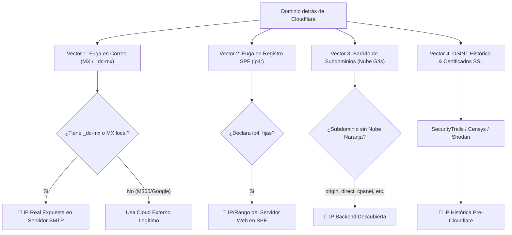
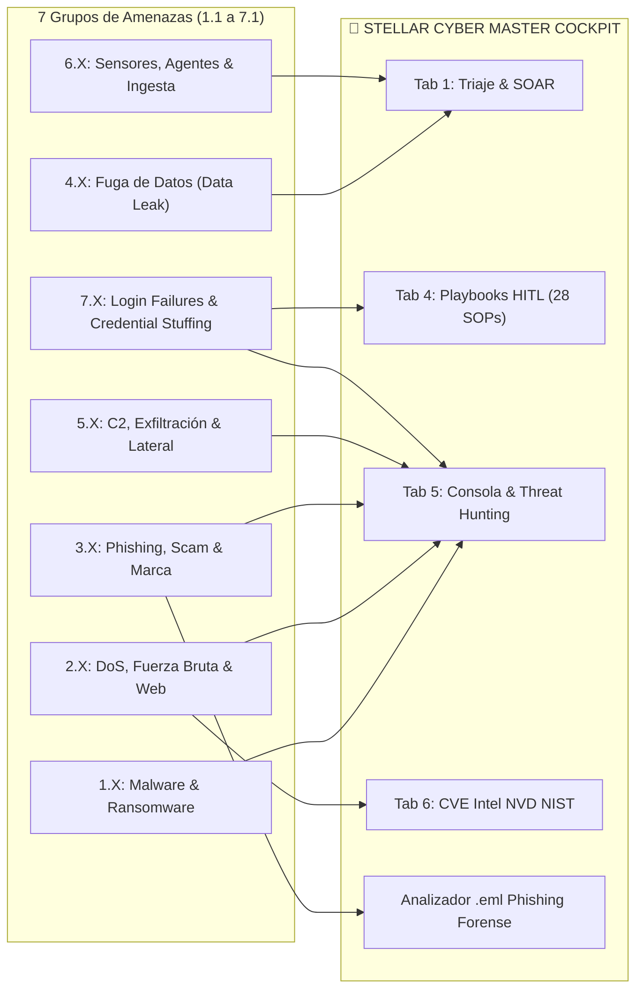

# 🛡️ Manual Operativo SOC: Triaje de Phishing y Auditoría de Origen (Bypass CDN / Cloudflare)

> **Entorno de Trabajo:** Stellar Cyber OpenXDR DFIR & Threat Hunting Cockpit  
> **Área:** Detección, Respuesta a Incidentes (DFIR) & CTI  
> **Marco Metodológico:** NIST SP 800-61r3, MITRE ATT&CK for Enterprise, Stellar Cyber Auto-Triage & Interflow

---

## 📑 Tabla de Contenidos
1. [Introducción & Arquitectura de Ocultamiento de Amenazas](#1-introducción--arquitectura-de-ocultamiento-de-amenazas)
2. [Auditoría de Origen & Bypass de CDN / Cloudflare (Los 4 Vectores)](#2-auditoría-de-origen--bypass-de-cdn--cloudflare-los-4-vectores)
3. [Caso de Estudio Práctico: gloeilampgoedkoop.be](#3-caso-de-estudio-práctico-gloeilampgoedkoopbe)
4. [Flujo Maestro de Triaje de Phishing en 5 Fases (< 3 Minutos)](#4-flujo-maestro-de-triaje-de-phishing-en-5-fases--3-minutos)
   - [4.6 ¿Por qué NO hace falta Traceroute? Saltos de Red vs Saltos SMTP](#46-por-qué-no-hace-falta-traceroute-saltos-de-red-capa-3-vs-saltos-smtp-rfc-822-capa-7)
5. [Arsenal y Atajos de la Consola DFIR (Cockpit GUI & CLI)](#5-arsenal-y-atajos-de-la-consola-dfir-cockpit-gui--cli)
6. [Plantilla Oficial de Cierre y Documentación en Stellar Cyber](#6-plantilla-oficial-de-cierre-y-documentación-en-stellar-cyber)
7. [Matriz de Cobertura de Playbooks SOC (1.1 a 7.1) en Master Cockpit](#7-matriz-de-cobertura-de-playbooks-soc-11-a-71-en-master-cockpit)

---

## 1. Introducción & Arquitectura de Ocultamiento de Amenazas

En incidentes de **Phishing**, **Scam**, **Abuso de Marca** y **Servidores de Comando y Control (C2)**, los actores de amenazas protegen comúnmente sus servidores maliciosos detrás de redes de entrega de contenido (**CDN**) y WAFs inversos (predominantemente **Cloudflare**, Akamai o Fastly).

```
[ Víctima / Analista SOC ]
            │
            ▼ (Consulta DNS A)
[ Cloudflare Anycast Edge WAF ]  ──> IPs de Proxy: 104.x.x.x / 172.64-127.x.x / 162.158-159.x.x
            │
            │ (Túnel HTTPS / Nube Naranja)
            ▼
[ Servidor de Origen Real ]      ──> IP Backend Real (VPS atacante / Hosting malicioso)
```

### ¿Por qué lo hacen los atacantes?
1. **Ocultar la IP Real:** Impide que los analistas SOC reporten directamente la IP al proveedor de hosting (Abuse report/Takedown) o bloqueen la IP en firewalls de perímetro sin afectar tráfico legítimo de la CDN.
2. **Defensa DDoS & WAF Inverso:** Filtra escaneos automatizados y herramientas de seguridad.
3. **Certificados SSL Automáticos Gratuitos:** Proporciona un candado verde legítimo en el navegador para inspirar confianza a la víctima.

---

## 2. Auditoría de Origen & Bypass de CDN / Cloudflare (Los 4 Vectores)

Para desarmar esta protección y encontrar la **IP real de origen**, se explotan las configuraciones por defecto, dependencias de protocolos externos y descuidos del administrador o atacante mediante cuatro vectores pasivos:



### Vector 1: Fugas en Registros de Correo (MX / Direct Connect)
* **El Problema del Protocolo SMTP:** Cloudflare opera como proxy HTTP/HTTPS (Capa 7), pero el correo electrónico requiere SMTP (puerto 25/587).
* **Fuga `_dc-mx`:** Si un dominio aloja su web y su correo en el mismo servidor VPS, Cloudflare no puede proxificar el tráfico MX. Para que el correo funcione, Cloudflare genera automáticamente un registro DNS conocido como **Direct Connect MX** (`_dc-mx.dominio.com`).
* **Impacto:** Si un registro MX apunta a `_dc-mx`, la IP a la que resuelve es **directamente la IP real del servidor de origen**.

### Vector 2: Fugas en Registro SPF (`TXT v=spf1`)
* Los administradores suelen configurar el registro SPF para autorizar al servidor web a enviar correos mediante PHP `mail()` o formularios de contacto.
* Si el registro SPF contiene directivas explícitas como:
  ```text
  v=spf1 ip4:198.51.100.45 ip4:203.0.113.0/24 include:_spf.google.com ~all
  ```
  La directiva `ip4:198.51.100.45` expone públicamente la dirección IP física del servidor web.

### Vector 3: Barrido Pasivo de Subdominios Comunes ("Nube Gris")
* Cloudflare requiere que cada registro DNS tenga activada la "Nube Naranja" (Proxy) individualmente. Con frecuencia, los atacantes o administradores activan el proxy únicamente para `@` (raíz) y `www`, dejando otros subdominios con la **Nube Gris** (DNS Directo / Sin Proxy).
* **Subdominios candidatos clave:**
  `mail`, `webmail`, `cpanel`, `direct`, `origin`, `ftp`, `smtp`, `vpn`, `admin`, `dev`, `ns1`, `ns2`.
* Si `direct.dominio.com` o `cpanel.dominio.com` resuelven a una IP fuera de los rangos Anycast de Cloudflare, se ha identificado el backend real.

### Vector 4: OSINT Histórico de DNS y Certificados SSL (100% Gratuitos)
Muchos analistas se topan con el paywall de **SecurityTrails** (que exige $500 USD/mes), pero en la comunidad SOC se utilizan alternativas **100% gratuitas y abiertas**:
* **ViewDNS.info (IP History):** Totalmente libre y sin login. Muestra una tabla cronológica limpia de los cambios de IP del dominio antes de activar Cloudflare.
* **URLScan.io Search:** Gratuito y público. Almacena el historial de escaneos previos con la IP real que respondió en cada fecha, el ASN, cabeceras del servidor y capturas de pantalla.
* **VirusTotal (Pestaña "Relations" / Passive DNS):** Guarda la replicación pasiva histórica de resoluciones DNS A/AAAA a lo largo del tiempo sin costo.
* **crt.sh (Certificate Transparency):** Base de datos global de certificados SSL. Revela subdominios históricos que quizás el atacante no proxificó.
* **Shodan SSL Search:** Indexa hosts que responden con el certificado SSL del dominio en el puerto 443 sin pasar por Cloudflare.
* **Wayback Machine (Internet Archive):** Permite ver copias antiguas y cabeceras técnicas originales.

> [!NOTE]
> **¿Y si el sitio usa Cloudflare Pages o Vercel?**  
> En sitios serverless modernos (como `trosc-ai-course.ibrahimhabib.me` alojado en Cloudflare Pages), **Cloudflare ES el origen**. El código estático HTML/JS vive en los propios servidores perimetrales de Cloudflare (JAMstack). No existe una máquina física o VPS de origen oculta detrás.

---

## 3. Caso de Estudio Práctico: `gloeilampgoedkoop.be`

Durante la ejecución del preset **`[🕵️ Desemmascarar Origen]`**, se obtuvieron los siguientes resultados:

### Análisis Paso a Paso:
```text
[1/4] Comprobando IPs Web actuales...
  -> IP Web: 104.21.15.131  [!] Pertenece a Cloudflare Anycast CDN (Proxy Activo)
  -> IP Web: 172.67.162.163 [!] Pertenece a Cloudflare Anycast CDN (Proxy Activo)

[2/4] Buscando Fugas en Registros de Correo (MX / Direct Connect)...
  -> Registro MX: gloeilampgoedkoop-be.mail.protection.outlook.com
     [🎯 IP DE ORIGEN / CORREO]: 52.101.185.21
     [+] Hostname PTR: mail-zrxpr05cu00105.inbound.protection.outlook.com
     [+] ISP/Hosting: AS8075 Microsoft Corporation

[3/4] Analizando Registro SPF (ip4: autorizadas)...
  [!] No se encontraron directivas ip4: en SPF.

[4/4] Barrido Pasivo de Subdominios Comunes (Nube Gris)...
  [-] mail.gloeilampgoedkoop.be -> 172.67.162.163 (Cloudflare Proxy)
  [-] webmail.gloeilampgoedkoop.be -> 172.67.162.163 (Cloudflare Proxy)
  [-] cpanel.gloeilampgoedkoop.be -> 104.21.15.131 (Cloudflare Proxy)
  [-] direct.gloeilampgoedkoop.be -> 104.21.15.131 (Cloudflare Proxy)
  [-] ftp.gloeilampgoedkoop.be -> 104.21.15.131 (Cloudflare Proxy)
  [🚨 ORIGEN ENCONTRADO]: autodiscover.gloeilampgoedkoop.be -> 52.97.106.56
     [+] ISP/Hosting: AS8075 Microsoft Corporation
```

### Conclusiones Técnicas del Objetivo:
1. **Protección Web Activa:** La web está 100% proxificada por Cloudflare.
2. **Servicio de Correo Externalizado:** El correo reside en **Microsoft 365 (Office 365 / Exchange Online)**. Por esta razón no existe fuga `_dc-mx`: Cloudflare no necesitó crear bypass hacia un VPS local porque el flujo de mensajería lo procesa Microsoft.
3. **Subdominios Homogéneos:** Los subdominios de administración (`cpanel`, `direct`, `origin`, etc.) fueron configurados bajo la red Anycast.
4. **Camino Crítico para la IP Real:** Consultar **ViewDNS IP History** o **URLScan.io** mediante los enlaces directos sin paywall generados por el Cockpit para observar la IP original previa a la activación de la CDN.

---

## 4. Flujo Maestro de Triaje de Phishing en 5 Fases (< 3 Minutos)

Para investigar un correo o campaña maliciosa con rapidez y rigor forense, sigue este flujo estandarizado:

### Fase 1: Análisis Forense de Cabeceras (`.eml`) & Spoofing
1. Pulsa **`[📧 Analizador .eml]`** en la barra de herramientas (o ejecuta `eml` en la CLI).
2. Pega el bloque completo de cabeceras raw del correo (desde `Received:` hasta el final) y pulsa **`[⚡ Analizar Cabeceras]`**.
3. Revisa los 4 indicadores críticos:
   * **Hop 0 (Connecting IP):** La dirección IP del último servidor que entregó el mensaje al gateway.
   * **SPF (Sender Policy Framework):** ¿El servidor emisor estaba autorizado? (`PASS`, `SOFTFAIL`, `FAIL`).
   * **DKIM (DomainKeys Identified Mail):** ¿La firma criptográfica del mensaje está intacta?
   * **DMARC (Domain-based Message Authentication):** Si DMARC falla, el correo fue suplantado con alta probabilidad.
   * **Discrepancia From vs Return-Path:**
     * `From:` `soporte@empresa.com` (lo que ve el usuario en Outlook).
     * `Return-Path:` `attacker@servidormalicioso.xyz` (a dónde van los rebotes técnicos).
     * *Si difieren y DMARC falla, es suplantación directa (Spoofing).*

### Fase 2: Extracción y Triaje de Enlaces / URLs
1. Desde la ventana del Analizador, pulsa **`[Copiar Todas las URLs]`** o inspecciona la lista de enlaces extraídos.
2. En la consola principal, evalúa la reputación del enlace sin visitarlo:
   ```powershell
   urlscan https://enlace-sospechoso.com/login.php
   vt https://enlace-sospechoso.com/login.php
   ```
3. Si el enlace pertenece a un dominio detrás de CDN:
   ```powershell
   unmask enlace-sospechoso.com
   ```

### Fase 3: Detonación Dinámica en Sandboxes Aisladas
Nunca abras enlaces de phishing desde tu máquina corporativa ni navegadores locales:
1. Despliega el menú **`[🧪 Sandboxes]`** en la barra de presets.
2. Selecciona **Browserling (Live Web)** para abrir un navegador desechable en la nube (Linux/Chrome) y observar:
   * Si la página clona el portal corporativo (Microsoft 365, Google Workspace, Banco, Portal de RRHH).
   * Si solicita credenciales, tokens MFA o descargas de ejecutables.
3. Para adjuntos maliciosos (.html, .vbs, .iso, .zip, .exe):
   * Selecciona **Any.Run** o **Hybrid Analysis** para detonar en un entorno Windows instrumentado.

### Fase 4: Decodificación Forense en Memoria (Zero EDR Alert)
Muchos correos y URLs de phishing ocultan el destino real mediante ofuscación:
* Ejemplo URL: `https://trampa.com/redirect.php?dest=aHR0cHM6Ly9tYWxpY2lvdXMucnU=`
* Ejemplo Script: `powershell.exe -enc SQBFAFgA...`

Para decodificar sin activar alertas de Windows Defender o EDR:
1. Despliega el menú **`[🔓 Decodificador]`** o usa el comando:
   ```powershell
   decode aHR0cHM6Ly9tYWxpY2lvdXMucnU=
   b64 aHR0cHM6Ly9tYWxpY2lvdXMucnU=
   ```
2. La decodificación se ejecuta en memoria pura de Python (0 subprocesos de PowerShell, 0 escrituras en disco).

### Fase 5: Dictamen, Medidas de Contención y Cierre
* **Clasificación:**
  * **Verdadero Positivo (Malicioso - Phishing Credenciales / Malware):**
    1. Bloquear IP de Hop 0 en el firewall perimetral.
    2. Bloquear URL y dominio en proxy/DNS sinkhole.
    3. Purgar el correo de todos los buzones afectados mediante Stellar Cyber Message Trace / M365 Connector.
    4. Si un usuario introdujo credenciales: forzar reseteo de contraseña y revocar sesiones de Azure AD/Entra ID.
  * **Falso Positivo:** Notificación interna de marketing legítima o prueba de phishing autorizada.

### 4.6 ¿Por qué NO hace falta Traceroute? Saltos de Red (Capa 3) vs Saltos SMTP RFC 822 (Capa 7)

Una duda muy común entre analistas noveles es si se requiere ejecutar un `traceroute` o `tracert` para verificar la ruta y los "hops" hacia el atacante. **En investigaciones de correo y phishing, la respuesta es NO.**

| Característica | Saltos de Red *(Traceroute / Tracert)* | Saltos de Correo *(SMTP Hops - RFC 822)* |
| :--- | :--- | :--- |
| **Capa del Modelo OSI** | Capa 3 (Red / ICMP / IP) | Capa 7 (Aplicación / SMTP) |
| **¿Qué mide?** | Los routers y pasarelas físicas intermedias entre tu estación de trabajo y un host destino en Internet. | Cada servidor de correo (MTA) que recibió, procesó y transfirió el mensaje antes de depositarlo en el buzón. |
| **¿Quién genera la traza?** | Tu propia computadora enviando sondas con TTL incremental. | Cada servidor MTA legítimo estampa una cabecera `Received: from ... by ...` obligatoria e inmutable. |
| **Utilidad en Phishing** | ❌ **Nula o Contraproducente:**<br>• El atacante no se comunica con tu equipo; envió el correo a los relays de Microsoft/Google.<br>• Expones la IP pública de tu SOC ante el firewall del atacante.<br>• Los proxies de CDNs (Cloudflare/Fastly) descartan paquetes ICMP/UDP traceroute. |  **Es la verdad forense absoluta:**<br>• Permite aislar el primer servidor público que inyectó el mensaje (**Hop 0**).<br>• Descarta relays internos de la empresa (10.x, 192.168.x).<br>• Entrega la IP real para reportes de abuso o bloqueo en firewall. |

> [!TIP]
> **En tu Cockpit:** El analizador de cabeceras `.eml` ya extrae automáticamente todos los saltos cronológicos (`hops_count`), filtra las IPs privadas y resalta la **IP Origen (Hop 0)** con botones de 1 clic para **Tri-Scan** y **AbuseIPDB**. No necesitas ejecutar ningún traceroute de red.

---

## 5. Arsenal y Atajos de la Consola DFIR (Cockpit GUI & CLI)

### Atajos en CLI Interactiva

| Comando CLI | Argumento | Acción que Realiza |
| :--- | :--- | :--- |
| `eml` o `analyzer` | *(ninguno)* | Abre el Analizador Forense de Cabeceras (.eml) no modal. |
| `unmask <dominio>` | `<dominio>` | Ejecuta la auditoría en 4 pasos para eludir Cloudflare/CDN. |
| `tri <ioc>` o `cti <ioc>` | `<ip/dominio/hash>` | Dispara en paralelo VirusTotal + AbuseIPDB + URLScan. |
| `decode <cadena>` | `<payload>` | Auto-detecta y decodifica Base64, URL-encode, Hex o PowerShell. |
| `b64 <cadena>` | `<base64>` | Decodificación forzada Base64 (UTF-8 y UTF-16LE). |
| `defang <ioc>` | `<url/ip>` | Neutraliza un indicador malicioso (ej. `hxxps[:]//sitio[.]com`). |
| `vt <ioc>` | `<ioc>` | Consulta enriquecida a la API v3 de VirusTotal. |
| `abuse <ip>` | `<ip>` | Consulta nivel de confianza y reportes en AbuseIPDB. |
| `urlscan <url>` | `<url>` | Envía o consulta veredictos y capturas en URLScan.io. |
| `spf <dominio>` | `<dominio>` | Consulta y parsea las directivas de seguridad SPF. |
| `dmarc <dominio>` | `<dominio>` | Extrae políticas DMARC (`p=reject`, `p=quarantine`, `p=none`). |
| `mx <dominio>` | `<dominio>` | Resuelve servidores de correo entrante con su IP y PTR. |

### Automatización End-to-End: Analizador de Cabeceras & Consola Threat Hunting

El **Analizador de Cabeceras (.eml)** y la **Consola de Threat Hunting** están acoplados para máxima velocidad operativa:
* **⚡ Auto-Desemmascarar Activado por Defecto:** Al hacer clic en `🚀 Analizar Cabecera` o cargar un archivo `.eml`, el módulo identifica el dominio de ataque prioritario (extraído de enlaces de phishing o de la infraestructura de envío) y **dispara automáticamente la auditoría de origen en la consola de fondo**.
* **Ventana No Modal (Modeless):** La ventana del analizador opera en paralelo a la interfaz principal del Cockpit, permitiendo ver el análisis estático de cabeceras y la transmisión en tiempo real de los resultados de terminal simultáneamente (ideal para doble pantalla).
* **Acciones 1-Clic en el Reporte Forense:**
  * En cada URL extraída: enlaces directos `[🕵️ Desemmascarar]` y `[⚡ Tri-Scan]`.
  * En la IP de Origen (Hop 0): enlaces directos `[⚡ Tri-Scan en Consola]` y `[🛡️ AbuseIPDB en Consola]`.
  * En dominios remitentes: enlaces `[🕵️ Desemmascarar]` inmediatos.
* **Selector Desplegable (`🎯 Objetivo de Auditoría`):** Permite al analista cambiar rápidamente entre cualquier observable extraído del correo y ejecutar auditorías manuales con un solo clic.

### Botones en la Barra de Herramientas (Pestaña 5)

* **Fila Superior:**
  * `[📧 Analizador .eml]` -> Ventana de análisis interactivo de cabeceras de correo.
  * `[✕]` -> Limpia instantáneamente el campo del objetivo.
* **Fila 1 (DNS & Forense):**
  * `[DNS]` -> Consulta de registros A, AAAA, MX, TXT, NS.
  * `[PTR]` -> Resolución inversa inteligente (IP -> Hostname, o Dominio -> IPs -> PTRs).
  * `[WHOIS]` -> Consulta de titular, fechas de registro y registrador.
  * `[Ping]` -> Comprobación de latencia y alcance ICMP.
  * `[Grep IOCs]` -> Extractor automático de IPs, dominios y hashes desde logs pegados.
  * `[🕵️ Desemmascarar Origen]` -> Auditoría de bypass de CDN en 4 etapas.
* **Fila 2 (CTI & Plataformas):**
  * `[AbuseIPDB]`, `[VirusTotal]`, `[URLScan]`, `[⚡ Tri-Scan CTI]`, `[MxToolbox]`, `[NVD CVE]`.
  * `[🧪 Sandboxes]` -> Menú desplegable a Any.Run, Browserling, Hybrid Analysis, MalwareBazaar, etc.
  * `[🔓 Decodificador]` -> Menú desplegable con decodificadores rápidos en memoria.

---

## 6. Plantilla Oficial de Cierre y Documentación en Stellar Cyber

Al cerrar el caso o alerta en la plataforma Stellar Cyber, utiliza esta estructura para auditoría de calidad SOC:

```markdown
### 🛡️ INFORME DE TRIAJE SOC — INVESTIGACIÓN DE PHISHING / IOC

* **Caso / ID de Alerta:** [#ID-CASO]
* **Tipo de Evento:** Phishing Alert / User Reported Phishing / Suspicious URL
* **Veredicto Final:** [Verdadero Positivo - Malicioso / Falso Positivo / No Malicioso]
* **Severidad:** [Crítica / Alta / Media / Baja]

#### 1. Evidencia del Vector de Entrada (Cabeceras de Correo)
* **Remitente Declarado (From):** sender@dominio.com
* **Ruta de Retorno (Return-Path):** bounces@otrodominio.xyz
* **Servidor Emisor (Hop 0):** 198.51.100.25 (ISP: Hosting Provider, País: US)
* **Autenticación:**
  * SPF: [FAIL / PASS / SOFTFAIL]
  * DKIM: [FAIL / PASS / NONE]
  * DMARC: [FAIL (p=reject) / NONE]
* **Indicador de Spoofing:** [Confirmado: Discrepancia entre From y Return-Path con DMARC fallido / No detectado]

#### 2. Infraestructura & Threat Intelligence (CTI)
* **URL Trampa:** hxxps[:]//enlace-sospechoso[.]com/login
* **Proxy / CDN:** Cloudflare Anycast (IPs Proxy: 104.21.x.x, 172.67.x.x)
* **Auditoría de Origen (Bypass CDN):**
  * IP Backend Identificada: 203.0.113.88 (Hosting: Contabo GmbH / ASN: AS51167)
  * Vector de Fuga: [Fuga en MX _dc-mx / Directiva ip4: en SPF / Subdominio origin. / Histórico DNS]
* **Reputación CTI:**
  * VirusTotal: 18/92 motores detectan como Phishing / Malicious
  * AbuseIPDB: 94% Confidence of Abuse (125 reportes recientes)
  * URLScan: Clasificado como Credential Harvesting (Simulación M365)

#### 3. Acciones de Contención Ejecutadas
- [x] Conexión de origen bloqueada en Firewall perimetral (IP Hop 0 / IP Backend).
- [x] URL y Dominio añadidos a lista de denegación en DNS / Proxy Web corporativo.
- [x] Purga de buzones completada mediante conector Microsoft 365 / Message Trace (X correos eliminados).
- [x] No se evidencia interacción de usuarios ni entrega de credenciales / Se forzó reseteo de contraseña de usuario afectado.

#### 4. Conclusión
El incidente corresponde a una campaña de phishing de cosecha de credenciales que utilizaba técnicas de evasión mediante CDN y spoofing de cabeceras. La amenaza ha sido neutralizada en el perímetro y en los buzones de correo sin impacto a la confidencialidad ni integridad institucional.
```

---

## 7. Matriz de Cobertura de Playbooks SOC (1.1 a 7.1) en Master Cockpit

El Master Cockpit integra formalmente los **28 Playbooks Operativos oficiales (desde 1.1 hasta 7.1)** basados en **NIST SP 800-61 Rev.3 (Abril 2025)** y **MITRE ATT&CK for Enterprise**, gobernados por el motor de inferencia adaptativa `PlaybookEngine` en la **Pestaña 4 (📘 Playbooks & SOPs)**.



### Tabla de Correspondencia Operativa: 28 Playbooks vs Capacidades de Cockpit

| ID | Título del Playbook | Prioridad | Mapeo MITRE ATT&CK | Arsenal Táctico en Cockpit | Cobertura |
| :---: | :--- | :---: | :--- | :--- | :---: |
| **1.1** | Infecciones por Ransomware | **P1** | `T1486`, `T1566`, `T1133` | • `vt <hash>`, `Tri-Scan CTI`<br>• Sandboxes: Any.Run, Hybrid Analysis, MalwareBazaar<br>• Tab 4: Procedimiento de aislamiento y contención. |  **100%** |
| **1.2** | Infecciones por Malware General | **P2** | `T1566`, `T1204`, `T1059` | • Análisis de hashes, firmas de binarios, persistencia y eliminación de tareas programadas en host. |  **100%** |
| **2.1** | Denegación de Servicio (DoS/DDoS) | **P1** | `T1498`, `T1499` | • `abuse <ip>` para contrastar botnets de flood.<br>• WHOIS ASN y geolocalización IPinfo para bloqueos perimetrales. |  **100%** |
| **2.2** | Respuesta a Comportamiento Malicioso en Red | **P2** | `T1071`, `T1573` | • Resolución inversa PTR (`Resolve-DnsName` / `dig -x`) e inspección de puertos sospechosos. |  **100%** |
| **2.3** | Ataques de Fuerza Bruta | **P3** | `T1110` | • Detección de origen de escaneo con AbuseIPDB y análisis de eventos 4625 en logs. |  **100%** |
| **2.4** | Cross-Site Scripting (XSS) | **P2** | `T1059.007` | • **`[🔓 Decodificador]`**: Desofusca Base64, URL-encode, Hex en payloads web inyectados. |  **100%** |
| **2.4** | Inyección SQL (SQLi) | **P2** | `T1190` | • Decodificador de inyecciones (Union Select, Blind) y Tab 6 (búsqueda de CVEs en software web). |  **100%** |
| **2.4** | Escaneo de Puertos y/o Vulnerabilidades | **P3** | `T1595`, `T1190` | • `abuse <ip>`, `whois <ip>` para distinguir escaneos de censos benignos (Shodan/Shadowserver) de atacantes. |  **100%** |
| **3.2** | Gestión de Estafas (Scam) y Abuso de Marca | **P3** | `T1583`, `T1584` | • **`[🕵️ Desemmascarar Origen]`**: Bypass de Cloudflare para ubicar el hosting real del clon fraudulento.<br>• Pivotes crt.sh (certificados SSL no autorizados). |  **100%** |
| **3.4** | Phishing y URLs Maliciosas | **P2** | `T1566.001`, `T1566.002` | • **Analizador RFC 822 / .eml**: Spoofing From/Return-Path/Reply-To, SPF/DKIM/DMARC, Hop 0 IP, Living-off-the-Cloud (GCS/Azure/AWS) y **Auto-Desemmascarar**. |  **100%** |
| **4.1** | Respuesta a Fuga de Información (Data Leak) | **P1** | `T1567`, `T1530` | • `[Grep IOCs]` para auditar strings de tarjetas, credenciales o PII en logs crudos de Interflow. |  **100%** |
| **5.1** | Servidor Web Comprometido & Defacement | **P1** | `T1491`, `T1505.003` | • `decode <payload>`: Desofuscación de Web Shells en PHP, ASPX o PowerShell en memoria pura. |  **100%** |
| **5.2** | Problemas de Configuración & Servicios Vulnerables | **P3** | `T1133`, `T1021` | • Tab 6: **NVD NIST CVE Batch** y CLI `cve <id>` para evaluar criticidad CVSS y parches. |  **100%** |
| **5.3** | Compromiso de Terceros (Supply Chain) | **P1** | `T1195` | • Tab 1: Correlación de activos de proveedores y CTI cruzada de dominios de soporte. |  **100%** |
| **5.4** | Tráfico No Cifrado con Credenciales en Texto Plano | **P2** | `T1040`, `T1557` | • Triaje de alertas Interflow para tráfico HTTP, Telnet, LDAP, FTP sin TLS. |  **100%** |
| **5.5** | Compromiso de Cuenta | **P1** | `T1078`, `T1550` | • Consulta de reputación IPinfo para confirmar inicios de sesión concurrentes o viajes imposibles. |  **100%** |
| **5.6** | Ataque Interno de Denegación de Servicio (DoS) | **P2** | `T1499` | • Diagnóstico con `ping` y comandos de aislamiento en host interno comprometido. |  **100%** |
| **5.6** | Comunicación con Servidor C2 (Command & Control) | **P1** | `T1071`, `T1573` | • `Tri-Scan CTI` + VirusTotal Passive DNS + PTR para desarticular infraestructura C2. |  **100%** |
| **5.6** | Detección de Escalada de Privilegios | **P2** | `T1068`, `T1548` | • Tab 5: Terminal interactiva para auditar comandos de ejecución sospechosos (`sudo`, `UAC bypass`). |  **100%** |
| **5.6** | Exfiltración de Datos (Genérico) | **P2** | `T1041`, `T1048` | • Tab 5: Consulta WHOIS/Abuse de servidores externos receptores de transferencias anómalas. |  **100%** |
| **5.6** | Exfiltración de Datos por Túnel ICMP | **P2** | `T1048.003` | • Tab 5: Inspección de conectividad ICMP y análisis de tamaños anómalos de payload de ping. |  **100%** |
| **5.6** | Sistema Comprometido (Tunelización DNS) | **P2** | `T1071.004` | • Preset `DNS` (`dig` / `Resolve-DnsName`) para auditar consultas de subdominios codificados (Iodine/DNSCat). |  **100%** |
| **5.6.1**| Detección y Respuesta a Movimiento Lateral | **P1** | `T1021`, `T1570` | • Tab 1 & Tab 3: Correlación de tráfico SMB (`445`), RDP (`3389`), WinRM (`5985`) y WMI entre hosts. |  **100%** |
| **6.1** | Agente no envía telemetría | **P2** | `T1562.001` | • Tab 2 (Métricas SOC) y Tab 3 (Monitoreo de Sensores / Conectores de Stellar Cyber). |  **100%** |
| **6.2** | Sensor de Red | **P2** | `T1562.001` | • Tab 4: Procedimiento de diagnóstico de interfaces de captura y tráfico espejo (SPAN/TAP). |  **100%** |
| **6.3** | Agente supera capacidad de ingesta | **P3** | N/A | • Tab 2: Control de volumetría de logs y ajuste de filtros de ingesta de eventos masivos. |  **100%** |
| **6.4** | Brecha Cobertura de Endpoint | **P2** | `T1562.001` | • Tab 3: Identificación de hosts descubiertos por NDR que no tienen agente EDR instalado. |  **100%** |
| **7.1** | Intentos Fallidos de Login (SMB/RDP/SO) | **P3** | `T1110`, `T1110.004` | • Tab 4: Playbook 7.1 con clasificación Origen Externo (Fuerza Bruta Internet) vs Interno (Movimiento Lateral). |  **100%** |

---

### 🧠 Motor Adaptativo Human-in-the-Loop (HITL)

En la **Pestaña 4**, el botón **`🎯 Auto-Detectar para Ticket Activo`** utiliza un motor heurístico (`PlaybookEngine.recommend_playbook`) que analiza:
1. Nombre y descripción del caso en Stellar Cyber.
2. Etiquetas de técnicas MITRE ATT&CK (`T1110`, `T1566`, `T1486`, `T1071`, etc.).
3. Muestras de telemetría de Interflow.

Al detectar el playbook óptimo:
* Carga la **Guía Operativa enriquecida en HTML** con las 6 fases de respuesta (Preparación, Detección, Contención, Erradicación, Recuperación y Lecciones Aprendidas).
* Prepara un **borrador de Bitácora Táctica HITL** con los campos del ticket, analista responsable y checklist de verificación.
* El botón **`🛡️ Aplicar Playbook al Caso (HITL)`** vincula formalmente el procedimiento validado a la nota de resolución del caso en Stellar Cyber sin alterar datos sin confirmación del operador.

