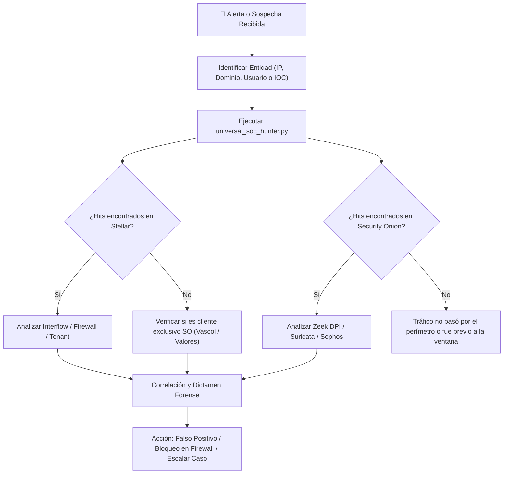

# 🔍 PROCEDIMIENTO OPERATIVO ESTÁNDAR: BÚSQUEDA Y THREAT HUNTING FEDERADO (STELLAR CYBER + SECURITY ONION 3)

**Código:** `SOP-SOC-HUNT-01`  
**Versión:** 1.0  
**Fecha de Publicación:** 22 de Octubre de 2026  
**Autor:** Kevin Moraes (Analista SOC Technoma) / Asistente Autónomo SOAR  
**Herramienta Oficial:** [`universal_soc_hunter.py`](file:///c:/Users/kevinmoraes/Desktop/SOC/soar/universal_soc_hunter.py)  
**Estado:** ✅ **APROBADO PARA OPERACIÓN DE GUARDIA**  

---

## 1. Propósito y Alcance
Este procedimiento establece el método formal y estandarizado para que los analistas del SOC de Technoma realicen investigaciones forenses y búsqueda de amenazas (*Threat Hunting*) simultáneas sobre:
1. **Stellar Cyber OpenXDR:** Data Lake multi-tenant (Interflow, Syslog, eventos de Windows, FortiGate, Azure/Office 365).
2. **Security Onion 3 Standalone:** Sensor perimetral de red e inspección profunda (Zeek DPI, Suricata NIDS, Sophos Central API de clientes Caja ANDE y Valores, y logs locales del sistema).

El procedimiento elimina la necesidad de realizar consultas manuales repetitivas en múltiples paneles web, consolidando la correlación en segundos mediante el motor federado CLI.

---

## 2. Requisitos Previos y Entorno
* **Ruta de la Herramienta:** `soar/universal_soc_hunter.py`
* **Credenciales requeridas en `.env`:**
  * `STELLAR_HOST`, `STELLAR_EMAIL`, `STELLAR_TOKEN` (API Key JWT de Stellar Cyber).
  * `SO3_HOST`, `SO3_USER`, `SO3_PASS` (Credenciales SSH para el nodo `172.17.10.25`).
  * `SO_ES_USER`, `SO_ES_PASS` (Acceso nativo a Elasticsearch de Security Onion).

---

## 3. Matriz de Comandos Operativos

### A. Investigación de Dirección IP (Host Interno o Externo)
Rastrea tráfico bidireccional (`source.ip` y `destination.ip`) en ambos entornos:
```bash
python universal_soc_hunter.py --ip <DIRECCION_IP> [--hours 24] [--limit 5]
```
* **Ejemplo en guardia (Controlador de Dominio):**
  ```bash
  python universal_soc_hunter.py --ip 10.11.1.1 --hours 12 --limit 5
  ```
* **Qué inspecciona:**
  * En Stellar: Sesiones Interflow (`interflow_traffic`), eventos de firewall y logs de autenticación de Windows.
  * En Security Onion: Sesiones de red en Zeek (`conn.log`), alertas IDS de Suricata y telemetría de endpoints Sophos.

### B. Investigación de Dominio / FQDN Sospechoso
Identifica si alguna máquina intentó resolver o comunicarse con un dominio (Phishing, C2, DGA o exfiltración):
```bash
python universal_soc_hunter.py --domain <NOMBRE_DOMINIO> [--hours 24]
```
* **Ejemplo en guardia:**
  ```bash
  python universal_soc_hunter.py --domain stellarcyber.cloud --limit 5
  ```
* **Qué inspecciona:**
  * En Stellar: Consultas DNS en NDR (`query`, `domain`, `dst_host`).
  * En Security Onion: Resoluciones de nombres en Zeek (`dns.query.name`, `dns.answers.name`).

### C. Rastreo de Actividad de Usuario
Investiga inicios de sesión, movimientos laterales y actividad en endpoints de una cuenta de usuario:
```bash
python universal_soc_hunter.py --user <NOMBRE_USUARIO>
```
* **Ejemplo en guardia:**
  ```bash
  python universal_soc_hunter.py --user rominalopez --limit 10
  ```
* **Qué inspecciona:**
  * En Stellar: Eventos de logon Kerberos/NTLM en Active Directory (EventIDs 4624, 4625, 4768).
  * En Security Onion: Detecciones de Sophos Central (`sophos_central.event.source.original`) y autenticaciones en Kratos/SOC.

### D. Búsqueda de Indicador de Compromiso (IOC) Genérico
Permite buscar hashes SHA256/MD5, cadenas sospechosas o nombres de procesos en todo el ecosistema:
```bash
python universal_soc_hunter.py --ioc <HASH_O_CADENA>
```
* **Ejemplo:**
  ```bash
  python universal_soc_hunter.py --ioc 181.94.247.147 --hours 48
  ```

---

## 4. Flujo de Trabajo en Triaje de Guardia (Workflow)



---

## 5. Mantenimiento y Buenas Prácticas
1. **Ventana de Tiempo:** Por defecto busca en las últimas 24 horas (`--hours 24`). Ampliar a `--hours 72` únicamente para análisis de incidentes de fin de semana para no saturar memoria.
2. **Límite de Resultados:** El parámetro `--limit` controla cuántas muestras detalladas se imprimen (por defecto: 5). El contador total (`total eventos encontrados`) siempre refleja el 100% de los registros en el Data Lake.
3. **Respeto Multi-Tenant:** La herramienta muestra el tenant correspondiente en Stellar y el data stream en Security Onion, garantizando que el analista no confunda eventos de clientes dedicados (Valores / Caja ANDE) con la red corporativa de Technoma.
