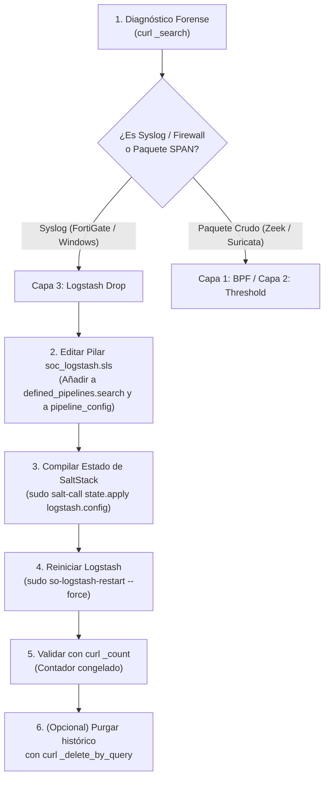

# 🧅 SECURITY ONION 3.1.0 (SO3) — ARQUITECTURA DISTRIBUIDA & GESTIÓN DE FILTROS

> **PROPÓSITO:**  
> Documentación técnica oficial del clúster de Security Onion 3.1.0 de Technoma SOC (`172.17.10.25`).  
> Define la topología de la Grid, el funcionamiento de SaltStack, la arquitectura de filtrado en 4 capas y el procedimiento de traducción de los filtros de Stellar Cyber a Security Onion sin romper la persistencia de los contenedores.

---

## 🗺️ 1. Topología Real de la Grid (Descubrimiento en Vivo)

El clúster opera en **modo distribuido** orquestado mediante **SaltStack** y contenedores Docker administrados bajo el registry local `soc-onion:5000`:

| Nodo / Minion | Rol | IP / Interfaz | Descripción / Destino |
| :--- | :--- | :--- | :--- |
| **`soc-onion_standalone`** | **Manager / Search / SOC** | `172.17.10.25` | Nodo central: Orquestador Salt, Interfaz Web SOC, Elastic/OpenSearch, Logstash y Kratos. |
| **`ndr_sensor`** | **Sensor NDR Red** | `192.168.40.232` (`bond0`) | Sensor de captura de tráfico en clientes (Valores Casa de Bolsa - `security-onion-sensor-VALORES`). Ejecuta Suricata, Zeek y Strelka. |
| **`secops-vascol_sensor`** | **Sensor Remoto** | Red Vascol | Sensor dedicado a la monitorización del entorno Vascol. |
| **`securityonion_sensor`** | **Sensor Corporativo** | Red Local Technoma | Sensor de telemetría de red interna. |

### Contenedores Core (`so-status`):
* **NDR / Detección:** `so-suricata`, `so-zeek`, `so-strelka-*` (analizador de archivos).
* **Ingesta / Data Lake:** `so-logstash`, `so-elasticsearch` (9.3.3), `so-influxdb`.
* **Gestión & SOC:** `so-soc` (Web UI en `https://172.17.10.25`), `so-kibana`, `so-fleet` (Elastic Agent), `so-kratos`, `so-dockerregistry`.

---

## 🛡️ 2. La Regla de Oro en SO3: Persistencia con SaltStack e IaC

> ⚠️ **ADVERTENCIA CRÍTICA: EL CICLO DE 15 MINUTOS (DRIFT RECONCILIATION)**  
> Security Onion ejecuta un proceso programado de **Highstate cada 15 minutos**:
> 1. Si un analista entra por SSH y modifica a mano un archivo dentro de `/opt/so/conf/...` (por ejemplo `/opt/so/conf/suricata/threshold.conf`) o dentro de un contenedor Docker, **SaltStack detecta la desviación (drift) y lo pisa sin piedad**, devolviendo el contenedor a su estado original.
> 2. Para que un cambio sea **100% permanente e indestructible**, debe definirse en la raíz de **Infraestructura como Código (IaC)** de SaltStack: en el árbol de plantillas locales `/opt/so/saltstack/local/` y debe estar registrado en el mapa de inclusión `top.sls`.

### Arquitectura de Árboles en SaltStack:
* **`/opt/so/saltstack/default/` (Proveedor / SO Core):**  
  Contiene las plantillas base del sistema. **Nunca se edita manualmente** porque cualquier actualización (`soup`) lo sobreescribe.
* **`/opt/so/saltstack/local/` (Tecnhoma / Overrides Locales):**  
  Contiene las personalizaciones del cliente. Cuando Salt corre cada 15 minutos, hace un *deep merge*: lee `default/`, le encima `local/`, y **`local/` tiene prioridad absoluta**. En lugar de borrar tu filtro, lo valida, lo compila y lo re-aplica a toda la Grid.

### ✅ Verificación de Integración en `top.sls` (Confirmado en Vivo):
El archivo maestro `/opt/so/saltstack/default/pillar/top.sls` mapea universalmente en todos los roles (sensores, search, manager):
```yaml
    - zeek.soc_zeek
    - zeek.adv_zeek
    - bpf.soc_bpf      <--- Mapeado nativo
    - bpf.adv_bpf      <--- Mapeado nativo
    - suricata.soc_suricata
    - suricata.adv_suricata
```
**Garantía:** Cualquier definición en `/opt/so/saltstack/local/pillar/bpf/soc_bpf.sls` es cargada por el 100% de los nodos y **es inmune a ser pisada por el ciclo de 15 minutos**.

---

## 🧱 3. Las 4 Capas de Filtrado (Traducción de Stellar a SO3)

Para replicar los 51 Log Filters y Alert Customizations de Stellar Cyber en Security Onion, cada filtro debe inyectarse en su capa técnica correspondiente:

```mermaid
flowchart TD
    subgraph CAPA 1: Captura de Red (BPF)
    A["Tráfico Crudo SPAN / TAP"] -->|"BPF Filter (Kernel Level)"| B["/opt/so/conf/*/bpf\n(Desecha antes de CPU)"]
    end

    subgraph CAPA 2: Motores NDR (Suricata & Zeek)
    B --> C["Suricata (IDS)"]
    B --> D["Zeek (Metadata)"]
    C -->|"/opt/so/conf/suricata/threshold.conf\n(Suprime Alertas)"| E["Alertas Limpias"]
    end

    subgraph CAPA 3: Ingesta Syslog (Logstash)
    F["Syslogs FortiGate / Windows"] --> G["Logstash Pipelines\n(custom drops)"]
    G -->|"drop { }\n(Descarte en Ingesta)"| H["Elasticsearch / OpenSearch"]
    end

    subgraph CAPA 4: Consola Web SOC (Detections)
    E --> I["Security Onion Web UI\n(https://172.17.10.25)"]
    H --> I
    I -->|"Tuning & Exclusions"| J["Silenciamiento en 1-Clic"]
    end
```

---

### Capa 1: BPF (Berkeley Packet Filter) — Captura de Red
* **Propósito:** Descartar tráfico benigno masivo **antes** de que Suricata y Zeek gasten CPU/RAM.
* **Archivos Clave en el Manager y Sensores:**
  * **Pillar Fuente de la Verdad:** `/opt/so/saltstack/local/pillar/bpf/soc_bpf.sls`.
  * **Plantilla Jinja:** `/opt/so/saltstack/default/salt/bpf/suricata.map.jinja` y `zeek.map.jinja`.
  * **Compilador Interno:** `/opt/so/saltstack/default/salt/common/tools/sbin/so-bpf-compile`.
  * **Destino Compilado en Sensores:** `/opt/so/conf/suricata/bpf` y `/opt/so/conf/zeek/bpf`.
* **Sintaxis de Definición en `soc_bpf.sls`:**
  ```yaml
  bpf:
    suricata:
      - "not (host 192.168.16.6 and port 53)"
      - "not (net 192.168.169.0/24 and tcp port 7680)"
    zeek:
      - "not (host 192.168.16.6 and port 53)"
      - "not (net 192.168.169.0/24 and tcp port 7680)"
  ```
* **Comando para compilar y aplicar a la Grid:**
  ```bash
  sudo salt '*' state.apply bpf
  ```

---

### Capa 2: Supresiones de Firmas IDS (Suricata Thresholds)
* **Propósito:** Permitir que el tráfico pase y se registre en la telemetría, pero **silenciar las alertas ruidosas de firmas IDS**.
* **Archivo Clave:** `/opt/so/conf/suricata/threshold.conf`.
* **Traducción de Filtros Stellar (Ejemplo: Negociación NTLM a File Server `adm-fs` `10.11.1.5`):**
  ```conf
  # Suprimir firmas informativas NTLM al servidor central de archivos adm-fs
  suppress gen_id 1, sig_id 2067085, track by_dst, ip 10.11.1.5
  suppress gen_id 1, sig_id 2067086, track by_src, ip 10.11.1.5
  suppress gen_id 1, sig_id 2067087, track by_dst, ip 10.11.1.5
  ```
* **Aplicar cambios a la Grid:**
  ```bash
  sudo so-rule-update
  sudo salt '*' state.apply suricata
  ```

---

### Capa 3: Ingesta de Syslog / FortiGate (Logstash Pipeline)
* **Propósito:** Equivalente exacto al *Log Filter (Drop)* de Stellar Cyber. Desecha logs de denegación repetitivos del FortiGate antes de indexarlos en Elasticsearch.
* **⚠️ Regla de Oro Operativa:** **Un BPF NO SIRVE para Syslog.** Si un firewall (ej. FortiGate) envía eventos de tráfico denegado (`action="deny"`), el evento viaja como un mensaje Syslog (UDP 514). Suricata y Zeek no lo procesan como paquete de red promiscuo, por lo que el BPF jamás lo frenará.
* **Caso de Estudio Real SOC (Cámara Dahua `192.168.16.6` DNS deny en `FG-Technoma`):**
  - **Diagnóstico:** Se detectaron más de 54.000 eventos en Elasticsearch con:
    ```text
    devname="FG-Technoma" srcip=192.168.16.6 dstport=53 action="deny" policyid=0 srchwvendor="Dahua"
    ```
  - **Solución SO3 (Descarte en Logstash):**
    ```ruby
    filter {
      if [message] =~ "FG-Technoma" and [message] =~ "srcip=192\.168\.16\.6" and [message] =~ "dstport=53" {
        drop { }
      }
    }
    ```
  - **Solución en Firewall (Mejor Práctica):** Deshabilitar el logging de la política implícita Deny (Policy 0) en el FortiGate para la VLAN16.
* **Ubicación en SO3:** `/opt/so/conf/logstash/pipelines/manager/` y `/opt/so/conf/logstash/pipelines/search/`.
* **Regla Logstash genérica (`drop { }`):**
  ```ruby
  filter {
    # Descarte de denegaciones de VPN hacia DNS de Active Directory
    if [rule][action] == "deny" and [destination][port] == 53 and [source][ip] =~ /^10\.212\.134\./ {
      drop { }
    }
    
    # Descarte de telemetría benigna Microsoft
    if [destination][ip] in ["20.189.173.1", "51.104.136.2"] {
      drop { }
    }
  }
  ```
* **Aplicar cambios:**
  ```bash
  sudo so-logstash-restart
  ```

---

### Capa 4: Tuning en Interfaz Web (Security Onion Console)
* **Propósito:** Silenciamiento visual inmediato desde la interfaz gráfica sin entrar por SSH.
* **Procedimiento:**
  1. Ingresar a `https://172.17.10.25` con credenciales de analista.
  2. Ir a **Detections** -> **Alerts**.
  3. Seleccionar la alerta recurrente y hacer clic en el botón **`Tune`**.
  4. Seleccionar `Suppress` (para una IP/Host específico) o `Disable` (para apagar la firma en toda la red).

---

## 🛠️ 4. Comandos de Operación Rápida en la Grid

```bash
# Estado general de todos los contenedores en el Manager
sudo so-status

# Ver sensores conectados a SaltStack
sudo salt-key -L

# Forzar sincronización de Suricata en todos los nodos de la Grid
sudo salt '*' state.apply suricata

# Forzar sincronización de Zeek en todos los nodos
sudo salt '*' state.apply zeek

# Actualizar y compilar reglas IDS en la Grid
sudo so-rule-update

# Reiniciar pipeline de Logstash tras modificar filtros
sudo so-logstash-restart
```

---

## 📋 5. Catálogo Oficial de Filtros Implementados en Producción (SO3 Grid)

A continuación se registra cada filtro que se encuentra en ejecución en los nodos de producción, su archivo de configuración exacto, su capa técnica y su justificación operativa:

| # | Filtro / Regla | Capa Técnica | Archivo y Ruta Absoluta | Sintaxis / Contenido Activo | Justificación Operativa |
| :--- | :--- | :--- | :--- | :--- | :--- |
| **1** | **Drop Syslog Dahua DNS Deny** | **Capa 3: Logstash (Salt IaC)** | Pilar: `/opt/so/saltstack/local/pillar/logstash/soc_logstash.sls`<br>Fuente: `/opt/so/saltstack/local/salt/logstash/pipelines/config/custom/9000_drop_fg_dahua.conf` | `if "192.168.16.6" in [message] or "192.168.16.6" in [event][original] { drop { } }` | Integrado en `defined_pipelines.search` de SaltStack para que `clean: True` lo proteja y no se borre en reinicios. Descarta en memoria antes de entrar a Elasticsearch el spam masivo de denegaciones de la cámara Dahua (>56.000 logs innecesarios). |
| **2** | **Suppress SID 2025707 (SMB .bat)** | **Capa 2: Suricata Threshold** | `/opt/so/saltstack/local/salt/suricata/files/threshold.conf` | `suppress gen_id 1, sig_id 2025707, track by_dst, ip 10.11.1.1/32` | Silencia alertas informativas de creación/petición de scripts `.bat` por SMB hacia el servidor `10.11.1.1` sin perder visibilidad en otros equipos. |
| **3** | **Drop Syslog VPN Caída ECOP-MATRIZ-SEC** | **Capa 3: Logstash (Salt IaC)** | Pilar: `/opt/so/saltstack/local/pillar/logstash/soc_logstash.sls`<br>Fuente: `/opt/so/saltstack/local/salt/logstash/pipelines/config/custom/9001_drop_fg_vpn_ecop.conf` | `if "ECOP-MATRIZ-SEC" in [message] or "ECOP-MATRIZ-SEC" in [event][original] { drop { } }` | Descarta en el pipeline `search` el spam continuo de errores de negociación de Fase 1 IPsec IKEv2 del túnel caído `ECOP-MATRIZ-SEC` generado por el FortiGate (>3.5 millones de logs descartados). |
| **4** | **Drop Zabbix DNS Queries Spam** | **Capa 3: Logstash (Salt IaC)** | Pilar: `/opt/so/saltstack/local/pillar/logstash/soc_logstash.sls`<br>Fuente: `/opt/so/saltstack/local/salt/logstash/pipelines/config/custom/9002_drop_zabbix_dns.conf` | `if "zbx.technoma.com.py" in [message] or "zbx.technoma.com.py" in [event][original] { drop { } }` | Descarta en `search` las millones de consultas DNS idénticas sin caché desde `192.168.15.23` hacia el DC `10.11.1.1` resolviendo el servidor Zabbix (>3.8 millones de logs neutralizados). Equivalente al filtro Stellar ID `6970d66abdf8d2b79dd882d2`. |
| **5** | **Drop Veeam Backup & mDNS Storm** | **Capa 3: Logstash (Salt IaC)** | Pilar: `/opt/so/saltstack/local/pillar/logstash/soc_logstash.sls`<br>Fuente: `/opt/so/saltstack/local/salt/logstash/pipelines/config/custom/9003_drop_veeam_backup.conf` | `if ("10.11.4.2" in [message] and "8010" in [message]) or "veeam-server-bd.local" in [message] or "veeam-server-bd.local" in [event][original] { drop { } }` | Descarta en `search` la sincronización continua de backups aceptados de `VEEAM-SERVER-BK` (`10.11.4.2:8010`) hacia el storage QNAP y la tormenta de paquetes mDNS UDP 5353 (`veeam-server-bd.local`) en IPv6 (>950.000 logs neutralizados). Equivalente al filtro Stellar ID `691e65a498520e1b91eb38c1`. |
| **6** | **Drop Syslog Masivo 10.99.99.1 a 192.168.15.70** | **Capa 3: Logstash (Salt IaC)** | Pilar: `/opt/so/saltstack/local/pillar/logstash/soc_logstash.sls`<br>Fuente: `/opt/so/saltstack/local/salt/logstash/pipelines/config/custom/9004_drop_syslog_10_99_99_1.conf` | `if ([source][ip] == "10.99.99.1" or [client][ip] == "10.99.99.1") and ([destination][ip] == "192.168.15.70" or [server][ip] == "192.168.15.70" or [destination][port] == 514) { drop { } }` | Descarta en `search` la inundación colosal de tráfico syslog UDP/514 proveniente de la interfaz del FortiGate `10.99.99.1` hacia el servidor `192.168.15.70` capturado por Zeek en el mirror/TAP. Detuvo una inyección de ~500 logs/segundo (**congelado en 25.001.893 documentos**). Equivalente directo al filtro Stellar #54 `Filtro_Syslog_Ruidoso_10.99.99.1`. |


---

## 🚀 7. Procedimiento Operativo Estandarizado (SOP): Aplicación de Filtros Drop en Logstash SO3 (Paso a Paso)

Este es el flujo de trabajo estandarizado y probado para silenciar ruido masivo de Syslog/Firewalls en Security Onion 3 sin adivinar y garantizando inmunidad ante SaltStack:



---

### Paso 1: Diagnóstico Forense (Identificar el campo exacto del ruido)
Extraer credenciales y ver el mensaje crudo del evento más reciente:
```bash
ES_PASS=$(sudo grep -A 2 "so_elastic_user:" /opt/so/saltstack/local/pillar/elasticsearch/auth.sls | grep "pass:" | awk '{print $2}' | tr -d '"')
curl -s -k -u "so_elastic:$ES_PASS" "https://127.0.0.1:9200/*/_search?q=<IP_O_PATRON>&size=1&sort=@timestamp:desc" | python3 -m json.tool | grep -A 10 -B 2 '"message"'
```
* **Regla de Decisión:** Si en el mensaje aparece `devname="FG-..."`, `type="traffic"` o tags `["elastic-agent", "syslog"]`, **es Syslog**. Debe filtrarse en Logstash (Paso 2). Si es una alerta IDS pura de Suricata, se filtra en `threshold.conf`.

---

### Paso 2: Declarar la regla en el Pilar Local (`soc_logstash.sls`)
En Security Onion 3, **Logstash no requiere crear archivos sueltos en disco**. Su plantilla `config.sls` lee el diccionario `pipeline_config` y la lista `defined_pipelines.search`, creando automáticamente los archivos en `/opt/so/conf/logstash/pipelines/search/` con permisos de servicio (`logstash:socore` 660) e inmunidad ante borrado por `clean: True`.

Editar `/opt/so/saltstack/local/pillar/logstash/soc_logstash.sls` respetando la estructura oficial (sin nivel intermedio `pipelines:`):
```yaml
logstash:
  defined_pipelines:
    manager:
      - so/0011_input_endgame.conf
      - so/0012_input_elastic_agent.conf.jinja
      - so/0013_input_lumberjack_fleet.conf.jinja
      - so/9999_output_redis.conf.jinja
    search:
      - so/0900_input_redis.conf.jinja
      - custom/9000_drop_fg_dahua.conf
      - custom/9001_drop_fg_vpn_ecop.conf
      - custom/<NUMERO>_drop_<NOMBRE>.conf    # <-- Tu nueva regla registrada
      - so/9805_output_elastic_agent.conf.jinja
      - so/9900_output_endgame.conf.jinja
  pipeline_config:
    9000_drop_fg_dahua: |
      filter {
        if "192.168.16.6" in [message] or "192.168.16.6" in [event][original] {
          drop { }
        }
      }
    9001_drop_fg_vpn_ecop: |
      filter {
        if "ECOP-MATRIZ-SEC" in [message] or "ECOP-MATRIZ-SEC" in [event][original] {
          drop { }
        }
      }
    <NUMERO>_drop_<NOMBRE>: |                 # <-- Contenido del filtro drop
      filter {
        if "<PATRON_O_IP>" in [message] or "<PATRON_O_IP>" in [event][original] {
          drop { }
        }
      }
```

---

### Paso 3: Compilar el estado de SaltStack
SaltStack lee el pilar, valida la sintaxis y genera el archivo físicamente en `/opt/so/conf/logstash/pipelines/search/<NUMERO>_drop_<NOMBRE>.conf`:
```bash
sudo salt-call state.apply logstash.config
```
* **Verificación:** Debe finalizar con `Failed: 0` y reflejar `changed` en los estados correspondientes.
* **Comprobación en disco:**
  ```bash
  sudo ls -la /opt/so/conf/logstash/pipelines/search/
  ```

---

### Paso 4: Reiniciar Logstash para cargar las reglas en memoria
```bash
sudo so-logstash-restart --force
```

---

### Paso 5: Validar que el flujo se detuvo al 100%
Ejecutar la consulta dos o tres veces con intervalos de 15 segundos:
```bash
curl -s -k -u "so_elastic:$ES_PASS" "https://127.0.0.1:9200/*/_count?q=<IP_O_PATRON>"
```
* **Criterio de Éxito:** El número devuelto por `{"count": ...}` debe quedar **completamente congelado**.
```
* **Criterio de Éxito:** El número devuelto por `{"count": ...}` debe quedar **completamente congelado**.

---

### Paso 6 (Opcional): Purgar los eventos viejos del disco
Si se quiere liberar espacio eliminando los registros viejos que entraron antes del filtro:
```bash
curl -s -k -u "so_elastic:$ES_PASS" -X POST "https://127.0.0.1:9200/*/_delete_by_query?conflicts=proceed" -H 'Content-Type: application/json' -d'
{
  "query": {
    "query_string": {
      "query": "<IP_O_PATRON>"
    }
  }
}'
```


