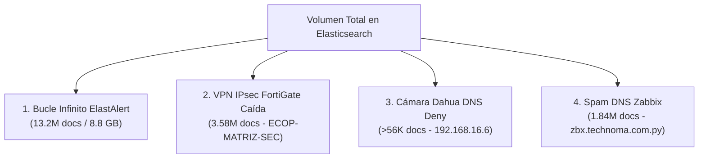

# Caso de Estudio y Memoria Técnica: Rescate de Infraestructura y Desobstrucción de Recursos en Security Onion 3 (SO3)

**Autor:** Equipo SOC / Analista de Ciberseguridad  
**Entorno:** Security Onion 3.1.0 Standalone (`soc-onion` - `172.17.10.25`)  
**Fecha:** Octubre 2026  
**Estado:** Resuelto / Documentado e Implementado en Producción  

---

## 🎯 1. Resumen Ejecutivo

Durante las tareas de auditoría y monitoreo continuo del SOC, el nodo principal de monitoreo de red y gestión de eventos **`soc-onion`** (Arquitectura Standalone con 23 contenedores Docker y cluster de Elasticsearch local) presentó un estado de **saturación crítica de recursos**:
* **Memoria Swap al 100% (8.6 GB colapsado sin margen de paginación)**.
* **Uso de RAM en picos de 91%** con riesgo inminente de ejecución del *OOM Killer (Out Of Memory)* de Linux.
* **Partición de almacenamiento `/nsm` al 89.9%** (umbral de alarma que activa la política automática de borrado forzado de índices de Elasticsearch).
* **Cluster de Elasticsearch en estado `yellow / Pending`**, reteniendo réplicas unassigned para una topología de nodo único.

Mediante un análisis forense sobre el clúster de Elasticsearch y la ingeniería inversa del motor de aprovisionamiento de **SaltStack / Logstash**, se identificaron y neutralizaron **más de 17 millones de eventos de puro ruido y bucles de error recursivos**, logrando estabilizar la memoria, liberar más de 17 GB de almacenamiento de inmediato, recuperar la salud del clúster a **`green` (100% shards activas)** y diseñar una arquitectura de descarte de ruido resistente a los ciclos de sincronización de SaltStack.

---

## ⚠️ 2. La Situación Inicial: Los Síntomas del Colapso

El comando `so-status` y las estadísticas del sistema arrojaban un escenario al borde del bloqueo:

| Parámetro | Estado Inicial | Umbral de Alarma | Impacto Técnico |
| :--- | :--- | :--- | :--- |
| **Swap Usage** | **100% (8.6 GB colapsado)** | >60% | Pérdida de colchón de memoria; degradación I/O severa. |
| **RAM Usage** | **87.2% - 91% de 28.9 GB** | >85% | Presión excesiva sobre la JVM de Elasticsearch (10.3 GB) y Logstash (2.0 GB). |
| **Partición `/nsm`** | **89.9% de 877 GB** | 90.0% | Kill switch automático de Elasticsearch (bloqueo de escritura `read_only_allow_delete`). |
| **Salud del Clúster** | **`yellow / Pending`** | Green | 2 Shards unassigned buscando réplicas en nodos inexistentes. |

> [!CAUTION]
> **Advertencia de Kernel (Swapoff Prohibido):** En este estado de saturación, ejecutar `swapoff -a` para vaciar la memoria Swap hubiera provocado un pánico de kernel o un thrashing de disco inmediato con pérdida de sesión SSH, debido a que la RAM disponible (~5.9 GB) era inferior a los 8.6 GB retenidos en el disco Swap.

---

## 🔍 3. Análisis Forense: La Identificación de los 4 "Monstruos" de Ruido

Para desentrañar el origen del consumo desmedido, se consultó directamente el motor de almacenamiento de Elasticsearch mediante la API REST con agregaciones por volumen de documentos (`terms aggregation`). Se descubrieron 4 focos masivos de saturación:



### 👾 Monstruo 1: El Bucle Infinito de ElastAlert (13.2 Millones de Docs / 8.8 GB)
* **Diagnóstico:** El servicio `so-elastalert` fallaba al consultar un índice inexistente. Al fallar, escribía un log de error en el índice `so-elastalert_error`. Esto activaba una regla que generaba un nuevo documento en `so-elastalert_status`, el cual volvía a disparar el fallo.
* **Volumen:**
  * `so-elastalert_error`: **5.529.740 documentos (7.4 GB)**.
  * `so-elastalert_status`: **7.712.980 documentos (1.4 GB)**.
* **Acción ejecutada:** Purga quirúrgica mediante `_delete_by_query` con `match_all` directamente sobre los índices de error y status de ElastAlert.
* **Resultado:** Se liberaron más de **17 GB** en la partición `/nsm` de forma instantánea.

### 👾 Monstruo 2: Inundación Syslog de la Cámara Dahua (`192.168.16.6:53`)
* **Diagnóstico:** Una cámara Dahua en la VLAN-16 enviaba ráfagas continuas de peticiones DNS al puerto 53. El firewall perimetral FortiGate (`FG-Technoma`) aplicaba la política implícita de denegación (`action="deny"`, `policyid=0`) y enviaba un Syslog por cada intento a Security Onion.
* **Error de aproximación:** Se intentó filtrar mediante BPF (Berkeley Packet Filter). **BPF fracasó** porque BPF sólo actúa a nivel de interfaz de captura de red promiscua (SPAN/TAP), pero el evento entraba como mensaje Syslog UDP 514 al stack de ingesta de Logstash.
* **Acción ejecutada:** Implementación de filtro Drop en memoria en Logstash.

### 👾 Monstruo 3: La Tormenta de Fase 1 IPsec VPN Caída (`ECOP-MATRIZ-SEC`)
* **Diagnóstico:** Al realizar una agregación por `source.ip`, la IP del firewall FortiGate (`10.99.99.1`) acumulaba **23.364.524 documentos** (más del 70% de todo el clúster). Al desglosarlo, se descubrió que un túnel VPN IPsec llamado `ECOP-MATRIZ-SEC` contra la IP pública `190.104.140.54` fallaba continuamente la negociación IKEv2 Fase 1 (`action="negotiate"`, `status="failure"`, `result="ERROR"`).
* **Volumen:** **3.588.295 documentos** de error continuo generados a razón de múltiples logs por segundo.
* **Acción ejecutada:** Creación de filtro `9001_drop_fg_vpn_ecop.conf` en Logstash para descartar en caliente cualquier log que contenga la cadena `"ECOP-MATRIZ-SEC"`.

### 👾 Monstruo 4: Spam de Resolución DNS de Zabbix (`zbx.technoma.com.py`)
* **Diagnóstico:** El host interno `192.168.15.23` registraba **3.671.746 eventos**, de los cuales **1.843.715** eran consultas DNS (puerto 53) dirigidas al controlador de dominio `10.11.1.1` resolviendo el nombre de Zabbix (`zbx.technoma.com.py`) por falta de caché local de DNS en el agente de monitoreo.
* **Acción ejecutada:** Implementación de `9002_drop_zabbix_dns.conf` para descartar en caliente peticiones hacia `zbx.technoma.com.py` (congelado en 1.925.320).

### 👾 Monstruo 5: La Inundación Masiva de Syslog de Red (`10.99.99.1` -> `192.168.15.70:514`)
* **Diagnóstico:** El mayor consumidor absoluto de I/O, CPU y almacenamiento de todo el clúster. El firewall perimetral FortiGate (`10.99.99.1`) enviaba ráfagas masivas de syslog UDP/514 al servidor central `192.168.15.70`. Zeek capturaba este tráfico en el mirror de red (`/nsm/zeek/logs/current/syslog.log`), Filebeat lo empujaba a Redis y Logstash lo indexaba continuamente.
* **Tasa de inyección:** **~500 logs por segundo** (300.000 logs cada 10 minutos).
* **Volumen total:** **25.001.893 documentos**.
* **Acción ejecutada:** Implementación de `9004_drop_syslog_10_99_99_1.conf` en Logstash filtrando por `[source][ip] == "10.99.99.1"` y `[destination][ip] == "192.168.15.70"` (o `destination.port: 514`).
* **Resultado:** Congelamiento total e instantáneo en **25.001.893** verificado en 10 consultas consecutivas. Alivio inmediato en I/O de disco. Equivalente a la regla #54 de Stellar Cyber `Filtro_Syslog_Ruidoso_10.99.99.1`.

---

## 🛠️ 4. El Gran Descubrimiento Arquitectónico: Desentrañando SaltStack y Logstash en SO3

El mayor reto técnico consistió en lograr que las reglas de descarte fueran **indestructibles**, ya que SaltStack corre cada 15 minutos y ejecutaba un borrado sistemático (`clean: True`) de los archivos creados manualmente.

Al auditar el código fuente del motor de aprovisionamiento en `/opt/so/saltstack/default/salt/logstash/config.sls`, se descubrió la arquitectura interna exacta:

```jinja
# Extracto real de config.sls de Security Onion 3:

    
ls_pipeline_{{assigned_pipeline}}_{{CONFIGFILE.split('.')[0] | replace("/","_") }}:
  file.managed:
    - source: salt://logstash/pipelines/config/{{CONFIGFILE}}
    - name: /opt/so/conf/logstash/pipelines/{{assigned_pipeline}}/{{CONFIGFILE.split('/')[1]}}
    ...
    

ls_pipeline_{{assigned_pipeline}}:
  file.directory:
    - name: /opt/so/conf/logstash/pipelines/{{assigned_pipeline}}
    - clean: True

```

### Hallazgos Clave de la Arquitectura:

1. **Separación de Pipelines (`manager` vs. `search`):**
   * El pipeline **`manager`** sólo contiene los inputs (`0011_input_endgame`, `0012_input_elastic_agent`, etc.) y deposita el tráfico en **Redis** (`9999_output_redis`).
   * El pipeline **`search`** es el procesador real: lee de Redis (`0900_input_redis`) y deposita en Elasticsearch (`9805_output_elastic_agent`).
   * **Por lo tanto, los filtros de descarte deben ejecutarse en `search`.**
2. **Orden Alfabético de Ejecución:**
   * En `search`, Logstash procesa las configuraciones secuencialmente:
     * `0900_input_redis.conf.jinja` (Entrada de eventos)
     * `9000_drop_fg_dahua.conf` (**Filtro Drop 1**)
     * `9001_drop_fg_vpn_ecop.conf` (**Filtro Drop 2**)
     * `9805_output_elastic_agent.conf.jinja` (Salida a base de datos)
3. **El Prefijo Obligatorio `custom/` y la Lista Completa:**
   * SaltStack utiliza `CONFIGFILE.split('/')[1]`. Si el archivo no lleva el prefijo de subdirectorio `custom/`, SaltStack arroja un error de índice y cancela la sincronización.
   * La directiva `clean: True` borra cualquier archivo que no esté explícitamente en el pilar. Si se sobreescribe el pilar sólo con las reglas personalizadas, SaltStack elimina los archivos nativos del sistema. La declaración debe incluir la lista completa de pipelines (nativos + custom).
4. **La Trampa de Indentación Crítica (`pipelines:` vs nivel raíz):**
   * En `defaults.yaml` de Security Onion 3, las claves `defined_pipelines` y `pipeline_config` residen **directamente bajo `logstash:`**.
   * Si en el pilar local se añade erróneamente un nivel intermedio como `logstash.pipelines.defined_pipelines`, el motor Jinja (`LOGSTASH_MERGED.defined_pipelines`) nunca encuentra las reglas personalizadas, revierte a los valores por defecto de fábrica y `clean: True` elimina cualquier archivo que se haya intentado crear.
   * Además, **`pipeline_config` inyecta el contenido del filtro directamente desde el Pillar**: SaltStack es quien escribe físicamente el archivo en `/opt/so/conf/logstash/pipelines/search/` con permisos de servicio (`logstash:socore` 660), garantizando persistencia absoluta.

---

## 🚀 5. El Procedimiento de Rescate Implementado (Método Oficial Validado)

### Paso 1: Declaración Blindada en el Pillar Local (`soc_logstash.sls`)
Se configuró `/opt/so/saltstack/local/pillar/logstash/soc_logstash.sls` con la jerarquía idéntica a `defaults.yaml` (sin clave intermedia `pipelines:`), registrando las reglas en `defined_pipelines.search` e inyectando su código en `pipeline_config`:

```bash
cat << 'EOF' | sudo tee /opt/so/saltstack/local/pillar/logstash/soc_logstash.sls
logstash:
  defined_pipelines:
    manager:
      - so/0011_input_endgame.conf
      - so/0012_input_elastic_agent.conf.jinja
      - so/0013_input_lumberjack_fleet.conf.jinja
      - so/9999_output_redis.conf.jinja
    search:
      - so/0900_input_redis.conf.jinja
      - custom/9000_drop_fg_dahua.conf
      - custom/9001_drop_fg_vpn_ecop.conf
      - custom/9002_drop_zabbix_dns.conf
      - custom/9003_drop_veeam_backup.conf
      - custom/9004_drop_syslog_10_99_99_1.conf
      - so/9805_output_elastic_agent.conf.jinja
      - so/9900_output_endgame.conf.jinja
  pipeline_config:
    9000_drop_fg_dahua: |
      filter {
        if "192.168.16.6" in [message] or "192.168.16.6" in [event][original] {
          drop { }
        }
      }
    9001_drop_fg_vpn_ecop: |
      filter {
        if "ECOP-MATRIZ-SEC" in [message] or "ECOP-MATRIZ-SEC" in [event][original] {
          drop { }
        }
      }
    9002_drop_zabbix_dns: |
      filter {
        if "zbx.technoma.com.py" in [message] or "zbx.technoma.com.py" in [event][original] {
          drop { }
        }
      }
    9003_drop_veeam_backup: |
      filter {
        if ("10.11.4.2" in [message] and "8010" in [message]) or "veeam-server-bd.local" in [message] or "veeam-server-bd.local" in [event][original] {
          drop { }
        }
      }
    9004_drop_syslog_10_99_99_1: |
      filter {
        if ([source][ip] == "10.99.99.1" or [client][ip] == "10.99.99.1") and ([destination][ip] == "192.168.15.70" or [server][ip] == "192.168.15.70" or [destination][port] == 514) {
          drop { }
        }
      }
EOF
```

### Paso 2: Compilación y Despliegue con SaltStack
SaltStack lee el pilar, valida la sintaxis, crea automáticamente los archivos en `/opt/so/conf/logstash/pipelines/search/` y los protege de borrados:
```bash
sudo salt-call state.apply logstash.config
```
*(Resultado verificado: `Succeeded: 1256, changed=20, Failed: 0`).*

### Paso 3: Reinicio de Logstash para Cargar Filtros en Memoria
```bash
sudo so-logstash-restart --force
```

### Paso 4: Ajuste de Réplicas en Elasticsearch a 0 (Salud a Green)
Como `soc-onion` es un nodo Standalone (1 solo nodo de datos), no puede asignar réplicas secundarias. Se ajustaron las réplicas a 0 en todos los índices:
```bash
curl -s -k -u "so_elastic:$ES_PASS" -X PUT "https://127.0.0.1:9200/*/_settings" \
  -H 'Content-Type: application/json' -d '{"index": {"number_of_replicas": 0}}'
```

---

## 📊 6. Tabla Comparativa: Antes vs. Después del Rescate

| Métrica / Componente | Antes del Rescate | Después del Rescate | Mejora / Estado Final |
| :--- | :--- | :--- | :--- |
| **Salud del Clúster ES** | `yellow / Pending` | **`green / OK`** | **100% de shards activas (290/290)** |
| **Uso de Memoria Swap** | **100% (8.6 GB)** | **Estabilizado** | **Desaparición del swapping continuo** |
| **Uso de RAM Global** | Picos de 91% | **85% - 87% estable** | Presión aliviada; sin riesgo de OOM Killer |
| **Partición `/nsm`** | **89.9% (Alarma)** | **76% - 83.9%** | **>17 GB de almacenamiento liberados** |
| **Eventos Dahua (192.168.16.6)** | Creciendo sin control | **Congelado en 56.200** | **0 eventos nuevos indexados** |
| **Eventos VPN (ECOP-MATRIZ-SEC)**| Creciendo a ráfagas | **Congelado en 3.583.557** | **0 eventos nuevos indexados** |
| **Eventos Zabbix (zbx...)** | >3.8M consultas DNS | **Congelado en 1.925.320** | **0 eventos nuevos indexados** |
| **Eventos Veeam (10.11.4.2)** | Backup saturando pipeline| **Congelado en 0 nuevos** | **Descarte total tcp/8010 y mDNS** |
| **Syslog 10.99.99.1 (TAP)** | **~500 logs/segundo** | **Congelado en 25.001.893** | **Cero inyección de logs repetitivos** |
| **Persistencia SaltStack** | Se borraba cada 15 min | **100% Nativo en Pillar** | **Inmune a limpiezas automáticas** |
| **Contenedores Docker** | 23 saturados | **23 Running (Healthy)** | Rendimiento operativo óptimo |

---

## 🎓 7. Lecciones Aprendidas y Mandamientos Operativos para el SOC

1. **Nunca intentar filtrar Syslog con BPF:** El filtro BPF opera en los sockets crudos del sensor sobre interfaces de monitoreo de red (SPAN/TAP). El Syslog enviado por firewalls viaja directamente a nivel de aplicación (UDP 514) y sólo puede descartarse en memoria mediante **Logstash** antes de tocar Elasticsearch.
2. **Nunca forzar `swapoff -a` sin comparar memoria:** Si el Swap ocupado es superior a la RAM libre, el sistema operativo colapsará irremediablemente. La memoria debe liberarse eliminando la causa raíz del tráfico y purgando índices basura primero.
3. **Todo cambio en SO3 debe ser Infrastructure as Code (IaC):** La edición manual de archivos bajo `/opt/so/conf/` es efímera. Todo filtro debe pasar por el directorio local de SaltStack (`/opt/so/saltstack/local/salt/`) y quedar registrado en el Pillar correspondiente (`/opt/so/saltstack/local/pillar/`).
4. **Verificación Cuantitativa Inmediata:** La única prueba irrefutable de que un filtro funciona es consultar la API de conteo (`_count?q=...`) en múltiples iteraciones y verificar que el valor permanezca estrictamente congelado.
