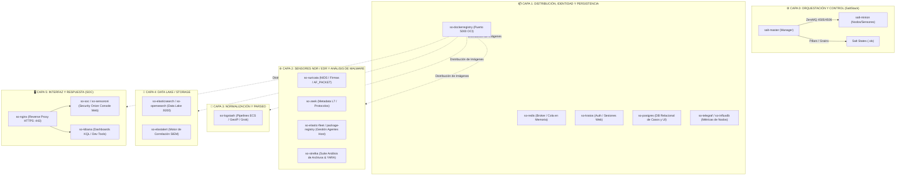

# 🧅 ÍNDICE MAESTRO: ARQUITECTURA, CONTENEDORES Y ORQUESTACIÓN SO3 & SALTSTACK

> **Guía Técnica de Referencia y Desglose Arquitectural de Security Onion (SO2 / SO3)**
> **Autor / Mantenimiento:** Security Operations Center (SOC) — Kevin Moraes  
> **Repositorio Salt Local:** `G:\Hermes + Antigravity\salt`  
> **Objetivo:** Desentrañar de cero todos los contenedores Docker, flujos de datos, estados de SaltStack y la orquestación distribuida de SO3.  

---

## 🗺️ Mapa Arquitectural Completo de Security Onion 3 (SO3)



---

## ⚙️ 0. El Núcleo Orquestador: SaltStack
* [x] **`salt-master` / `salt-minion`**
  * **Proyecto Upstream:** `saltstack/salt`. Repositorio local de documentación: `G:\Hermes + Antigravity\salt\doc\`.
  * **Puertos:** `4505/TCP` (ZeroMQ PUB), `4506/TCP` (ZeroMQ ROUTER).
  * **Función:** Cerebro de orquestación, desired state (idempotencia), ejecución distribuida, Grains (hardware/red), Pillars (secretos) y Highstate.
  * **Ficha Técnica Maestra:** [`00_Nucleo_Orquestador_SaltStack.md`](./contenedores/00_Nucleo_Orquestador_SaltStack.md)

## 📚 Matriz 100% Cubierta: Tus 23 Contenedores Activos vs Documentación Local

A continuación tienes el mapeo exacto de los **23 contenedores que tienes corriendo en tu servidor SO3**, vinculados a sus fichas técnicas y sus repositorios de documentación oficial locales:

| # | Contenedor Activo en tu SO3 | Rol Técnico en la Arquitectura | Ficha Técnica Oficial Creada | Documentación Local Clonada |
| :-: | :--- | :--- | :---: | :--- |
| **1** | `so-dockerregistry` | Repositorio OCI local en Manager para despliegues Airgap. | [Ficha 01](./contenedores/01_Contenedor_so-dockerregistry.md) | `docs/` oficial OCI |
| **2** | `so-elastalert` | Motor de correlación periódica de reglas YAML SIEM. | [Ficha 02](./contenedores/02_Contenedor_so-elastalert.md) | `G:\Hermes + Antigravity\elastalert` |
| **3** | `so-elastic-fleet` | Orquestador y gestor de políticas para Elastic Agents. | [Ficha 13](./contenedores/13_Contenedor_so-elastic-fleet.md) | `G:\Hermes + Antigravity\elastic-docs-content` |
| **4** | `so-elastic-fleet-package-registry` | Repositorio local de integraciones de Fleet sin salir a internet. | [Ficha 13](./contenedores/13_Contenedor_so-elastic-fleet.md) | `G:\Hermes + Antigravity\elastic-docs-content` |
| **5** | `so-elasticsearch` | Data Lake distribuido central (índices `so-*`). | [Ficha 03](./contenedores/03_Contenedor_so-elasticsearch.md) | `G:\Hermes + Antigravity\elastic-docs-content` |
| **6** | `so-influxdb` | Base de datos de series temporales (TSDB) de métricas de red y drop rate. | [Ficha 04](./contenedores/04_Contenedor_so-influxdb-telegraf.md) | `G:\Hermes + Antigravity\influxdb-docs` |
| **7** | `so-kibana` | Plataforma de dashboards avanzados, queries KQL y Dev Tools. | [Ficha 05](./contenedores/05_Contenedor_so-kibana.md) | `G:\Hermes + Antigravity\elastic-docs-content` |
| **8** | `so-kratos` | Servidor de identidades, sesiones y login web (Ory Kratos). | [Ficha 06](./contenedores/06_Contenedor_so-kratos.md) | `G:\Hermes + Antigravity\ory-docs` |
| **9** | `so-logstash` | Fábrica de parseo de pipelines, normalización ECS y GeoIP. | [Ficha 07](./contenedores/07_Contenedor_so-logstash.md) | `G:\Hermes + Antigravity\logstash-docs` |
| **10** | `so-nginx` | Reverse Proxy endurecido y terminación TLS HTTPS (:443). | [Ficha 12](./contenedores/12_Contenedor_so-soc-nginx-sensoroni.md) | `securityonion-docs` |
| **11** | `so-postgres` | Base de datos relacional ACID para casos, notas y estado UI. | [Ficha 14](./contenedores/14_Contenedor_so-postgres.md) | PostgreSQL Core Docs |
| **12** | `so-redis` | Cola y buffer ultrarrápido en memoria RAM anti-desbordes. | [Ficha 10](./contenedores/10_Contenedor_so-redis.md) | `G:\Hermes + Antigravity\redis-doc` |
| **13** | `so-sensoroni` | Agente en Go para gestión de nodos y telemetría de Grid. | [Ficha 12](./contenedores/12_Contenedor_so-soc-nginx-sensoroni.md) | `G:\Hermes + Antigravity\sensoroni-docs` |
| **14** | `so-soc` | Consola Web oficial (Alerts, Hunt, PCAP, Cases, Grid). | [Ficha 12](./contenedores/12_Contenedor_so-soc-nginx-sensoroni.md) | `securityonion-docs` |
| **15** | `so-strelka-backend` | Worker ejecutor de escaneos estáticos YARA, OLE, PEfile. | [Ficha 11](./contenedores/11_Contenedor_so-strelka.md) | `G:\Hermes + Antigravity\strelka-docs` |
| **16** | `so-strelka-coordinator` | Orquestador de tareas de análisis de archivos en cola. | [Ficha 11](./contenedores/11_Contenedor_so-strelka.md) | `G:\Hermes + Antigravity\strelka-docs` |
| **17** | `so-strelka-filestream` | Shipper que vigila la carpeta de extracción de Zeek. | [Ficha 11](./contenedores/11_Contenedor_so-strelka.md) | `G:\Hermes + Antigravity\strelka-docs` |
| **18** | `so-strelka-frontend` | API gRPC de recepción de solicitudes de análisis. | [Ficha 11](./contenedores/11_Contenedor_so-strelka.md) | `G:\Hermes + Antigravity\strelka-docs` |
| **19** | `so-strelka-gatekeeper` | Filtro de entrada (descarta duplicados por hash previo). | [Ficha 11](./contenedores/11_Contenedor_so-strelka.md) | `G:\Hermes + Antigravity\strelka-docs` |
| **20** | `so-strelka-manager` | Gestor del ciclo de vida y métricas de la suite Strelka. | [Ficha 11](./contenedores/11_Contenedor_so-strelka.md) | `G:\Hermes + Antigravity\strelka-docs` |
| **21** | `so-suricata` | Motor NIDS multihilo AF_PACKET para firmas ETPro en el SPAN. | [Ficha 08](./contenedores/08_Contenedor_so-suricata.md) | `G:\Hermes + Antigravity\suricata-docs` |
| **22** | `so-telegraf` | Agente recolector de métricas de hardware y drop_rate. | [Ficha 04](./contenedores/04_Contenedor_so-influxdb-telegraf.md) | `G:\Hermes + Antigravity\influxdb-docs` |
| **23** | `so-zeek` | Analizador transaccional L7 de protocolos (conn, dns, tls). | [Ficha 09](./contenedores/09_Contenedor_so-zeek.md) | `G:\Hermes + Antigravity\zeek-docs` |

---

## ⚡ El Núcleo de Automatización: SaltStack en SO3

La estructura de configuración de SaltStack en un nodo SO3 se ubica en `/opt/so/saltstack/`:

```text
/opt/so/saltstack/
├── salt/                   # SALT STATES (.sls)
│   ├── common/             # Paquetes base, firewall ufw/iptables, usuarios
│   ├── docker/             # Instalación y demonio Docker
│   ├── docker-registry/    # Despliegue de so-dockerregistry
│   ├── suricata/           # Configuración, af-packet, reglas ETPro
│   ├── zeek/               # Scripts Zeek, local.zeek, bpf
│   ├── strelka/            # Configuración de los 6 microservicios Strelka
│   ├── elasticsearch/      # JVM heap, cluster settings, shards
│   ├── fleet/              # Configuración de Fleet y Package Registry
│   ├── logstash/           # Pipelines y filtros de parseo ECS
│   ├── kratos/             # Autenticación y esquema de usuarios
│   ├── postgres/           # Base de datos relacional interna
│   └── soc/                # Aplicación Web SOC y Nginx
│
├── pillar/                 # PILLAR DATA (Variables y Secretos)
│   ├── top.sls             # Mapeo de minions a configuraciones
│   ├── global.sls          # Parámetros compartidos (IPs, dominios, puertos)
│   ├── secrets.sls         # Claves de cifrado, contraseñas de bases de datos
│   └── minion_roles/       # Roles: manager, searchnode, sensor, standalone
```

### Comandos de Poder de Salt en SO3:
* **Aplicar todos los estados en un nodo:**
  ```bash
  sudo salt-call state.apply
  ```
* **Aplicar solo un contenedor/módulo específico:**
  ```bash
  sudo salt-call state.apply suricata
  sudo salt-call state.apply zeek
  sudo salt-call state.apply strelka
  sudo salt-call state.apply logstash
  ```
* **Ver variables Grains del nodo (Hardware/Interfaces):**
  ```bash
  sudo salt-call grains.items
  ```
* **Ver variables Pillar asignadas al nodo:**
  ```bash
  sudo salt-call pillar.items
  ```
