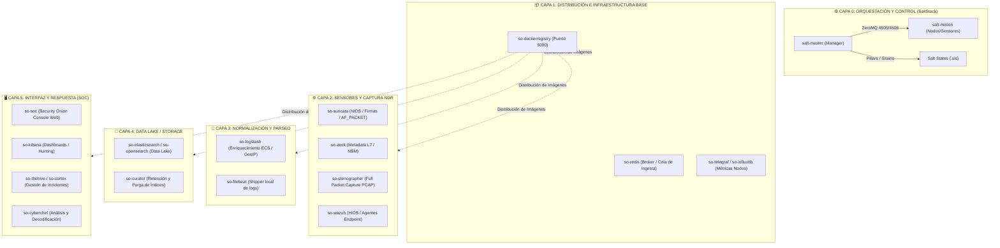

# 🧅 ÍNDICE MAESTRO: ARQUITECTURA, CONTENEDORES Y ORQUESTACIÓN SO3 & SALTSTACK

> **Guía Técnica de Referencia y Desglose Arquitectural de Security Onion (SO2 / SO3)**
> **Autor / Mantenimiento:** Security Operations Center (SOC) — Kevin Moraes
> **Repositorio Salt Local:** `G:\Hermes + Antigravity\salt`
> **Objetivo:** Desentrañar de cero todos los contenedores Docker, flujos de datos, estados de SaltStack y la orquestación distribuida de SO3.

---

## 🗺️ Mapa Arquitectural de Security Onion 3 (SO3)



---

## 📚 Catálogo Detallado de Contenedores SO3

A continuación se indexan todos los contenedores oficiales de SO3, su función, imagen upstream y relación operativa con SaltStack:

### 1. Infraestructura y Repositorios
* [x] **`so-kratos`**
  * **Imagen Upstream:** `ory/kratos`. Documentación local: `ory-docs/docs/kratos/`.
  * **Puertos:** `4433/TCP` (Public), `4434/TCP` (Admin).
  * **Función:** Servidor de autenticación, gestión de identidades de analistas SOC, sesiones web y flujo de login de `so-soc`.
  * **Ficha Técnica:** [`06_Contenedor_so-kratos.md`](./contenedores/06_Contenedor_so-kratos.md)

* [x] **`so-dockerregistry`**
  * **Imagen Upstream:** `registry:2` / `distribution/distribution` (OCI Distribution v2).
  * **Puerto:** `5000/TCP`.
  * **Función:** Registro privado local en el Manager para despliegues Airgap y distribución LAN de imágenes hacia los sensores minion.
  * **Ficha Técnica:** [`01_Contenedor_so-dockerregistry.md`](./contenedores/01_Contenedor_so-dockerregistry.md)

* [x] **`so-influxdb` / `so-telegraf`**
  * **Imagen Upstream:** `influxdb` / `telegraf`. Repositorio local de documentación: `influxdb-docs`.
  * **Puerto:** `8086/TCP`.
  * **Función:** Base de datos de series temporales (TSDB) y agente recolector de métricas de hardware, contenedores Docker y tasa de pérdida de paquetes (`drop_rate`) de Suricata/Zeek.
  * **Ficha Técnica:** [`04_Contenedor_so-influxdb-telegraf.md`](./contenedores/04_Contenedor_so-influxdb-telegraf.md)

* [ ] **`so-redis`**
  * **Imagen Upstream:** `redis:alpine`.
  * **Puerto:** `6379/TCP`.
  * **Función:** Buffer de memoria intermedia (Message Broker) que absorbe ráfagas de logs de Zeek y Suricata antes de Logstash.

* [ ] **`so-nginx` / `so-reverseproxy`**
  * **Imagen Upstream:** `nginx:alpine`.
  * **Puertos:** `80/TCP`, `443/TCP`.
  * **Función:** Punto de entrada único HTTPS, terminación SSL, autenticación y enrutamiento hacia la consola SO y herramientas internas.

---

### 2. Detección, Inspección y Sensores (NDR / EDR)
* [ ] **`so-suricata`**
  * **Imagen Upstream:** `suricata`.
  * **Función:** Motor NIDS multihilo (AF_PACKET) para detección de firmas ETPro/Emerging Threats, decodificación de protocolos y alertas en tiempo real.
  * **Salt State:** Sincronizado mediante `so-rule-update` (`rules.sls`).

* [ ] **`so-zeek`**
  * **Imagen Upstream:** `zeek/zeek`.
  * **Función:** Análisis de comportamiento y extracción de metadata transaccional de Capa 7 (`conn.log`, `dns.log`, `http.log`, `ssl.log`).

* [ ] **`so-stenographer`**
  * **Imagen Upstream:** `google/stenographer`.
  * **Función:** Captura continua de paquetes completos (Full PCAP) a disco con indexación ultra rápida de microsegundos para extracciones forenses.

* [ ] **`so-wazuh`**
  * **Imagen Upstream:** `wazuh/wazuh-manager`.
  * **Puertos:** `1514/UDP`, `1515/TCP`, `55000/TCP`.
  * **Función:** Servidor HIDS/EDR para auditoría de integridad de archivos (FIM), eventos de seguridad de endpoints Windows y Linux.

---

### 3. Pipeline de Datos y Normalización
* [x] **`so-logstash`**
  * **Imagen Upstream:** `elastic/logstash`. Documentación local: `logstash-docs/`.
  * **Puerto:** `9600/TCP` (Monitoreo de Pipelines), `5044/TCP` (Beats).
  * **Función:** Fábrica de parseo (Grok/KV), enriquecimiento en vuelo (GeoIP/ASN) y normalización ECS de toda la telemetría antes de indexarla en Elasticsearch.
  * **Ficha Técnica:** [`07_Contenedor_so-logstash.md`](./contenedores/07_Contenedor_so-logstash.md)

* [ ] **`so-filebeat`**
  * **Imagen Upstream:** `filebeat:8.x`.
  * **Función:** Recolección de logs locales de contenedores y del sistema operativo hacia Redis/Logstash.

---

### 4. Motor de Búsqueda y Almacenamiento
* [x] **`so-elasticsearch` / `so-opensearch`**
  * **Imagen Upstream:** `elasticsearch` / `opensearch`. Repositorio local de documentación: `elastic-docs-content`.
  * **Función:** Data Lake distribuido central donde residen todos los registros Interflow/ECS (`so-*`).
  * **Ficha Técnica:** [`03_Contenedor_so-elasticsearch.md`](./contenedores/03_Contenedor_so-elasticsearch.md)
  * **Imagen Upstream:** `elasticsearch` / `opensearchproject/opensearch`.
  * **Puertos:** `9200/TCP` (REST API), `9300/TCP` (Transporte Clúster).
  * **Función:** Data Lake distribuido donde residen todos los registros Interflow/ECS.

* [ ] **`so-curator`**
  * **Imagen Upstream:** `elasticsearch-curator`.
  * **Función:** Tareas cron programadas para mantenimiento, rotación, compactación y purga de índices por tiempo o porcentaje de disco.

---

### 6. Motor Analítico y Correlación SIEM
* [x] **`so-elastalert`**
  * **Imagen Upstream:** `Yelp/ElastAlert` / `elastalert2`.
  * **Función:** Motor de correlación y detección en tiempo real sobre Elasticsearch/OpenSearch; evalúa reglas YAML periódicas y escribe en `so-alerts`.
  * **Ficha Técnica:** [`02_Contenedor_so-elastalert.md`](./contenedores/02_Contenedor_so-elastalert.md)

### 5. Interfaz de Usuario y Respuesta a Incidentes
* [ ] **`so-soc` (Security Onion Console)**
  * **Tecnología:** Node.js / React.
  * **Función:** Consola central nativa de SO3 para Alerts, Hunting, PCAP extraction y Grid Management.

* [x] **`so-kibana`**
  * **Imagen Upstream:** `elastic/kibana`. Documentación local: `elastic-docs-content/explore-analyze/`.
  * **Puerto:** `5601/TCP` (Proxy inverso `/kibana`).
  * **Función:** Plataforma de visualización, creación de dashboards KQL, consultas Dev Tools y exploración forense avanzada.
  * **Ficha Técnica:** [`05_Contenedor_so-kibana.md`](./contenedores/05_Contenedor_so-kibana.md)

* [ ] **`so-cyberchef`**
  * **Función:** Navaja suiza de análisis criptográfico y decodificación de payloads integrada a la interfaz con 1-clic.

---

## ⚡ El Núcleo de Automatización: SaltStack en SO3

La estructura de configuración de SaltStack en un nodo SO3 se ubica en `/opt/so/saltstack/`:

```text
/opt/so/saltstack/
├── salt/                   # SALT STATES (.sls)
│   ├── common/             # Paquetes base, firewall ufw/iptables, usuarios
│   ├── docker/             # Instalación y demonio Docker
│   ├── docker-registry/    # Despliegue de so-dockerregistry
│   ├── suricata/           # Configuración, af-packet, reglas
│   ├── zeek/               # Scripts Zeek, local.zeek, bpf
│   ├── elasticsearch/      # JVM heap, cluster settings, shards
│   ├── logstash/           # Pipelines y filtros de parseo
│   └── soc/                # Aplicación Web SOC
│
├── pillar/                 # PILLAR DATA (Variables y Secretos)
│   ├── top.sls             # Mapeo de minions a configuraciones
│   ├── global.sls          # Parámetros compartidos (IPs, dominios, puertos)
│   ├── secrets.sls         # Claves de cifrado, contraseñas de bases de datos
│   └── minion_roles/       # Roles: manager, searchnode, sensor, standalone
```

### Comandos de Poder de Salt en SO3:
* **Aplicar todos los estados en un nodo:**
  ```bash
  sudo salt-call state.apply
  ```
* **Aplicar solo un contenedor/módulo (ej. Suricata o Registro):**
  ```bash
  sudo salt-call state.apply suricata
  sudo salt-call state.apply docker-registry
  ```
* **Ver variables Grains del nodo (Hardware/Interfaces):**
  ```bash
  sudo salt-call grains.items
  ```
* **Ver variables Pillar asignadas al nodo:**
  ```bash
  sudo salt-call pillar.items
  ```

---

## 🔗 Referencias Cruzadas del Repositorio SOC
* 📘 [Guía de Traducción de Filtros Stellar a SO3](./01_Guia_Traduccion_Filtros_Stellar_a_Security_Onion_SO3.md)
* 🛠️ [Cheatsheet de Comandos Operativos SO3](./02_Cheatsheet_Comandos_Operativos_SO3.md)
* 📖 [Caso de Estudio: Rescate de Infraestructura SO3](./03_Caso_Estudio_Rescate_Infraestructura_Security_Onion_SO3.md)
* ⚙️ [Código Fuente Local de SaltStack](file:///G:/Hermes%20+%20Antigravity/salt)
