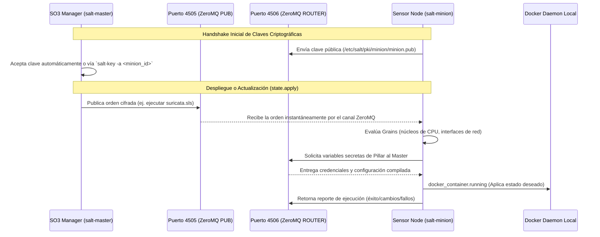

# ⚙️ FICHA MAESTRA: ORQUESTACIÓN Y CONTROL CON SALTSTACK EN SO3

> **Componente:** Orquestador Central, Motor de Estado Deseado (Idempotencia) y Bus de Eventos ZeroMQ  
> **Servicios en el SO3 Grid:** `salt-master` (Manager), `salt-minion` (Nodos/Sensores)  
> **Repositorio Local Upstream:** `G:\Hermes + Antigravity\salt` (Directorio de Documentación Oficial: `G:\Hermes + Antigravity\salt\doc\`)  
> **Puertos de Red de Comunicación:** `4505/TCP` (Salt Publisher - ZeroMQ PUB), `4506/TCP` (Salt Request/Reply - ZeroMQ ROUTER)  
> **Ubicación en SO3:** `/opt/so/saltstack/` (`salt/`, `pillar/`, `local/`) y `/etc/salt/`  

---

## 1. ¿Por qué SaltStack es el "Cerebro" de Security Onion 3?

En Security Onion, **nada se configura a mano**. Cuando ejecutas un comando como `so-setup`, `soup` (actualización de versión) o `so-rule-update`, por debajo **no hay scripts bash caóticos**: hay llamadas al motor de **SaltStack**.

SaltStack garantiza:
1. **Idempotencia (Desired State):** Si un contenedor se apaga, un archivo `.yaml` se corrompe o una interfaz de red pierde el modo promiscuo, SaltStack lo repara automáticamente para devolverlo al estado deseado definido en los archivos `.sls`.
2. **Escalabilidad Distribuida en Tiempo Real:** Un solo Manager puede gobernar 50 sensores distribuidos por todo el país enviando órdenes en milisegundos gracias al bus de mensajería **ZeroMQ**.
3. **Seguridad y Cifrado Asimétrico:** Toda la comunicación entre Manager y Minions está cifrada con claves públicas/privadas AES-CBC / RSA (`salt-key`).

---

## 2. Flujo de Arquitectura Master-Minion en Security Onion



---

## 3. Los 4 Pilares Conceptuales de Salt en SO3

Para dominar SO3 como un experto, debes entender cómo divide la información:

```text
┌────────────────────────────────────────────────────────────────────────┐
│                        SALTSTACK EN SECURITY ONION                     │
├───────────────────┬───────────────────┬────────────────────────────────┤
│      GRAINS       │      PILLARS      │         STATES (.sls)          │
│ (Propiedades Host)│(Configuraciones)  │       (El "Qué Hacer")         │
├───────────────────┼───────────────────┼────────────────────────────────┤
│ • Núcleos de CPU  │ • Secretos / Keys │ • Iniciar contenedores Docker  │
│ • RAM Total       │ • IP del Manager  │ • Compilar reglas Suricata     │
│ • Interfaces SPAN │ • Retención Días  │ • Configurar sysctl de kernel  │
│ • Rol (sensor/mgr)│ • Perfiles Docker │ • Generar zeek/local.zeek      │
└───────────────────┴───────────────────┴────────────────────────────────┘
```

### A. Grains (Los "Genes" del Servidor):
* Son variables generadas **localmente por el Minion** inspeccionando el hardware y el sistema operativo.
* En SO3, Salt usa Grains para:
  * Detectar cuántos cores tiene el servidor (`grains['num_cpus']`) para calcular cuántos hilos darle a Suricata.
  * Identificar las interfaces de red de monitoreo (`grains['so_mon_interfaces']`).

### B. Pillars (Los "Secretos y Configuraciones Globales"):
* Son datos definidos **exclusivamente en el Manager** y entregados de forma segura a Minions específicos.
* En SO3 se ubican en `/opt/so/saltstack/pillar/`:
  * `global.sls`: IP del Manager, dominios, puertos autorizados.
  * `secrets.sls`: Claves de cifrado, contraseñas de bases de datos PostgreSQL y tokens de InfluxDB.

### C. States (`.sls` - El Motor de Ejecución):
* Son archivos YAML con lógica de plantillas Jinja2 ubicados en `/opt/so/saltstack/salt/`.
* Le dicen a Salt cómo debe lucir el sistema:
  * Si un contenedor debe estar corriendo (`docker_container.running`).
  * Si un archivo debe existir con permisos estrictos (`file.managed`).
  * Si un parámetro de kernel debe estar activo (`sysctl.present`).

### D. Highstate:
* Es la consolidación de **todos los estados asignados a un nodo**. Cuando ejecutas `salt-call state.highstate`, Salt evalúa los 23 contenedores, los archivos de configuración, las reglas de firewall y los servicios para que todo coincida con la plantilla oficial.

---

## 4. Directorios Clave de SaltStack en Security Onion 3

```text
/opt/so/saltstack/
├── salt/                       # SALT STATES (Fórmulas oficiales de SO3)
│   ├── top.sls                 # Asigna qué estados corresponden a cada rol
│   ├── common/                 # Paquetes base, UFW/iptables, SSH
│   ├── docker/                 # Daemon Docker, daemon.json, insecure registries
│   ├── docker-registry/        # Despliegue de so-dockerregistry
│   ├── suricata/               # suricata.yaml, hilos, sockets AF_PACKET
│   ├── zeek/                   # node.cfg, local.zeek, bpf.conf
│   ├── strelka/                # Orquestación de los 6 microservicios Strelka
│   ├── elasticsearch/          # JVM Heap, cluster settings, límites kernel
│   ├── logstash/               # Pipelines de parseo Grok, ECS y GeoIP
│   ├── kratos/                 # Identidades, esquemas de usuarios, DB SQLite
│   ├── fleet/                  # Fleet Server y Package Registry
│   └── soc/                    # Consola web so-soc y Nginx
│
├── pillar/                     # PILLAR (Variables globales y asignación por rol)
│   ├── top.sls                 # Mapeo de Minions con sus archivos de variables
│   ├── global.sls              # Variables compartidas de todo el clúster
│   └── roles/                  # Variables específicas: manager.sls, sensor.sls
│
└── local/                      # OVERRIDES LOCALES (Personalización del SOC)
    └── salt/                   # Si creas un state aquí, sobreescribe el oficial
```

---

## 5. Arsenal de Comandos Operativos de Salt en SO3

Como analista o administrador del SOC, estos son los comandos fundamentales para operar y rescatar el clúster:

### A. Gestión de Claves y Nodos (`salt-key` en el Manager):
```bash
# Ver todos los nodos minions conectados, pendientes y rechazados:
sudo salt-key -L

# Aceptar un nuevo nodo sensor en el clúster:
sudo salt-key -a <nombre_del_nodo>

# Aceptar todos los nodos pendientes:
sudo salt-key -A -y
```

### B. Probar Conectividad con los Nodos del Clúster:
```bash
# Ping a todos los sensores minion (responde 'True' si el bus ZeroMQ está vivo):
sudo salt '*' test.ping

# Ping a un nodo sensor específico:
sudo salt 'sensor-forward-01' test.ping
```

### C. Inspeccionar Grains y Pillars de un Nodo:
```bash
# Ver todas las propiedades de hardware/red del nodo local:
sudo salt-call grains.items

# Ver un dato específico de un nodo remoto (ej. versión de kernel o IP):
sudo salt 'sensor-01' grains.item fqdn ip4_interfaces

# Ver las variables Pillar compiladas asignadas al nodo:
sudo salt-call pillar.items
```

### D. Aplicar Estados y Reparar Contenedores:
```bash
# Sincronizar y reparar el nodo completo (Highstate):
sudo salt-call state.highstate

# Aplicar o reparar un solo contenedor/servicio específico:
sudo salt-call state.apply suricata
sudo salt-call state.apply zeek
sudo salt-call state.apply logstash
sudo salt-call state.apply elastalert
sudo salt-call state.apply kratos

# Simular qué cambios haría Salt sin aplicarlos (Dry-Run / Test Mode):
sudo salt-call state.apply suricata test=True
```

### E. Ejecutar Comandos Remotos en Masa a través del Bus:
```bash
# Ver el espacio en disco de todos los nodos del clúster en un solo comando:
sudo salt '*' cmd.run 'df -h /nsm'

# Ver si el contenedor Suricata está corriendo en todos los sensores:
sudo salt '*' cmd.run 'docker ps | grep suricata'
```

---

## 6. Puntos de Falla Comunes y Troubleshooting de Salt en SO3

1. **Minion no responde (`Minion did not return. [No response]`):**
   * **Causa:** El puerto `4505` o `4506` está bloqueado en el firewall intermedio entre el Sensor y el Manager, o el servicio `salt-minion` está detenido.
   * **Diagnóstico en el Minion:**
     ```bash
     sudo systemctl status salt-minion
     sudo nc -zv <IP_MANAGER> 4505
     sudo nc -zv <IP_MANAGER> 4506
     ```
2. **Error de Renderizado Jinja (`Jinja variable not found`):**
   * **Causa:** Se editó un archivo `.sls` y se hizo referencia a una variable de Pillar que no existe en `/opt/so/saltstack/pillar/`.
   * **Diagnóstico:**
     ```bash
     sudo salt-call state.show_sls <nombre_del_estado>
     ```
3. **Claves Desincronizadas tras Reinstalación:**
   * Si reinstalas un sensor con el mismo hostname, el Manager rechazará la conexión porque la clave RSA cambió.
   * **Solución:** Borrar la clave vieja en el Manager (`sudo salt-key -d <nombre_nodo>`) y volver a aceptarla (`sudo salt-key -a <nombre_nodo>`).
