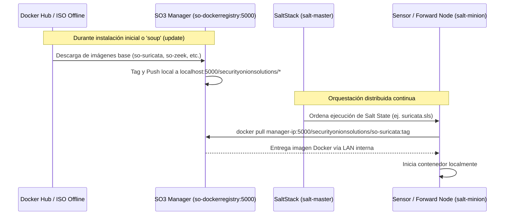

# 📦 FICHA TÉCNICA: CONTENEDOR `so-dockerregistry`

> **Componente:** Docker Registry Local (Airgap Distribution)  
> **Servicio SO3:** `so-dockerregistry`  
> **Ubicación en SO:** `/opt/so/saltstack/salt/docker-registry/`  
> **Directorio de Almacenamiento:** `/nsm/docker/registry/`  

---

## 1. Identificación y Origen Upstream

* **Imagen Base Upstream:** [`registry:2`](https://hub.docker.com/_/registry) / `distribution/distribution` (CNCF OCI Distribution Specification).
* **Puerto de Escucha:** `5000/TCP` (Expuesto localmente y en la red de gestión del Grid de SO3).
* **Protocolo:** Docker Registry HTTP API v2.
* **Propósito en SO3:** Servir como repositorio privado e inmutable de imágenes Docker dentro del Manager para que ningún nodo Sensor o Search Node dependa de conexión a Internet (Docker Hub) durante despliegues, arranques o actualizaciones.

---

## 2. Flujo de Arquitectura en Security Onion



---

## 3. Orquestación con SaltStack (`.sls`)

En Security Onion, la configuración de este contenedor se gestiona mediante el módulo `docker_container` de SaltStack.

### Definición típica del State (`/opt/so/saltstack/salt/docker-registry/init.sls`):
```yaml



so-dockerregistry:
  docker_container.running:
    - image: registry:2
    - restart_policy: always
    - port_bindings:
      - {{ registry_port }}:5000
    - binds:
      - {{ registry_storage }}:/var/lib/registry
    - environment:
      - REGISTRY_STORAGE_DELETE_ENABLED: "true"
      - REGISTRY_HTTP_ADDR: "0.0.0.0:5000"
    - require:
      - file: registry_storage_dir

registry_storage_dir:
  file.directory:
    - name: {{ registry_storage }}
    - user: root
    - group: root
    - mode: 755
    - makedirs: True
```

---

## 4. Diagnóstico y Comandos de Administración

### A. Verificar estado del contenedor en el Manager:
```bash
# Estado en Docker
sudo docker ps --filter "name=so-dockerregistry"

# Chequeo nativo SO
sudo so-dockerregistry-status
```

### B. Consultar el catálogo de imágenes disponibles vía API REST:
Como el registro implementa la API v2 de OCI, puedes consultar directamente con `curl`:
```bash
# Listar todos los repositorios/imágenes cacheadas en el Manager
curl -k -s -X GET https://localhost:5000/v2/_catalog | jq .

# Ver los tags disponibles para una imagen en particular (ej. so-suricata)
curl -k -s -X GET https://localhost:5000/v2/securityonionsolutions/so-suricata/tags/list | jq .
```

### C. Reiniciar o reaplicar estado vía SaltStack:
Si el registro falla o se corrompen sus volúmenes:
```bash
# Re-ejecutar el estado de Salt específico para el registro
sudo salt-call state.apply docker-registry

# Reiniciar manualmente el contenedor si fuera necesario
sudo docker restart so-dockerregistry
```

---

## 5. Puntos de Falla Comunes y Resolución (Troubleshooting)

1. **Disco Lleno en `/nsm`:**
   * **Síntoma:** Los sensores fallan al hacer `docker pull` y devuelven error `no space left on device`.
   * **Causa:** Acumulación histórica de capas de imágenes Docker viejas tras múltiples updates (`soup`).
   * **Solución:** Ejecutar el recolector de basura del registro de Docker:
     ```bash
     sudo docker exec -it so-dockerregistry bin/registry garbage-collect /etc/docker/registry/config.yml
     ```

2. **Certificados TLS o Firewall en Minions:**
   * **Síntoma:** Un sensor minion nuevo no puede descargar imágenes y arroja `http: server gave HTTP response to HTTPS client`.
   * **Causa:** Docker en el minion requiere que la IP/puerto del Manager esté definida como `insecure-registries` en `/etc/docker/daemon.json` o que tenga el certificado CA de SO importado. SaltStack normalmente automatiza esto mediante el estado `docker.sls`.
