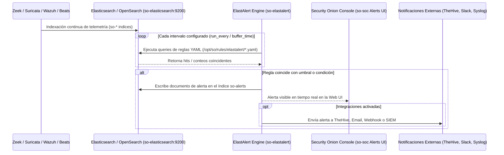

# 🚨 FICHA TÉCNICA: CONTENEDOR `so-elastalert` / `elastalert2`

> **Componente:** Motor de Correlación y Alertas en Tiempo Real sobre Elasticsearch / OpenSearch  
> **Servicio SO3:** `so-elastalert`  
> **Repositorio Local Upstream:** `G:\Hermes + Antigravity\elastalert`  
> **Ubicación en SO3:** `/opt/so/conf/elastalert/` y `/opt/so/saltstack/salt/elastalert/`  
> **Directorio de Reglas en SO3:** `/opt/so/rules/elastalert/` o `/etc/elastalert/rules/`  

---

## 1. Identificación y Propósito en Security Onion

* **Proyecto Base Upstream:** [Yelp/ElastAlert](https://github.com/YelpArchive/elastalert) *(y su fork mantenido ElastAlert 2)*.
* **Propósito en SO3:** 
  * Es el **cerebro de correlación y SIEM analítico** de Security Onion.
  * Mientras que Suricata detecta amenazas a nivel de paquete en vivo (NIDS), **ElastAlert consulta continuamente el Data Lake (Elasticsearch / OpenSearch)** para detectar patrones complejos, anomalías de comportamiento, frecuencias anormales, coincidencias con fuentes de Inteligencia de Amenazas (CTI) y reglas MITRE ATT&CK.
  * Cuando se cumple una regla de ElastAlert, genera un documento de alerta en el índice `so-alerts` (que se visualiza en la pestaña **Alerts** de la consola web `so-soc`).

---

## 2. Flujo de Datos y Arquitectura en SO3



---

## 3. Tipos de Reglas ElastAlert Utilizadas en SO3

ElastAlert evalúa las reglas definidas en formato YAML. En SO3, las más comunes son:

| Tipo de Regla (`type`) | Funcionamiento | Ejemplo en SO3 |
| :--- | :--- | :--- |
| **`any`** | Dispara una alerta por cada documento que coincida con el filtro. | Detección de coincidencia directa con IOC (IP o Dominio malicioso en CTI). |
| **`frequency`** | Dispara cuando se registran más de $N$ eventos en un intervalo de tiempo. | Ataque de fuerza bruta SSH/RDP (ej. más de 10 fallos de login en 1 minuto). |
| **`spike`** | Dispara cuando el volumen de eventos aumenta o disminuye bruscamente respecto a la ventana anterior. | Picos anómalos de tráfico saliente o peticiones DNS masivas (Beaconing / Exfiltración). |
| **`flatline`** | Dispara cuando los eventos caen a cero o por debajo de un umbral. | Caída de un sensor, pérdida de ingesta de un agente Wazuh o apagón de firewall. |
| **`blacklist` / `whitelist`** | Compara un campo específico contra una lista de valores bloqueados/permitidos. | Uso de puertos no estándar o ejecución de binarios sospechosos (LOLBINs). |
| **`cardinality`** | Cuenta valores únicos de un campo (ej. cantidad de IPs destino únicas). | Escaneo de puertos o barrido de red (un host conectándose a 50 IPs distintas en 30s). |

---

## 4. Estructura de una Regla Típica en SO3

Ejemplo de regla YAML para detección de **Fuerza Bruta SSH** (`/opt/so/rules/elastalert/ssh_brute_force.yaml`):

```yaml
name: "SOC-ALERTA: Posible Fuerza Bruta SSH Detectada"
type: frequency
index: "so-zeek-*"
num_events: 10
timeframe:
  minutes: 2

filter:
  - query:
      query_string:
        query: "event.dataset:zeek.ssh AND zeek.ssh.auth_success:false"

alert:
  - "debug"

alert_text: |
  🚨 ALERTA DE FUERZA BRUTA SSH
  Origen: {0}
  Destino: {1}
  Eventos Fallidos: {2} en 2 minutos.
alert_text_args:
  - source.ip
  - destination.ip
  - num_events
```

---

## 5. Orquestación con SaltStack (`.sls`)

En el Manager de SO3, SaltStack mantiene la configuración del servicio y la distribución de reglas:

### Ubicación del State: `/opt/so/saltstack/salt/elastalert/init.sls`
```yaml
so-elastalert:
  docker_container.running:
    - image: {{ salt['pillar.get']('docker:registry', 'localhost:5000') }}/securityonionsolutions/so-elastalert:latest
    - restart_policy: always
    - network_mode: host
    - binds:
      - /opt/so/conf/elastalert/config.yaml:/opt/elastalert/config.yaml:ro
      - /opt/so/rules/elastalert:/opt/elastalert/rules:ro
      - /opt/so/log/elastalert:/opt/elastalert/logs:rw
    - environment:
      - ES_HOST: "127.0.0.1"
      - ES_PORT: "9200"
```

---

## 6. Comandos Operativos y Diagnóstico

### A. Verificar estado del contenedor:
```bash
# Estado en Docker
sudo docker ps --filter "name=so-elastalert"

# Estado nativo en SO3
sudo so-elastalert-status
```

### B. Probar una regla manualmente (Dry-Run / Test):
Antes de desplegar una regla a producción, puedes probar si tiene errores de sintaxis o cuántas alertas generaría en el historial reciente:
```bash
# Ejecutar elastalert-test-rule dentro del contenedor
sudo docker exec -it so-elastalert elastalert-test-rule /opt/elastalert/rules/mi_regla.yaml --days 1
```

### C. Inspeccionar los logs del motor de alertas:
```bash
# Ver si ElastAlert tiene errores de conexión a Elasticsearch o sintaxis YAML
sudo docker logs --tail 100 -f so-elastalert
```

### D. Reiniciar y recargar reglas:
```bash
# Si agregaste o editaste reglas YAML en /opt/so/rules/elastalert/
sudo so-elastalert-restart
```

---

## 7. Puntos Clave de Mantenimiento para el Analista SOC

1. **Reglas Ruidosas (Alerta Fatiga):**
   * Si una regla está mal afinada, generará miles de documentos en `so-alerts`, saturando la cola de Elastic y la vista de la consola web.
   * **Mitigación:** Usar el parámetro `realert` en la regla:
     ```yaml
     realert:
       minutes: 30  # No volver a alertar para el mismo atacante en 30 minutos
     ```
2. **Índice de Estado (`elastalert_status`):**
   * ElastAlert guarda sus metadatos y timestamps en el índice `elastalert_status` en Elasticsearch para no perder la pista temporal si el contenedor se reinicia.
