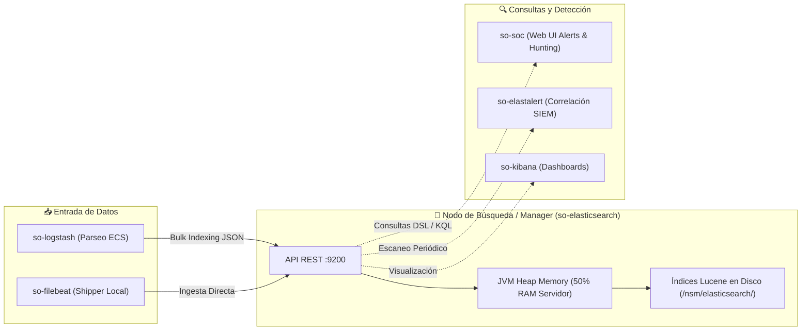

# 🔍 FICHA TÉCNICA: MOTOR DE DATOS E INDEXACIÓN `so-elasticsearch` / `so-opensearch`

> **Componente:** Data Lake, Motor de Búsqueda Distribuido y Almacenamiento Centralizado  
> **Servicio SO3:** `so-elasticsearch` (en stacks basados en Elastic) o `so-opensearch`  
> **Repositorio Local Upstream de Documentación:** `G:\Hermes + Antigravity\elastic-docs-content`  
> **Puertos de Red:** `9200/TCP` (API REST / HTTP), `9300/TCP` (Transporte Interno / Gossip entre Nodos)  
> **Ubicación en SO3:** `/opt/so/conf/elasticsearch/` y `/opt/so/saltstack/salt/elasticsearch/`  
> **Directorio de Datos en Disco:** `/nsm/elasticsearch/`  

---

## 1. Identificación y Propósito en Security Onion

* **Proyectos Base Upstream:** 
  * [Elasticsearch](https://github.com/elastic/elasticsearch) *(Documentación oficial clonada en local: `elastic-docs-content`)*.
  * [OpenSearch](https://github.com/opensearch-project/OpenSearch) *(Fork open source utilizado en variantes de SO3)*.
* **Propósito en SO3:**
  * Es el **Data Lake centralizado y distribuido** donde se almacenan, indexan y buscan todos los eventos del SOC.
  * Recibe los logs procesados y enriquecidos por `so-logstash` (tráfico Zeek, alertas Suricata, eventos HIDS Wazuh, syslogs de firewalls FortiGate/Cisco, logs de autenticación de Windows).
  * Es la base de datos consultada por la interfaz de usuario **Security Onion Console (`so-soc`)**, **Kibana** y el motor de correlación **ElastAlert**.

---

## 2. Flujo de Arquitectura e Ingesta en SO3



---

## 3. Esquema de Nombres de Índices en SO3

Security Onion organiza sus índices utilizando una convención temporal y de fuente de datos:

| Patrón de Índice | Tipo de Información Almacenada |
| :--- | :--- |
| **`so-suricata-*`** | Alertas de firmas NIDS, anomalías de red detectadas por Suricata. |
| **`so-zeek-*`** | Metadata de protocolos L7 (`conn`, `dns`, `http`, `ssl`, `x509`, `ssh`). |
| **`so-wazuh-*`** | Logs de endpoints (integridad de archivos FIM, eventos de autenticación, alertas OSSEC). |
| **`so-firewall-*`** | Syslogs de cortafuegos perimetrales (FortiGate, Palo Alto, Cisco). |
| **`so-alerts`** | Documentos generados por el motor de detección y correlación `so-elastalert`. |
| **`so-beats-*`** | Métricas y logs operativos recolectados por Metricbeat y Filebeat. |

---

## 4. Orquestación con SaltStack (`.sls`)

En SO3, SaltStack ajusta automáticamente el tamaño de la memoria Java (Heap Size), los límites del kernel de Linux (`vm.max_map_count`) y la configuración del clúster.

### Definición del State: `/opt/so/saltstack/salt/elasticsearch/init.sls`
```yaml



so-elasticsearch:
  docker_container.running:
    - image: {{ salt['pillar.get']('docker:registry', 'localhost:5000') }}/securityonionsolutions/so-elasticsearch:latest
    - restart_policy: always
    - network_mode: host
    - environment:
      - "ES_JAVA_OPTS=-Xms{{ es_mem }} -Xmx{{ es_mem }}"
      - "discovery.type=single-node"
      - "bootstrap.memory_lock=true"
    - ulimits:
      - memlock:
          soft: -1
          hard: -1
      - nofile:
          soft: 65536
          hard: 65536
    - binds:
      - {{ es_storage }}:/usr/share/elasticsearch/data:rw
      - /opt/so/conf/elasticsearch/elasticsearch.yml:/usr/share/elasticsearch/config/elasticsearch.yml:ro

vm_max_map_count:
  sysctl.present:
    - name: vm.max_map_count
    - value: 262144
```

---

## 5. Comandos Operativos y Consultas Directas (Cheat Sheet)

### A. Diagnóstico de Salud del Clúster (Cluster Health):
```bash
# Consultar estado general (Green, Yellow, Red)
curl -s -X GET "http://localhost:9200/_cluster/health?pretty"

# Ver uso de memoria y nodos activos
curl -s -X GET "http://localhost:9200/_nodes/stats/jvm?pretty"
```

### B. Listar índices y consumo de espacio en disco:
```bash
# Ver todos los índices ordenados por tamaño
curl -s -X GET "http://localhost:9200/_cat/indices?v&s=pri.store.size:desc"

# Ver estado de los shards (fragmentos)
curl -s -X GET "http://localhost:9200/_cat/shards?v"
```

### C. Consulta forense rápida (Buscar IP específica vía Lucene Query):
```bash
curl -s -X POST "http://localhost:9200/so-*/_search?pretty" -H 'Content-Type: application/json' -d'
{
  "size": 5,
  "query": {
    "query_string": {
      "query": "source.ip: 192.168.169.143 OR destination.ip: 192.168.169.143"
    }
  }
}'
```

### D. Reinicio de Servicio en SO3:
```bash
# Ver estado del contenedor
sudo so-elasticsearch-status

# Reiniciar servicio
sudo so-elasticsearch-restart
```

---

## 6. Puntos Críticos y Resolución de Problemas (Troubleshooting)

1. **Estado `RED` del Clúster:**
   * **Causa:** Uno o más primary shards no están asignados o están corruptos tras un apagón inesperado.
   * **Diagnóstico:** 
     ```bash
     curl -s -X GET "http://localhost:9200/_cluster/allocation/explain?pretty"
     ```
2. **Límite de Disco `Flood-Stage Watermark` (95% Lleno):**
   * **Síntoma:** Elasticsearch bloquea todos los índices en modo solo lectura (`read_only_allow_delete: true`) y se detiene la ingesta de Zeek y Suricata.
   * **Solución:**
     1. Purgar índices antiguos usando `so-curator` o eliminándolos manualmente vía API:
        ```bash
        curl -X DELETE "http://localhost:9200/so-zeek-2026.09.*"
        ```
     2. Desbloquear el índice:
        ```bash
        curl -X PUT "http://localhost:9200/_all/_settings" -H 'Content-Type: application/json' -d'{"index.blocks.read_only_allow_delete": null}'
        ```
3. **Optimización de JVM Heap:**
   * **Regla de Oro en SO3:** Nunca asignar más del 50% de la memoria RAM total del servidor a la JVM de Elasticsearch (y un máximo de 31 GB para preservar los punteros comprimidos Zero-Based Compressed OOPs). La otra mitad de la RAM debe quedar para el caché de páginas del kernel de Linux y los motores de captura (Suricata/Zeek).
