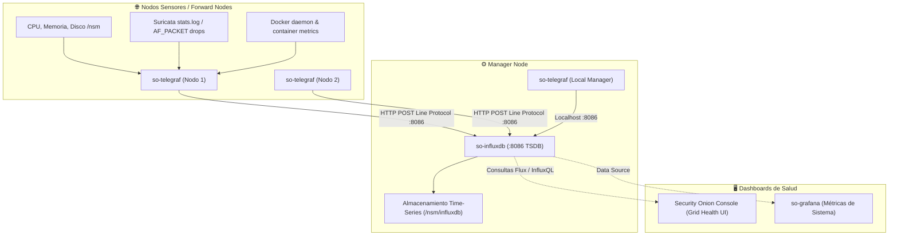

# 📈 FICHA TÉCNICA: MONITORIZACIÓN TEMPORAL `so-influxdb` Y `so-telegraf`

> **Componente:** Base de Datos de Series Temporales (TSDB) y Agente de Métricas de Hardware / Grid  
> **Servicios SO3:** `so-influxdb` y `so-telegraf`  
> **Repositorio Local Upstream de Documentación:** `G:\Hermes + Antigravity\influxdb-docs`  
> **Puertos de Red:** `8086/TCP` (API HTTP InfluxDB)  
> **Ubicación en SO3:** `/opt/so/conf/influxdb/`, `/opt/so/conf/telegraf/` y `/opt/so/saltstack/salt/`  
> **Directorio de Datos en Disco:** `/nsm/influxdb/`  

---

## 1. Identificación y Propósito en Security Onion

* **Proyectos Base Upstream:** 
  * [InfluxDB OSS](https://github.com/influxdata/influxdb) *(Documentación oficial clonada en: `influxdb-docs`)*.
  * [Telegraf](https://github.com/influxdata/telegraf) *(Agente recolector de métricas de plugins)*.
* **Propósito en SO3:**
  * **Separar las métricas de rendimiento de los logs de seguridad:** En lugar de saturar Elasticsearch con métricas de CPU, RAM, uso de disco, paquetes descartados por Suricata o caídas de enlaces cada 10 segundos, Security Onion utiliza una arquitectura dedicada con InfluxDB.
  * `so-telegraf` corre en cada nodo (Manager, Search Nodes, Sensores Forward) recolectando telemetría de hardware, estado de contenedores Docker y estadísticas de red.
  * `so-telegraf` envía esas métricas hacia `so-influxdb` (ubicado típicamente en el Manager o nodo dedicado).
  * La consola web **Security Onion Console (`so-soc`)** y **Grafana** consultan InfluxDB para graficar la salud del Grid en la sección **Administration / Grid**.

---

## 2. Flujo de Arquitectura y Métricas en el Grid SO3



---

## 3. ¿Qué Métricas Específicas Recolecta `so-telegraf`?

1. **Métricas de Rendimiento del Sistema Operativo:**
   * Uso de CPU (user, system, iowait).
   * Uso de Memoria RAM y Swap.
   * Uso de espacio en particiones críticas (`/`, `/nsm`, `/nsm/elasticsearch`).
2. **Métricas de Inspección de Red (NDR):**
   * **Suricata AF_PACKET:** Paquetes capturados, paquetes descartados (`drop_rate`), errores de checksum.
   * **Zeek:** Flujos procesados, memoria consumida por workers.
3. **Métricas de Contenedores Docker:**
   * Estado de ejecución de cada contenedor `so-*`.
   * Consumo de CPU/memoria individual por contenedor.
4. **Métricas de Elasticsearch:**
   * Documentos indexados por segundo, tiempos de respuesta de queries, JVM Heap usage.

---

## 4. Orquestación con SaltStack (`.sls`)

En SO3, SaltStack aprovisiona el usuario, bases de datos y tokens de autenticación de InfluxDB, además de distribuir la plantilla de Telegraf a todos los minions.

### Ubicación del State de Telegraf: `/opt/so/saltstack/salt/telegraf/init.sls`
```yaml


so-telegraf:
  docker_container.running:
    - image: {{ salt['pillar.get']('docker:registry', 'localhost:5000') }}/securityonionsolutions/so-telegraf:latest
    - restart_policy: always
    - network_mode: host
    - pid_mode: host
    - binds:
      - /opt/so/conf/telegraf/telegraf.conf:/etc/telegraf/telegraf.conf:ro
      - /var/run/docker.sock:/var/run/docker.sock:ro
      - /sys:/rootfs/sys:ro
      - /proc:/rootfs/proc:ro
      - /nsm:/rootfs/nsm:ro
```

### Configuración del Output de Telegraf (`telegraf.conf`):
```toml
[agent]
  interval = "10s"
  round_interval = true
  metric_batch_size = 1000

[[outputs.influxdb_v2]]
  urls = ["http://{{ manager_ip }}:8086"]
  token = "$INFLUX_TOKEN"
  organization = "securityonion"
  bucket = "telegraf"
```

---

## 5. Diagnóstico y Comandos de Administración

### A. Verificar estado de los contenedores:
```bash
# Ver estado de InfluxDB (en el Manager)
sudo docker ps --filter "name=so-influxdb"
sudo so-influxdb-status

# Ver estado de Telegraf (en cualquier nodo)
sudo docker ps --filter "name=so-telegraf"
sudo so-telegraf-status
```

### B. Probar conectividad con InfluxDB vía CLI / cURL:
```bash
# Healthcheck de la API de InfluxDB
curl -s -X GET "http://localhost:8086/health" | jq .

# Ver buckets de métricas existentes (vía API v2)
curl -s -X GET "http://localhost:8086/api/v2/buckets" \
  -H "Authorization: Token <TU_INFLUX_TOKEN>" | jq .
```

### C. Inspeccionar logs de Telegraf en un sensor:
Si un nodo aparece como "Desconectado" o "Unknown" en la pantalla de Grid de SO3:
```bash
sudo docker logs --tail 50 so-telegraf
```
*(Permite ver si Telegraf tiene errores de red o rechazo de autenticación `401 Unauthorized` contra el Manager).*

### D. Reiniciar servicios:
```bash
sudo so-telegraf-restart
sudo so-influxdb-restart
```

---

## 6. Puntos Críticos y Buenas Prácticas para el SOC

1. **Retención de Métricas (Retention Policies):**
   * Las métricas de Telegraf son voluminosas a largo plazo pero pierden valor después de unos días.
   * En SO3, el bucket de Telegraf está configurado con una política de retención automática (ej. **14 o 30 días**) para evitar que `/nsm/influxdb` crezca indefinidamente.
2. **Detección Temprana de Pérdida de Paquetes:**
   * La gráfica más crítica que el analista debe vigilar en SO3 Grid es **`suricata.drop_rate`** provista por InfluxDB. Si este valor supera el **0.5%**, significa que la tarjeta de red o la CPU del sensor no da abasto para procesar el SPAN y se están perdiendo amenazas en el tráfico.
