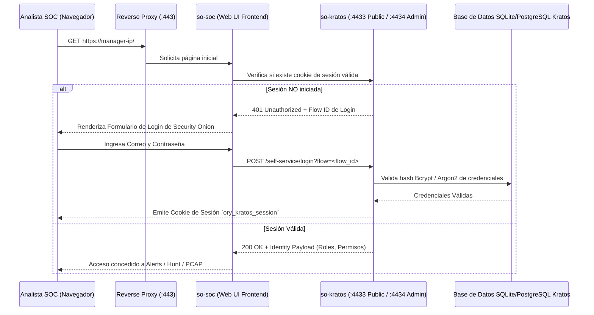

# 🔐 FICHA TÉCNICA: GESTIÓN DE IDENTIDAD Y AUTENTICACIÓN `so-kratos`

> **Componente:** Servidor de Autenticación, Manejo de Identidades y Sesiones Web (Ory Kratos)  
> **Servicio SO3:** `so-kratos`  
> **Repositorio Local Upstream de Documentación:** `G:\Hermes + Antigravity\ory-docs` (Directorio `docs/kratos/`)  
> **Puertos de Red:** `4433/TCP` (API Pública de Login/Registro), `4434/TCP` (API Administrativa Interna)  
> **Ubicación en SO3:** `/opt/so/conf/kratos/` y `/opt/so/saltstack/salt/kratos/`  
> **Directorio de Logs:** `/opt/so/log/kratos/`  

---

## 1. Identificación y Aclaración Crítica Upstream

* **¿Es `go-kratos/kratos`?:** **NO.** `go-kratos/kratos` es un framework chino de microservicios en Go (estilo gRPC).
* **¿Cuál es el Kratos real de Security Onion?:** Es [**Ory Kratos**](https://github.com/ory/kratos) (especializado en *Identity, User Management & Authentication*). Su documentación oficial completa ya la tenemos clonada en:
  📁 `G:\Hermes + Antigravity\ory-docs\docs\kratos\`
* **Propósito en SO3:**
  * Es el **guardián de acceso y autenticación** de la consola web **Security Onion Console (`so-soc`)**.
  * Administra el ciclo de vida completo de usuarios del SOC: creación de cuentas, contraseñas, tokens de sesión seguros, flujos MFA/2FA y recuperación.
  * Se comunica con la base de datos interna de identidades y expone APIs REST para el frontend de React de `so-soc`.

---

## 2. Flujo de Autenticación de un Analista en SO3



---

## 3. Orquestación con SaltStack (`.sls`)

En SO3, SaltStack inicializa la base de datos de identidades, define los esquemas JSON de los usuarios (`identity.schema.json`) y configura el contenedor.

### Ubicación del State: `/opt/so/saltstack/salt/kratos/init.sls`
```yaml
so-kratos:
  docker_container.running:
    - image: {{ salt['pillar.get']('docker:registry', 'localhost:5000') }}/securityonionsolutions/so-kratos:latest
    - restart_policy: always
    - network_mode: host
    - environment:
      - DSN: "sqlite3:///etc/config/kratos/kratos.db?_fk=true&mode=rwc"
      - SERVE_PUBLIC_BASE_URL: "https://{{ salt['pillar.get']('global:manager_ip') }}/kratos/public/"
      - SERVE_ADMIN_BASE_URL: "http://127.0.0.1:4434/"
    - binds:
      - /opt/so/conf/kratos/kratos.yml:/etc/config/kratos/kratos.yml:ro
      - /opt/so/conf/kratos/identity.schema.json:/etc/config/kratos/identity.schema.json:ro
      - /opt/so/conf/kratos/kratos.db:/etc/config/kratos/kratos.db:rw
      - /opt/so/log/kratos:/opt/kratos/logs:rw
```

---

## 4. Gestión de Usuarios y Comandos Operativos

Security Onion envuelve las llamadas complejas de la API de Ory Kratos en el comando nativo **`so-user`**:

### A. Comandos de Gestión de Usuarios en SO3:
```bash
# Listar todos los usuarios activos del clúster
sudo so-user-list

# Crear un nuevo usuario analista SOC
sudo so-user-add analista_soc@technoma.com.py

# Cambiar la contraseña de un usuario
sudo so-user-password analista_soc@technoma.com.py

# Eliminar un usuario
sudo so-user-delete analista_soc@technoma.com.py
```

### B. Diagnóstico y Estado del Contenedor:
```bash
# Estado en Docker
sudo docker ps --filter "name=so-kratos"

# Chequeo de salud del servicio nativo
sudo so-kratos-status

# Ver logs de autenticación en tiempo real
sudo docker logs --tail 100 -f so-kratos
# o en disco:
sudo tail -f /opt/so/log/kratos/kratos.log
```

---

## 5. El Problema Número 1 en Producción: "Login Form Expired"

En los foros de Security Onion, el 90% de los tickets sobre Kratos se deben al error:
> ❌ **`The login form has expired. Please try again.`**

### ¿Por qué ocurre?
1. **Desincronización de Tiempo (NTP Drift):**
   * Ory Kratos genera tokens criptográficos con una ventana de validez muy estricta (usualmente 10 a 15 minutos).
   * Si el reloj del servidor de Security Onion o de la máquina del analista está desfasado por unos minutos respecto a UTC, Kratos cree que el formulario se envió en el pasado o en el futuro y rechaza el login automáticamente en un bucle infinito.
2. **Solución en el Manager SO3:**
   ```bash
   # Verificar estado del servicio de hora
   timedatectl status

   # Forzar sincronización NTP inmediata
   sudo chronyc makestep  # o sudo systemctl restart systemd-timesyncd
   ```
