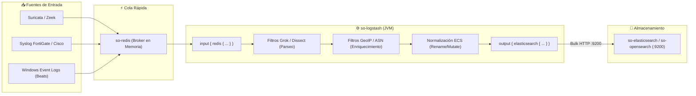

# 🔄 FICHA TÉCNICA: MOTOR DE PIPELINES Y PARSEO `so-logstash`

> **Componente:** Procesamiento, Enriquecimiento ECS, Filtros Grok/Mutate y Normalización de Logs  
> **Servicio SO3:** `so-logstash`  
> **Repositorio Local Upstream de Documentación:** `G:\Hermes + Antigravity\logstash-docs`  
> **Puertos de Red:** `9600/TCP` (API de Monitoreo de Pipelines), `5044/TCP` (Ingesta Beats opcional)  
> **Ubicación en SO3:** `/opt/so/conf/logstash/` y `/opt/so/saltstack/salt/logstash/`  
> **Directorio de Pipelines:** `/opt/so/conf/logstash/etc/logstash/conf.d/`  

---

## 1. Identificación y Rol Crítico en Security Onion

* **Proyecto Base Upstream:** [elastic/logstash](https://github.com/elastic/logstash) *(Documentación de plugins clonada en: `logstash-docs`)*.
* **¿Qué hace exactamente en SO3?:**
  * Es la **fábrica de transformación y normalización de datos** del SOC.
  * Recibe logs crudos en texto plano (syslogs de FortiGate, eventos de Windows, logs de Zeek y Suricata) desde la cola intermedia **`so-redis`**.
  * Aplica filtros de parseo (**Grok**, **Dissect**, **Mutate**) para convertir texto no estructurado en campos estándar **Elastic Common Schema (ECS)**: `source.ip`, `destination.port`, `user.name`, `rule.name`.
  * **Enriquecimiento en vuelo:** Agrega coordenadas geográficas (**GeoIP**), nombres de proveedores/ASN (`geo.city_name`, `as.organization.name`) y traduce códigos de eventos antes de indexarlos en Elasticsearch / OpenSearch.

---

## 2. Flujo de Ingesta y Pipelines en SO3



---

## 3. Estructura de Pipelines en SO3

Security Onion divide las etapas de Logstash en archivos numerados secuenciales:

| Prefijo de Archivo | Etapa del Pipeline | Función |
| :--- | :--- | :--- |
| **`0001_input_*.conf`** | **Inputs** | Lee mensajes de las colas de Redis (`so-redis`) o de Beats. |
| **`1000_preprocess_*.conf`** | **Pre-procesado** | Identifica el tipo de log (`event.dataset`, `event.module`). |
| **`2000_filter_fortigate.conf`** | **Parseo Específico** | Parsea pares clave-valor (`kv`) de firewalls FortiGate. |
| **`2100_filter_windows.conf`** | **Parseo Windows** | Normaliza EventIDs (4624, 4625, 4688) a esquemas ECS. |
| **`8000_postprocess_geoip.conf`** | **Enriquecimiento** | Consulta bases de datos MaxMind GeoLite2 para IPs públicas. |
| **`9000_output_elasticsearch.conf`** | **Outputs** | Escribe por lotes (Bulk) en `so-elasticsearch:9200`. |

---

## 4. Orquestación con SaltStack (`.sls`)

En SO3, SaltStack gestiona la configuración de los trabajadores (`pipeline.workers`), el tamaño del heap de Java de Logstash y la distribución de los archivos de configuración `.conf`.

### Ubicación del State: `/opt/so/saltstack/salt/logstash/init.sls`
```yaml


so-logstash:
  docker_container.running:
    - image: {{ salt['pillar.get']('docker:registry', 'localhost:5000') }}/securityonionsolutions/so-logstash:latest
    - restart_policy: always
    - network_mode: host
    - environment:
      - "LS_JAVA_OPTS=-Xms{{ ls_heap }} -Xmx{{ ls_heap }}"
    - binds:
      - /opt/so/conf/logstash/etc/logstash/pipelines.yml:/usr/share/logstash/config/pipelines.yml:ro
      - /opt/so/conf/logstash/etc/logstash/conf.d:/usr/share/logstash/pipeline:ro
      - /opt/so/conf/logstash/etc/logstash/logstash.yml:/usr/share/logstash/config/logstash.yml:ro
      - /opt/so/log/logstash:/var/log/logstash:rw
```

---

## 5. Diagnóstico y Comandos de Administración

### A. Verificar estado del contenedor:
```bash
# Ver estado en Docker
sudo docker ps --filter "name=so-logstash"

# Ver estado en Security Onion CLI
sudo so-logstash-status
```

### B. Monitorear tasa de eventos por segundo (EPS):
```bash
# Consultar estadísticas del pipeline vía API interna en el puerto 9600
curl -s http://localhost:9600/_node/stats/pipelines?pretty | jq .pipelines.main.events
```
*(Muestra cuántos eventos entraron (`in`), cuántos se filtraron (`filtered`) y cuántos se indexaron (`out`)).*

### C. Inspeccionar logs de errores de parseo:
Si los logs no aparecen en Kibana o en el SOC:
```bash
sudo docker logs --tail 100 -f so-logstash
```
*(Permite ver si hay fallas de conexión a Elasticsearch o errores en expresiones regulares Grok).*

### D. Reiniciar Logstash tras modificar filtros:
```bash
sudo so-logstash-restart
```

---

## 6. Puntos Críticos y Cuellos de Botella (Troubleshooting)

1. **Cola de Redis Creciendo (Lag de Ingesta):**
   * **Síntoma:** El comando `redis-cli llen logstash:beats` muestra cientos de miles de eventos en espera.
   * **Causa:** Logstash no da abasto para procesar el volumen de eventos que entran desde los sensores o firewalls.
   * **Solución:** Incrementar los workers de Logstash en SaltStack (`pipeline.workers` = número de cores de CPU) o aumentar el `pipeline.batch.size` de 125 a 250/500 en `logstash.yml`.
2. **Uso Excesivo de CPU por Filtros Grok Ineficientes:**
   * Expresiones regulares que sufren de *Catastrophic Backtracking* pueden colapsar un hilo de CPU al 100%. En SO3 se prefiere siempre el uso del filtro `dissect` o `kv` antes que `grok` para logs tabulados o tipo syslog.
