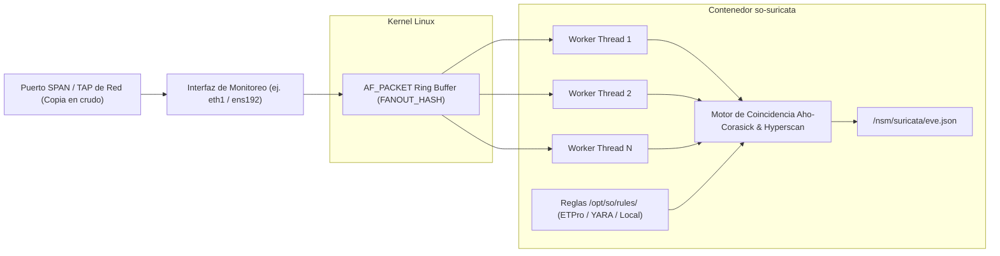

# 🌐 FICHA TÉCNICA: DETECCIÓN DE INTRUSIONES NIDS `so-suricata`

> **Componente:** Motor NIDS multihilo, inspección profunda de firmas y desencapsulado de protocolos  
> **Servicio SO3:** `so-suricata`  
> **Repositorio Local Upstream:** `G:\Hermes + Antigravity\suricata-docs`  
> **Ubicación en SO3:** `/opt/so/conf/suricata/`, `/opt/so/rules/` y `/opt/so/saltstack/salt/suricata/`  
> **Directorio de Logs:** `/nsm/suricata/` (`eve.json`, `fast.log`, `stats.log`)  

---

## 1. Identificación y Rol Crítico en Security Onion

* **Proyecto Base Upstream:** [OISF/Suricata](https://github.com/OISF/suricata).
* **¿Qué hace exactamente en SO3?:**
  * Es el **ojo perimetral e interno de detección basada en firmas**.
  * Escucha en modo pasivo la copia en crudo de la red recibida a través del puerto **SPAN/Mirror** mediante el socket de kernel de alto rendimiento **AF_PACKET**.
  * Evalúa cada paquete contra miles de reglas de firmas (reglas oficiales Emerging Threats / ETPro, reglas personalizadas del SOC y reglas de CVEs).
  * Genera el archivo maestro **`eve.json`**, el cual contiene todas las alertas NIDS, decodificación de protocolos y anomalías de red.
  * `so-filebeat` lee `eve.json` y lo envía a la cola de Redis para ser indexado en el índice `so-suricata-*` de Elasticsearch.

---

## 2. Flujo de Captura y Multi-hilo en SO3



---

## 3. Orquestación con SaltStack (`.sls`)

En SO3, SaltStack balancea automáticamente la cantidad de hilos de Suricata basándose en la cantidad de núcleos de CPU detectados por los **Grains** (`grains['num_cpus']`), optimiza los buffers del socket AF_PACKET y gestiona la descarga y compilación de reglas mediante `so-rule-update`.

### Ubicación del State: `/opt/so/saltstack/salt/suricata/init.sls`
```yaml



so-suricata:
  docker_container.running:
    - image: {{ salt['pillar.get']('docker:registry', 'localhost:5000') }}/securityonionsolutions/so-suricata:latest
    - restart_policy: always
    - network_mode: host
    - cap_add:
      - NET_ADMIN
      - NET_RAW
      - SYS_NICE
    - environment:
      - INTERFACE: "{{ mon_int }}"
      - THREADS: "{{ suricata_threads }}"
    - binds:
      - /opt/so/conf/suricata/suricata.yaml:/etc/suricata/suricata.yaml:ro
      - /opt/so/rules:/etc/suricata/rules:ro
      - /nsm/suricata:/var/log/suricata:rw
```

---

## 4. Diagnóstico y Comandos de Administración

### A. Verificar estado del contenedor:
```bash
sudo docker ps --filter "name=so-suricata"
sudo so-suricata-status
```

### B. Actualizar y recompilar reglas ETPro / Custom:
```bash
# Descarga las últimas reglas, aplica supresiones/modificaciones y recarga Suricata
sudo so-rule-update
```

### C. Verificar si hay pérdida de paquetes en el SPAN (Drop Rate):
```bash
# Inspeccionar stats.log en tiempo real
sudo tail -f /nsm/suricata/stats.log | grep -E "capture.kernel_packets|capture.kernel_drops"
```
*(Si `kernel_drops` es mayor a 0, la CPU o los buffers de anillo de AF_PACKET están saturados).*

### D. Reiniciar motor:
```bash
sudo so-suricata-restart
```
