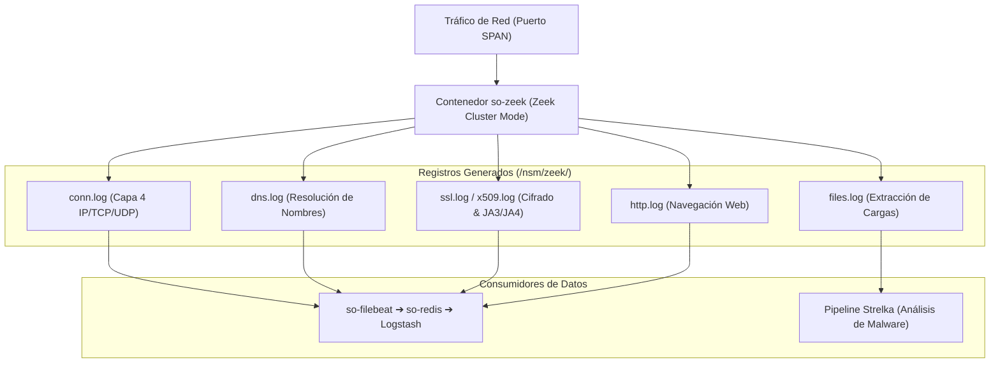

# 🔬 FICHA TÉCNICA: ANÁLISIS DE METADATA DE PROTOCOLOS `so-zeek`

> **Componente:** Analizador transaccional de protocolos de red, extracción de archivos en vuelo y NSM  
> **Servicio SO3:** `so-zeek`  
> **Repositorio Local Upstream:** `G:\Hermes + Antigravity\zeek-docs`  
> **Ubicación en SO3:** `/opt/so/conf/zeek/` y `/opt/so/saltstack/salt/zeek/`  
> **Directorio de Logs:** `/nsm/zeek/spool/` y `/nsm/zeek/logs/`  

---

## 1. Identificación y Rol Crítico en Security Onion

* **Proyecto Base Upstream:** [Zeek (anteriormente Bro)](https://github.com/zeek/zeek).
* **¿Qué hace exactamente en SO3?:**
  * Mientras Suricata busca patrones maliciosos conocidos (firmas), **Zeek es un analista de protocolos neutral y de alta fidelidad**.
  * Observa todo el tráfico del SPAN y genera registros estructurados individuales por protocolo:
    * `conn.log`: Resumen de cada conexión TCP/UDP/ICMP (IPs, puertos, duración, bytes transferidos, estados TCP).
    * `dns.log`: Cada consulta y respuesta DNS, servidores utilizados, TTL y códigos de respuesta.
    * `ssl.log` / `x509.log`: Versiones TLS, cifrados negociados, huellas digitales JA3/JA4, certificados y emisor.
    * `http.log`: URLs, User-Agents, métodos, cabeceras y códigos de estado.
    * `files.log`: Hashes SHA1/MD5/SHA256 de archivos transferidos por HTTP, SMB o FTP en la red.
  * **Interacción con Strelka:** Zeek extrae archivos sospechosos en vuelo desde el tráfico de red y los deposita en cola para que el clúster de **Strelka** los analice dinámicamente en busca de malware.

---

## 2. Flujo de Procesamiento y Logs de Zeek



---

## 3. Orquestación con SaltStack (`.sls`)

En SO3, SaltStack genera la topología de Zeek (`node.cfg`), los scripts locales (`local.zeek`), configura la memoria compartida (BPA / AF_PACKET o PF_RING) y compila los filtros BPF para omitir tráfico benigno ruidoso.

### Ubicación del State: `/opt/so/saltstack/salt/zeek/init.sls`
```yaml
so-zeek:
  docker_container.running:
    - image: {{ salt['pillar.get']('docker:registry', 'localhost:5000') }}/securityonionsolutions/so-zeek:latest
    - restart_policy: always
    - network_mode: host
    - cap_add:
      - NET_ADMIN
      - NET_RAW
    - binds:
      - /opt/so/conf/zeek/node.cfg:/opt/zeek/etc/node.cfg:ro
      - /opt/so/conf/zeek/local.zeek:/opt/zeek/share/zeek/site/local.zeek:ro
      - /opt/so/conf/zeek/bpf.conf:/opt/zeek/etc/bpf.conf:ro
      - /nsm/zeek:/nsm/zeek:rw
```

---

## 4. Diagnóstico y Comandos de Administración

### A. Verificar estado del contenedor y sus workers:
```bash
sudo docker ps --filter "name=so-zeek"
sudo so-zeek-status
```

### B. Inspeccionar en vivo conexiones o DNS registrados por Zeek:
```bash
# Ver conexiones activas en tiempo real
sudo tail -f /nsm/zeek/logs/current/conn.log | zeek-cut id.orig_h id.resp_h id.resp_p proto service

# Ver consultas DNS resueltas en el SPAN
sudo tail -f /nsm/zeek/logs/current/dns.log | zeek-cut id.orig_h query answers
```

### C. Reiniciar Zeek:
```bash
sudo so-zeek-restart
```
