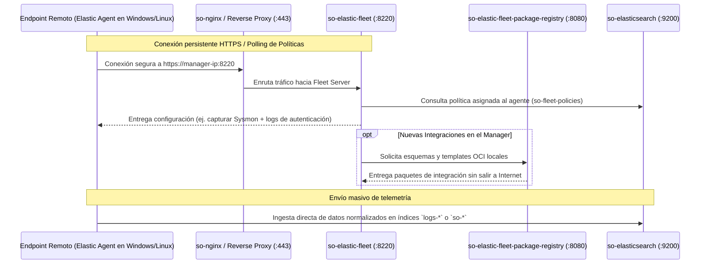

# 🛡️ FICHA TÉCNICA: GESTIÓN DE AGENTES ENDPOINT `so-elastic-fleet` Y `so-elastic-fleet-package-registry`

> **Componente:** Gestión Centralizada de Agentes de Endpoint (Elastic Agent), Políticas de Recolección e Integraciones  
> **Servicios SO3:** `so-elastic-fleet`, `so-elastic-fleet-package-registry`  
> **Repositorio Local Upstream de Documentación:** `G:\Hermes + Antigravity\elastic-docs-content`  
> **Puertos de Red:** `8220/TCP` (Fleet Server HTTPS), `8080/TCP` (Package Registry local en el Manager)  
> **Ubicación en SO3:** `/opt/so/conf/fleet/` y `/opt/so/saltstack/salt/fleet/`  

---

## 1. Identificación y Rol Crítico en Security Onion

* **Proyectos Base Upstream:** 
  * [Elastic Fleet Server](https://github.com/elastic/fleet-server) (Gestión y orquestación de Elastic Agents en endpoints).
  * [Elastic Package Registry](https://github.com/elastic/package-registry) (Repositorio local de integraciones para entornos Airgap).
* **¿Qué hace exactamente en SO3?:**
  * Es la **plataforma moderna de gestión masiva de agentes de endpoint (EDR / Telemetría)**.
  * Mientras que Suricata y Zeek monitorean la red por el cable (NDR), **Fleet administra los agentes instalados dentro de los servidores y estaciones de trabajo** (Windows, Linux, macOS).
  * Permite desplegar, actualizar y modificar políticas de recolección de logs sin tocar las máquinas clientes:
    * Eventos de Seguridad de Windows (Sysmon, EventIDs de Login, PowerShell).
    * Telemetría de procesos, conexiones de red del host y actividad de archivos.
    * Integraciones con endpoints y software corporativo.
  * **`so-elastic-fleet-package-registry`:** Es un contenedor espejo local que aloja los paquetes e integraciones de Elastic para que la consola no tenga que descargarlos de internet pública cada vez que agregas una integración (compatibilidad 100% Airgap).

---

## 2. Flujo de Arquitectura y Comunicación de Endpoints



---

## 3. Comandos Operativos y Diagnóstico

### A. Verificar estado de los contenedores:
```bash
sudo docker ps --filter "name=so-elastic-fleet"

# Estado nativo
sudo so-elastic-fleet-status
sudo so-elastic-fleet-package-registry-status
```

### B. Comprobar salud del Package Registry local:
```bash
curl -s http://localhost:8080/health
```

### C. Inspeccionar logs de comunicación de agentes:
```bash
sudo docker logs --tail 50 -f so-elastic-fleet
```
*(Permite ver si los agentes en las estaciones de trabajo tienen problemas de certificados TLS o tokens de enrolamiento inválidos).*

### D. Reiniciar servicios de Fleet:
```bash
sudo so-elastic-fleet-restart
sudo so-elastic-fleet-package-registry-restart
```
