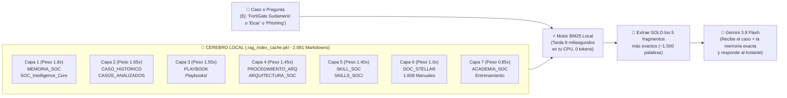

# 🛡️ MANUAL OPERATIVO: CÓMO TRABAJA TU SOAR + CEREBRO DE MEMORIA + ANTIGRAVITY / HERMES

> **Objetivo de esta guía**: Explicarte en español claro y sin vueltas **cómo funciona hoy tu ecosistema**, **cómo se solucionó para siempre el problema de la memoria de tus 2.081 Markdowns**, y **cuál es la forma más rápida y cómoda de trabajar en tu guardia diaria sin gastar tokens de más**.

---

## 🧠 1. Lo que más te preocupaba: ¿Cómo funciona AHORA la Memoria?

### ❌ El problema que tenías antes (por qué era lento y gastaba todos tus tokens)
Tenías **2.081 archivos Markdown** (`13.868` bloques de conocimiento, ~50 MB de texto) repartidos en 8 carpetas:
- `SOC_Intelligence_Core/` (Memoria institucional, IPs conocidas, infraestructura de clientes)
- `CASOS_ANALIZADOS/` y `Casos_Documentados_SOC/` (Histórico de casos resueltos, ej. Sudameris, Ueno, Conti, Infostealers)
- `Playbooks/` (57 playbooks de respuesta)
- `SKILLS_SOC/` (61 skills forenses)
- `ARQUITECTURA_SOC_DOCUMENTACION/` (30 procedimientos operativos e ingeniería)
- `Documentacion_StellarCyber/` (1.608 manuales técnicos de Stellar Cyber)
- `ACADEMIA_SOC/` (172 guías y laboratorios)

**Antes**, cada vez que abrías Antigravity o analizabas un caso, la IA tenía que buscar archivo por archivo en vivo (`grep` / leer decenas de `.md`) para enterarse de quién era el cliente, qué decía el playbook o si un caso ya había pasado. **Eso tardaba minutos y te quemaba miles de tokens en cada pregunta.**

---

### ✅ Cómo funciona AHORA (Búsqueda instantánea en 8 milisegundos, CERO tokens desperdiciados)

Creamos un **Cerebro Local Pre-Compilado de 7 Capas** en [`rag_engine.py`](file:///g:/Hermes%20+%20Antigravity/soar/rag_engine.py) guardado en el archivo binario [`.rag_index_cache.pkl`](file:///g:/Hermes%20+%20Antigravity/soar/.rag_index_cache.pkl) y documentado en [`CATALOGO_COMPLETO_MARKDOWNS_SOC.md`](file:///g:/Hermes%20+%20Antigravity/soar/CATALOGO_COMPLETO_MARKDOWNS_SOC.md).



### ¿Qué significa esto en la práctica para vos?
1. **Ninguno de tus 2.081 Markdowns perdió su función**: Todos están adentro del índice [`.rag_index_cache.pkl`](file:///g:/Hermes%20+%20Antigravity/soar/.rag_index_cache.pkl).
2. **Prioridad inteligente automática**: Si entra un caso de *Sudameris*, el motor le da prioridad `1.8x` a tu memoria institucional y `1.65x` a casos históricos previos antes que a un manual genérico de Stellar Cyber (`1.0x`).
3. **Se actualiza solo**: Si mañana agregás o editás cualquier archivo `.md` en cualquiera de tus carpetas, [`rag_engine.py`](file:///g:/Hermes%20+%20Antigravity/soar/rag_engine.py) detecta que cambió la fecha de modificación y actualiza el índice automáticamente en 2 segundos.

---

## 🖥️ 2. Las 3 Herramientas que tenés y para qué sirve cada una

Para no confundirte entre **el Cockpit**, **Antigravity** y **Hermes**, pensalo así:

| Herramienta | ¿Qué es? | ¿Cuándo la usás? | ¿Cómo se abre? |
| :--- | :--- | :--- | :--- |
| **1. Tu Cockpit Desktop (`command_center.py`)** | **Tu consola principal de guardia SOC (el 95% de tu trabajo diario).** Tiene toda tu interfaz gráfica, tablas, filtros, botones, tickets Technoma, Security Onion, Phishing, Feeds y AbuseIPDB. | Durante toda tu guardia para monitorear Stellar Cyber, hacer Tri-Scan, analizar casos con 1 clic y generar tickets/planillas. | Doble clic en [`INICIAR_COMMAND_CENTER.bat`](file:///g:/Hermes%20+%20Antigravity/soar/INICIAR_COMMAND_CENTER.bat) (o ya lo tenés abierto en tu barra de tareas). |
| **2. Chat de Antigravity (este chat donde hablamos)** | **Tu Ingeniero / Copiloto de Desarrollo y Casos Complejos.** | Cuando querés modificar el código de tu Cockpit, agregar una función nueva, o pedirme que investigue algo puntual usando [`soar_cli.py`](file:///g:/Hermes%20+%20Antigravity/soar/soar_cli.py). | Hablándome acá mismo (usando el modelo **Gemini 3.8** para no gastar Argon). |
| **3. Hermes (`hermes-agent`)** | **El puente de autenticación OAuth y agente de terminal (WSL).** | **No necesitás abrir Hermes manualmente para usar tu SOAR.** Tu Cockpit en Windows ya toma prestada la llave OAuth de Google Antigravity (`~/.hermes/antigravity_accounts.json`) de forma automática y transparente. | Automático en segundo plano a través de [`soar_ai_client.py`](file:///g:/Hermes%20+%20Antigravity/soar/soar_ai_client.py). |

> **Resumen clave sobre Hermes**: No tenés que aprender a usar Hermes por consola si no querés. Lo único vital que nos dio Hermes fue el plugin [`hermes-antigravity-auth`](file:///g:/Hermes%20+%20Antigravity/hermes-antigravity-auth), que yo ya conecté adentro de tu Cockpit de Windows ([`soar_ai_client.py`](file:///g:/Hermes%20+%20Antigravity/soar/soar_ai_client.py)) para que **tu Cockpit use Gemini 3.8 Flash gratis con tu cuenta OAuth de Google sin pedirte API Key**.

---

## 🚀 3. Cómo trabajar paso a paso en tu día a día

### Escenario A: Estás de guardia en tu Cockpit (`command_center.py`)
1. Abrís tu Cockpit con [`INICIAR_COMMAND_CENTER.bat`](file:///g:/Hermes%20+%20Antigravity/soar/INICIAR_COMMAND_CENTER.bat).
2. El Cockpit se conecta solo a `technoma.stellarcyber.cloud` usando las credenciales seguras de tu archivo [`.env`](file:///g:/Hermes%20+%20Antigravity/soar/.env).
3. **Cuando seleccionás un caso en la tabla y tocás el botón de Analizar con IA**:
   - **Paso 1**: El Cockpit descarga los observables, alertas e Interflow del caso desde Stellar Cyber.
   - **Paso 2**: [`stellar_gemini_orchestrator.py`](file:///g:/Hermes%20+%20Antigravity/soar/stellar_gemini_orchestrator.py) enmascara datos sensibles (PII) y le pregunta al **Cerebro RAG de 7 capas** ([`rag_engine.py`](file:///g:/Hermes%20+%20Antigravity/soar/rag_engine.py)): *"¿Qué sabemos en nuestros 2.081 Markdowns sobre este cliente, esta alerta y este tipo de ataque?"*.
   - **Paso 3**: En **8 milisegundos**, el RAG le inyecta a la IA el playbook exacto, los casos históricos parecidos y la memoria del cliente.
   - **Paso 4**: [`soar_ai_client.py`](file:///g:/Hermes%20+%20Antigravity/soar/soar_ai_client.py) envía todo a **Gemini 3.8 Flash (`gemini-3.8-flash-high`)** vía tu cuenta de Antigravity y te devuelve en pantalla el dictamen completo + la tabla de 6 columnas lista para tu ticket Technoma.
4. **Cuando usás cualquiera de tus otros módulos del Cockpit**:
   - **Generador de Tickets Technoma** ([`thn_ticket_generator.py`](file:///g:/Hermes%20+%20Antigravity/soar/thn_ticket_generator.py)): Genera el reporte oficial y las filas de 40 columnas (`FL-THN-POS-01 Rev. 03`) y 18 columnas (bitácora TSV).
   - **Analizador de Cabeceras de Phishing** ([`email_header_analyzer.py`](file:///g:/Hermes%20+%20Antigravity/soar/email_header_analyzer.py)): Analiza saltos SMTP, SPF/DKIM/DMARC y reputación CTI en paralelo.
   - **Feeds de Inteligencia** ([`feeds_intel_module.py`](file:///g:/Hermes%20+%20Antigravity/soar/feeds_intel_module.py)): Redacta boletines ejecutivos usando también Gemini 3.8 Flash por detrás.
   - **Copiloto Forense** ([`soc_agent_gui.py`](file:///g:/Hermes%20+%20Antigravity/soar/soc_agent_gui.py)): Si querés chatear libremente sobre un caso o pegarle logs crudos desde una ventana dedicada, usa el mismo motor y la misma memoria RAG.

---

### Escenario B: Querés hacerme una consulta rápida acá en el chat de Antigravity SIN gastar tokens
Cuando estés hablando conmigo acá en el chat de Antigravity (con el modelo **3.8**) y me digas, por ejemplo:
- *"Che, fijate qué teníamos documentado de Sudameris y FortiGate"*
- *"Analizame el caso 69dc... de Stellar"*
- *"Escaneame la IP 185.220.101.45"*

**Yo ya NO voy a ponerme a leer cientos de archivos del workspace.** En vez de eso, ejecuto un solo comando de [`soar_cli.py`](file:///g:/Hermes%20+%20Antigravity/soar/soar_cli.py) que consulta el índice pre-compilado en milisegundos:

```powershell
# Buscar en tus 2.081 Markdowns en 8 ms (sin gastar tokens de lectura de archivos)
python soar_cli.py rag "FortiGate Sudameris VPN"

# Escanear una IP/Dominio/Hash en paralelo (VirusTotal + AbuseIPDB + URLScan)
python soar_cli.py cti 185.220.101.45

# Analizar un caso de Stellar Cyber por ID con memoria RAG + Gemini 3.8
python soar_cli.py analyze <CASE_ID>
```

---

## 📂 4. Mapa Rápido de Archivos Clave de tu Proyecto

| Archivo | Función |
| :--- | :--- |
| [`INICIAR_COMMAND_CENTER.bat`](file:///g:/Hermes%20+%20Antigravity/soar/INICIAR_COMMAND_CENTER.bat) | **Doble clic acá** para abrir tu Cockpit completo (`command_center.py`) sin ventana negra de consola. |
| [`command_center.py`](file:///g:/Hermes%20+%20Antigravity/soar/command_center.py) | Tu aplicación principal Desktop (10.425 líneas) con todos tus módulos integrados. |
| [`soc_agent_gui.py`](file:///g:/Hermes%20+%20Antigravity/soar/soc_agent_gui.py) | Tu Copiloto Forense interactivo en ventana de escritorio. |
| [`rag_engine.py`](file:///g:/Hermes%20+%20Antigravity/soar/rag_engine.py) | El motor de memoria que indexa tus **2.081 Markdowns** en 7 capas ponderadas. |
| [`.rag_index_cache.pkl`](file:///g:/Hermes%20+%20Antigravity/soar/.rag_index_cache.pkl) | La base de datos en caché donde viven indexados los 13.868 fragmentos de tus Markdowns. |
| [`CATALOGO_COMPLETO_MARKDOWNS_SOC.md`](file:///g:/Hermes%20+%20Antigravity/soar/CATALOGO_COMPLETO_MARKDOWNS_SOC.md) | El inventario completo de tus 2.081 Markdowns explicando qué hace cada carpeta y cómo se usa. |
| [`soar_ai_client.py`](file:///g:/Hermes%20+%20Antigravity/soar/soar_ai_client.py) | El conector que une tu Cockpit con Google Antigravity OAuth (`gemini-3.8-flash-high`). |
| [`.env`](file:///g:/Hermes%20+%20Antigravity/soar/.env) | Tus llaves privadas (Stellar Cyber, VirusTotal, AbuseIPDB, URLScan, Security Onion). Protegido en `.gitignore`. |

---

## ❓ Preguntas Frecuentes para tu tranquilidad

1. **¿Qué pasa si edito o creo un nuevo Markdown en `SOC_Intelligence_Core/` o `CASOS_ANALIZADOS/`?**
   - Nada manual: la próxima vez que tu Cockpit o `soar_cli.py` hagan una consulta, [`rag_engine.py`](file:///g:/Hermes%20+%20Antigravity/soar/rag_engine.py) detecta solo el archivo nuevo/modificado y actualiza la memoria en 2 segundos.
2. **¿Si quiero forzar un re-indexado manual de los Markdowns, cómo hago?**
   - Ejecutás `python soar_cli.py rag-stats` o desde Python `LocalRAG().build_index(force_rebuild=True)`.
3. **¿Se subió algo de esto a GitHub?**
   - **No.** Todo está local en tu carpeta `g:\Hermes + Antigravity\soar` como me pediste.
