# INFORME PERICIAL FORENSE Y TÉCNICO INTEGRAL (SOC / CIRT)
## Caso: Investigación de Tráfico Anómalo Saliente NetBIOS (UDP 137) hacia IP Pública (`47.77.228.76`)
### Tipificación Final: FALSO POSITIVO (False Positive) por Comportamiento Nativo de Windows (`gethostbyaddr` / NetBT) durante Tareas de Reconocimiento Administrativo (`whois.exe`)

---

| Metadato Pericial | Detalle de la Investigación |
| :--- | :--- |
| **Fecha de Inicio de Incidente** | 28 de Octubre de 2026 (18:51:03 a 19:41:52 UTC-3) |
| **Fecha de Validación en Vivo** | 30 de Octubre de 2026 (07:47:52 a 07:52:56 UTC-3) |
| **Fecha de Dictamen Final** | 30 de Octubre de 2026 |
| **Clasificación del Evento** | **Falso Positivo** / Operación Administrativa Legítima / Telemetría de Red Inocua |
| **Severidad Asignada en SIEM** | Media-Alta (Regla perimetral por evasión de puerto no estándar en WAN) |
| **Dictamen de Cierre** | **Cerrado sin afectación**. Descartada presencia de malware, gusanos, balizas o fuga de datos. |
| **Sistemas Involucrados** | FortiGate (`FG-Technoma`), Stellar Cyber (SIEM/NDR), Cortex XDR (EDR), Security Onion Desktop 3.3.0 |

---

## 1. Resumen Ejecutivo y Cadena de Hechos

El Centro de Operaciones de Seguridad (SOC) detectó ráfagas de tráfico saliente sobre el puerto **UDP 137 (NetBIOS Name Service)** dirigidas hacia una dirección IP pública en Internet: **`47.77.228.76`** (Alibaba Cloud / Singapur).

Inicialmente, el sistema correlacionador de Stellar Cyber identificó la estación de origen bajo el nombre **`NB-NSILVA`**, sugiriendo una anomalía o posible infección en el equipo de Noelia Silva. Sin embargo, un análisis forense de bajo nivel demostró:
1. **La estación y el usuario real** correspondían a **Igor Mayor (`NB-IMAYOR` / `IGORMAYOR`)**. La presencia de `NB-NSILVA` se debió exclusivamente a la persistencia de arrendamientos históricos en la tabla de activos DHCP de la red inalámbrica corporativa (`WiFi_Corp`).
2. **Cortex XDR** registró con absoluta exactitud que en esa ventana de tiempo Igor Mayor ejecutó de forma repetida la herramienta oficial de Microsoft Sysinternals **`whois.exe 47.77.228.76`** desde la consola `cmd.exe`.
3. **Causa Raíz de Red**: En sistemas Windows, la herramienta `whois.exe` realiza una resolución inversa llamando a la API de red `gethostbyaddr`. Al fallar el registro DNS inverso (PTR) de la IP externa, el subsistema de red activa el orden de proveedores del Registro (`ServiceProvider`) e invoca **NetBIOS over TCP/IP (NetBT)**, disparando una ráfaga de 3 paquetes UDP 137 hacia la IP remota para consultar su nombre de host (`NBSTAT *`).
4. **Matemática de Firewall Explicada**: Se aclaró el motivo por el cual 3 ráfagas de comandos generaron exactamente **6 logs en el FortiGate/Stellar Cyber**. El firewall no genera un log por paquete individual, sino que agrupa los paquetes en **Sesiones de Red**:
   * **Sesión 1 (18:51 - 18:54)**: 1 ráfaga (3 paquetes = 234 bytes) = 3 logs (1 UTM App-Ctrl + 2 logs de cierre/forward).
   * **Sesión 2 (19:38 - 19:41)**: 2 ráfagas consecutivas (6 paquetes = 468 bytes agrupados) = 3 logs (1 UTM App-Ctrl + 2 logs de cierre/forward).
   * **Total: 2 sesiones $\times$ 3 logs = 6 eventos exactos.**
5. **Comprobación Empírica en Vivo**: El analista Kevin Moraes ejecutó la misma prueba en su máquina (`192.168.169.2`) el 30/10, reproduciendo en tiempo real la misma firma (`app="NetBIOS.Name.Service"`), con la misma discrepancia de DHCP en el SIEM (`NB-ZGONZALEZ` en lugar de `KEVINMORAES`).
6. **Comparativa Multiplataforma**: Se contrastó y reprodujo el tráfico en una estación de laboratorio **Security Onion Desktop 3.3.0 en Linux**, demostrando que mientras Linux resuelve limpiamente por el puerto TCP 43, Windows introduce tráfico residual UDP 137 debido a su arquitectura histórica.

---

## 2. Cronología y Evidencia Forense de Procesos (Cortex XDR XQL)

La inspección forense en la base de datos de telemetría de endpoints (`xdr_data`) de Cortex XDR mediante consultas XQL reveló la secuencia cronológica de comandos ejecutados en el equipo de Igor Mayor (`NB-IMAYOR`):

```xql
config timeframe = 7d
| dataset = xdr_data
| filter agent_hostname = "NB-IMAYOR" and event_type = ENUM.PROCESS
| filter actor_process_image_name in ("cmd.exe", "powershell.exe")
| fields _time, actor_process_image_name, action_process_image_name, action_process_image_command_line, actor_effective_username
| sort desc _time
```

### Tabla de Comandos Ejecutados por Igor Mayor (28/10/2026):
| Hora Local (_time) | Proceso Padre (`actor`) | Ejecutable Invocado | Línea de Comando Exacta (`action_process_image_command_line`) | Usuario Efectivo |
| :---: | :---: | :---: | :--- | :--- |
| **18:51:06** | `cmd.exe` | `whois.exe` | `whois  47.77.228.76` | `TECHNOMA\igormayor` |
| **19:38:20** | `cmd.exe` | `whois.exe` | `whois` *(ayuda/sintaxis)* | `TECHNOMA\igormayor` |
| **19:38:31** | `cmd.exe` | `whois.exe` | `whois  47.77.228.76` | `TECHNOMA\igormayor` |
| **19:38:51** | `cmd.exe` | `whois.exe` | `whois  47.77.228.76` | `TECHNOMA\igormayor` |
| **20:23:00** | `cmd.exe` | `whois.exe` | `whois  85.217.140.11` | `TECHNOMA\igormayor` |
| **20:23:15** | `cmd.exe` | `whois.exe` | `whois  85.217.140.11` | `TECHNOMA\igormayor` |

Adicionalmente, se constató en su historial de PowerShell:
```powershell
Invoke-RestMethod -Uri "https://ipapi.co" | Format-List
```
Y consultas HTTP/HTTPS hacia `47.77.228.76` en Google Chrome a las 15:53 del día 29/10, confirmando de manera terminante que el usuario estaba realizando investigaciones manuales de geolocalización y reputación de direcciones IP.

---

## 3. Desglose Forense en Stellar Cyber / FortiGate (Auditoría Vía Go)

Mediante script automatizado en lenguaje Go contra la API REST de datos de Stellar Cyber (`technoma.stellarcyber.cloud`), se extrajeron los 14 registros históricos de NetBIOS hacia `47.77.228.76`. 

A continuación se detalla la anatomía de los **6 eventos del 28/10 pertenecientes a Igor Mayor**:

```mermaid
flowchart TD
    subgraph S1["SESIÓN 1: Session ID 44466920 (18:51:03 a 18:54:07)"]
        A1["18:51:03 - Inicio de Conexión<br/>whois 47.77.228.76"] --> B1["Log UTM App-Ctrl (pass)<br/>Detecta NetBIOS.Name.Service"]
        B1 --> C1["Tráfico en cable: 3 paquetes UDP 137<br/>Total: 234 bytes"]
        C1 --> D1["18:54:07 - Expiración de Sesión (184s)<br/>Log Traffic forward (accept, 234 bytes)"]
        D1 --> E1["Log Traffic forward (ip-conn, cierre)"]
    end

    subgraph S2["SESIÓN 2: Session ID 46134049 (19:38:31 a 19:41:52)"]
        A2["19:38:31 y 19:38:51 - Dos ráfagas consecutivas<br/>whois 47.77.228.76"] --> B2["Log UTM App-Ctrl (pass)<br/>Detecta NetBIOS.Name.Service"]
        B2 --> C2["Tráfico agrupado: 6 paquetes UDP 137<br/>Total: 468 bytes (234 x 2)"]
        C2 --> D2["19:41:52 - Expiración de Sesión<br/>Log Traffic forward (accept, 468 bytes)"]
        D2 --> E2["Log Traffic forward (ip-conn, cierre)"]
    end
```



### Tabla de Auditoría Cruda de Logs del 28/10/2026:
| # | Hora Exacta | Usuario Real | Host en SIEM | Acción | Bytes | Sesión Firewall | Tipo de Registro | Explicación Técnica |
| :---: | :---: | :---: | :---: | :---: | :---: | :---: | :---: | :--- |
| **1** | **18:51:03** | `IGORMAYOR` | `NB-NSILVA` | `pass` | 0 | **`44466920`** | `utm/app-ctrl` | El motor DPI detecta la firma `NetBIOS.Name.Service` al abrirse la sesión. |
| **2** | **18:54:07** | `IGORMAYOR` | `NB-NSILVA` | `accept` | **234** | **`44466920`** | `traffic/forward` | Cierre por timeout. Reporta 3 paquetes enviados ($3 \times 78 = 234$ bytes). |
| **3** | **18:54:07** | `IGORMAYOR` | `NB-NSILVA` | `ip-conn` | 0 | **`44466920`** | `traffic/forward` | Notificación de cierre de conexión WAN sin retorno (`Connection Failed`). |
| **4** | **19:38:31** | `IGORMAYOR` | `NB-NSILVA` | `pass` | 0 | **`46134049`** | `utm/app-ctrl` | Se abre la segunda sesión al ejecutar el segundo comando `whois`. |
| **5** | **19:41:52** | `IGORMAYOR` | `NB-NSILVA` | `ip-conn` | 0 | **`46134049`** | `traffic/forward` | Cierre de la segunda sesión sin respuesta del servidor remoto. |
| **6** | **19:41:52** | `IGORMAYOR` | `NB-NSILVA` | `accept` | **468** | **`46134049`** | `traffic/forward` | Cierre por timeout. Reporta 6 paquetes enviados ($6 \times 78 = 468$ bytes). |

---

## 4. Causa Raíz a Nivel de Sistema Operativo y Red

### 4.1. La llamada a la API `gethostbyaddr`
La herramienta `whois.exe` de Sysinternals (diseñada por Mark Russinovich) recibe una dirección IP y antes de conectarse al puerto WHOIS (TCP 43), intenta resolver el nombre del host invocando la API de Windows Sockets (`ws2_32.dll`):
```c
struct hostent* FAR gethostbyaddr(
  const char *addr,
  int len,
  int type
);
```
Cuando la dirección IP no tiene un registro inverso configurado en el servidor DNS (respuesta `NXDOMAIN` o error `WSANO_DATA 11004`: *"El nombre solicitado es válido pero no se encontraron datos del tipo solicitado"*), la función no se detiene, sino que delega la búsqueda a los proveedores de resolución secundarios de Windows.

### 4.2. La Jerarquía del Registro de Windows (`ServiceProvider`)
Windows consulta la siguiente ruta del Registro para determinar qué método tiene prioridad (menor valor numérico = mayor prioridad):
`HKEY_LOCAL_MACHINE\SYSTEM\CurrentControlSet\Services\Tcpip\ServiceProvider`

| Parámetro en Registro | Valor Hex (Decimal) | Función / Proveedor | Rol en el Incidente |
| :--- | :---: | :--- | :--- |
| **`LocalPriority`** | `0x1f3` (499) | Caché local de resolución | Consulta si la IP ya fue resuelta antes. |
| **`HostsPriority`** | `0x1f4` (500) | Archivo `C:\Windows\System32\drivers\etc\hosts` | Comprueba si existe mapeo manual estático. |
| **`DnsPriority`** | `0x7d0` (2000) | Servidor DNS configurado | Envía consulta PTR inversa (`in-addr.arpa`). |
| **`NetbtPriority`** | `0x7d1` (2001) | NetBIOS over TCP/IP (NetBT) | **Se ejecuta automáticamente al fallar el DNS.** |

### 4.3. El Estándar RFC de NetBIOS (3 Intentos Fijos)
Al entrar en acción NetBT, el kernel de Windows asume que la IP podría ser una máquina Windows local o remota y emite una consulta **Node Status Query (`NBSTAT *`)** por el puerto **UDP 137**. Por estándar RFC 1001/1002, Windows envía **exactamente 3 peticiones de reintento** espaciadas por 1.5 segundos. 
* Si se multiplica 78 bytes por 3 paquetes = **234 bytes**, coincidiendo de forma matemática perfecta con los logs del FortiGate.

### 4.4. Comparativa de Stack de Red: Windows vs. Linux

| Característica | Windows (`cmd.exe` / `whois.exe`) | Linux (`bash` / `whois` / `getnameinfo`) |
| :--- | :--- | :--- |
| **Llamada de Sistema** | `gethostbyaddr()` (Winsock) | `getnameinfo()` / `getaddrinfo()` (POSIX) |
| **Resolución Inversa DNS** | Consulta PTR en DNS | Consulta PTR en DNS |
| **Comportamiento si falla PTR** | **Activa NetBT y dispara ráfagas UDP 137** | **Finaliza la resolución inversa limpiamente** |
| **Tráfico en Firewall** | **Alerta en SIEM/NDR (NetBIOS en WAN)** | **Tráfico limpio (únicamente TCP 43)** |

---

## 5. Reproducción y Validación en Vivo (Host Kevin Moraes - 30/10/2026)

A las **07:51:05 del 30 de Octubre de 2026**, el analista Kevin Moraes ejecutó `whois.exe 47.77.228.76` en `cmd.exe` desde su equipo físico bajo la red `WiFi_Corp`.

### Log Crudo Registrado en FortiGate (`FG-Technoma`):
```json
{
  "date": "2026-10-30",
  "time": "07:51:05",
  "devname": "FG-Technoma",
  "user": "KEVINMORAES",
  "group": "FSSO-THN-ALL",
  "authserver": "AD1",
  "srcip": "192.168.169.2",
  "srcip_host": "NB-ZGONZALEZ",
  "dstip": "47.77.228.76",
  "srcport": 137,
  "dstport": 137,
  "srcintf": "WiFi_Corp",
  "app": "NetBIOS.Name.Service",
  "appcat": "Network.Service",
  "apprisk": "elevated",
  "action": "pass",
  "sessionid": 124505706
}
```

### Hallazgos de la Reproducción:
1. **Confirmación de la Firma**: Se generó exactamente el mismo evento UTM con firma `NetBIOS.Name.Service` (UDP 137) hacia la misma IP pública.
2. **Desmitificación de los Nombres de Host en el SIEM**:
   * En el caso de Igor Mayor, la IP `192.168.169.12` figuraba como `NB-NSILVA`.
   * En el caso de Kevin Moraes, la IP `192.168.169.2` figuró como **`NB-ZGONZALEZ`**.
   * **Conclusión Operativa**: Queda demostrado que el campo `srcip_host` en Stellar Cyber proviene de la caché histórica de concesiones DHCP del AP/Controlador Wi-Fi. **El identificador forense inalterable y vinculante es el usuario autenticado por Active Directory (`user="KEVINMORAES"`) y la dirección MAC física del adaptador**.

---

## 6. Configuración de Laboratorio: Security Onion Desktop 3.3.0 en VirtualBox

Para contar con una estación de análisis forense aislada que no genere ruido de red en los firewalls corporativos, se completó el despliegue de **Security Onion Desktop**:

### 6.1. Especificaciones de la VM
* **OS**: Oracle Linux 9.x (64-bit) / Security Onion 3.3.0.
* **Recursos**: 2 vCPUs, 4096 MB RAM, 50 GB Disco dinámico.
* **Red**: Adaptador en modo `NAT` (para evitar bloqueos de asignación DHCP corporativa).

### 6.2. Comandos Clave Utilizados en el Despliegue y Puesta a Punto
```bash
# 1. Asegurar conectividad y levantar interfaz de red
ip a
sudo nmcli device connect enp0s3

# 2. Instalación de la interfaz gráfica de analista (independiente del Grid)
sudo /root/SecurityOnion/so-desktop-install
# Seleccionar: Grid = No | Graphical Interface at boot = Yes

# 3. Restaurar repositorios oficiales de Oracle Linux 9 (requerido por SO 3.x)
sudo dnf install -y oraclelinux-release-el9

# 4. Instalar dependencias de compilación y cabeceras del kernel UEK
sudo dnf install -y gcc make bzip2 perl kernel-uek-devel-$(uname -r)

# 5. Compilar módulos de VirtualBox Guest Additions
sudo /sbin/rcvboxadd setup

# 6. Reinicio del sistema
sudo reboot
```

### 6.3. Solución al Parpadeo de Pantalla (Post-Guest Additions)
* Con la VM apagada, ir a **Configuración > Pantalla**:
  * **Memoria de video**: Subir a **`128 MB`**.
  * **Aceleración 3D**: **Desmarcar** la casilla (elimina parpadeos y glitches en escritorios XFCE/Linux sobre VirtualBox).

---

## 7. Dictamen Final y Recomendaciones del SOC

### Dictamen Oficial
1. **Tipificación**: **FALSO POSITIVO (False Positive)**.
2. **Causa Concluyente**: Comportamiento nativo de resolución inversa de nombres de Windows Sockets (`gethostbyaddr` / NetBT) disparado de forma colateral por la utilidad `whois.exe` de Microsoft Sysinternals durante labores legítimas de análisis de red.
3. **Estado en Plataforma**: **CERRADO / RESUELTO**.

### Recomendaciones Operativas para el Equipo SOC y TI
1. **Uso de Entornos Especializados de Triage**:
   * Estandarizar que toda investigación de direcciones IP, WHOIS, DNS y reputación externa se realice desde la nueva estación **Security Onion Desktop** o terminales Linux/WSL. Linux utiliza `getnameinfo()` y no genera paquetes NetBIOS ni ruido en los firewalls perimetrales.
2. **Validación de Identidad en Redes Inalámbricas (`WiFi_Corp`)**:
   * Instruir a los analistas de Nivel 1 y 2 que en alertas provenientes de redes DHCP inalámbricas, **nunca deben confiar ciegamente en el campo `srcip_host`**, debiendo validar siempre el campo `user` / `authserver="AD1"` y la dirección MAC física del paquete original (`mastersrcmac`).
3. **Hardening de NetBIOS mediante GPO (Opcional)**:
   * Evaluar en el Directorio Activo la deshabilitación del protocolo NetBIOS over TCP/IP en estaciones de trabajo corporativas que no consuman recursos compartidos legados:
     `Configuración de Red > Propiedades de IPv4 > Opciones Avanzadas > WINS > Deshabilitar NetBIOS sobre TCP/IP`.

---
*Informe elaborado y certificado por el Equipo de Análisis Forense y Respuesta a Incidentes (SOC).*
