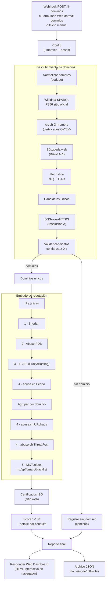

# Flujo n8n · Descubrimiento de dominios + embudo de reputación + score de riesgo

**Plataforma:** n8n (self-hosted ≥ 1.60, `executionOrder: v1`). Elegí n8n porque permite nodos Code en JS para normalizar y puntuar, guarda las credenciales cifradas, trae reintentos y *batching* por nodo y se puede alojar en tu propia infraestructura (los datos de TI no salen a un SaaS).

| Archivo | Contenido |
|---|---|
| [workflow_ti_dominios.json](workflow_ti_dominios.json) | Workflow importable (42 nodos). **No contiene claves.** |
| [nodes/](nodes/) | Código fuente de cada nodo Code (incluido el score en [score.js](nodes/score.js)). |
| [build.py](build.py) | Genera el JSON a partir de `nodes/*.js`. Ejecutar después de cada cambio. |
| [tests/simular.js](tests/simular.js) | Ejecuta los nodos Code reales con respuestas HTTP simuladas y comprueba el resultado con aserciones. |

---

## 1. Arquitectura



Principio de diseño: **cada llamada HTTP tiene `onError = continueRegularOutput`**. Si una API falla, el ítem sigue con `{error}` y el nodo `Norm …` siguiente lo transforma en `estado: "no_disponible"` con el motivo. Ninguna caída corta el flujo ni inventa un valor.

---

## 2. Descubrimiento de dominios (varias técnicas de coincidencia)

| Técnica | Endpoint | Peso | Por qué |
|---|---|---|---|
| Wikidata | `query.wikidata.org/sparql` (EntitySearch + `wdt:P856`) | 0.50 | Sitio web oficial curado. Sirve para empresas y personas públicas. Gratis, sin clave. |
| Certificate Transparency | `crt.sh/?O=<nombre>&output=json` | 0.30 | Los certificados OV/EV incluyen la razón social en el campo O. |
| Buscador | Brave Search API | 0.35 (1.º) / 0.20 (2.º-5.º) | Excluye redes sociales y agregadores (`dominios_excluidos`). |
| Heurística | `slug(nombre)` + `com, com.ar, com.uy, com.br, net, org` | 0.15 | Por sí sola nunca alcanza el umbral; solo refuerza otras técnicas. |
| Bonus | token del nombre (≥4 caracteres) dentro del dominio | +0.10 | |

- **Aceptado:** confianza ≥ `0.4` y resolución A a una IP pública (DoH `dns.google`). Se descartan las IPs privadas o CGNAT.
- **Posible:** resuelve, pero no llega al umbral. Va a `posibles_para_revision` y **no se consulta** en el embudo, para no investigar dominios de terceros.
- **Sin dominio:** se agrega a `sin_dominio[]` con su motivo (`sin coincidencias verificadas` o `todas las fuentes de descubrimiento no disponibles`) y el flujo sigue con el resto.
- `lista_urls` es la lista de URLs resultante (`https://<dominio>`).

---

## 3. Embudo de consulta (orden y endpoints)

| # | Fuente | Granularidad | Endpoint | Resultado normalizado |
|---|---|---|---|---|
| 1 | **Shodan** | IP | `GET api.shodan.io/shodan/host/{ip}` (o InternetDB) | org, ASN, puertos, servicios, CVEs. Un 404 da `ok_sin_datos` (neutral). |
| 2 | **AbuseIPDB** | IP | `GET api.abuseipdb.com/api/v2/check?maxAgeInDays=90` | confianza de abuso, total de reportes, whitelist |
| 3 | **IP-API** | IP | `GET ip-api.com/json/{ip}?fields=...` | proxy, hosting, vpn, isp, org, as. **Sin clave de API ni cuotas**. |
| 4a | **abuse.ch Feodo** | IP | `feodotracker.abuse.ch/downloads/ipblocklist.json` (**una sola descarga por ejecución**) | C2 de botnets |
| 4b | **abuse.ch URLhaus** | dominio | `POST urlhaus-api.abuse.ch/v1/host/` | URLs de malware (online o históricas) |
| 4c | **abuse.ch ThreatFox** | dominio | `POST threatfox-api.abuse.ch/api/v1/` `search_ioc` | IOCs de malware |
| 5 | **MXToolbox** | dominio | `GET mxtoolbox.com/api/v1/Lookup/{mx\|spf\|dmarc\|blacklist}/{dominio}` | Failed/Warnings por comando |

Cuando un dominio tiene varias IPs (máximo `max_ips_por_dominio = 3`), cada IP se consulta y el score toma **la peor**.

## 4. Certificados ISO

No existe una API pública y gratuita que relacione dominio con certificado ISO. Por eso el flujo:

1. Descarga `/`, `/certificaciones`, `/calidad`, `/iso` y `/certifications` del dominio.
2. Busca con expresiones regulares ISO 9001, 14001, 27001, 27017, 27018, 27701, 45001, 22301, 20000-1, 50001, 22000, 13485, 37001 y 28000, junto con su versión (`:2022`).
3. Registra cada norma con la URL y el fragmento de texto donde aparece, marcada como `verificado: false` (`metodo: declaracion_en_sitio_web`).

> **Extensión opcional:** la verificación formal se hace contra **IAF CertSearch**, que ofrece una API con registro. Se puede agregar un nodo HTTP antes de `Norm ISO` y poner `verificado: true` cuando haya coincidencia.

---

## 5. Regla explícita de ponderación (nodo **Config → `pesos`**)

$$score = \mathrm{clamp}\left(10 + \sum puntos,\ 1,\ 100\right)$$

| Fuente (tope +) | Hallazgo | Puntos |
|---|---|---|
| **AbuseIPDB** (30) | confianza ≥ 75 / 25-74 / 1-24 | +30 / +18 / +8 |
| | 0 reportes en 90 días | −3 |
| **abuse.ch** (30) | IP en Feodo (C2) | +30 |
| | URLhaus con URLs online / solo históricas | +20 / +8 |
| | ThreatFox IOC | +15 |
| | sin presencia en las 3 listas (cobertura completa) | −3 |
| **Shodan** (20) | ≥5 CVEs / 1-4 CVEs | +12 / +8 |
| | puerto sensible expuesto (RDP, SMB, DBs, Redis…) | +3 c/u (máx +8) |
| | solo puertos web y sin CVEs | −2 |
| **IP-API** (15) | clasificada como proxy / VPN / anonimizador | +15 |
| | alojada en datacenter / cloud / hosting | +5 |
| | infraestructura corporativa/residencial propia | −2 |
| **MXToolbox** (15) | aparece en blacklist | +8 |
| | sin SPF / SPF `+all` | +2 / +3 |
| | sin DMARC / DMARC `p=none` | +3 / +1 |
| | SPF correcto + DMARC reject/quarantine + sin blacklist | −3 |
| **ISO** | ISO 27001 declarada | −1 |

Modificadores:
- **Infraestructura compartida** (CDN, cloud o IP-API Hosting): los puntos positivos de AbuseIPDB e IP-API se multiplican por 0.5, porque los reportes sobre una IP de Cloudflare no son atribuibles al dominio.
- Cuando los positivos de una fuente superan su tope, se agrega una línea `tope_de_fuente` con el ajuste negativo.
- **Fuente no disponible:** línea con 0 puntos y `FUENTE NO DISPONIBLE: <motivo>`. Las bonificaciones por "limpio" solo se aplican con cobertura completa.
- `confianza_score`: **alta** con 5/5 fuentes completas, **media** con ≥3 disponibles, **baja** en el resto. `score_parcial = true` si alguna fuente falló total o parcialmente.
- `nivel_riesgo`: bajo < 25 ≤ medio < 50 ≤ alto < 75 ≤ crítico.

Cada punto queda trazado en `score_detalle[]` con `{fuente, consulta, evidencia, puntos}`. La suma del detalle es igual al score (el test lo comprueba).

---

## 6. Tasa de llamadas, reintentos, duplicados y secretos

| API | Batching (ítems / intervalo) | Reintentos | Timeout |
|---|---|---|---|
| Wikidata | 1 / 1000 ms | 3 × 5 s | 20 s |
| crt.sh | 1 / 2000 ms | 3 × 5 s | 45 s |
| Brave | 1 / 1100 ms | 3 × 5 s | 20 s |
| DoH | 10 / 500 ms | 3 × 2 s | 10 s |
| Shodan | 1 / 1100 ms (límite de 1 req/s) | 3 × 5 s | 20 s |
| AbuseIPDB | 1 / 1000 ms | 3 × 5 s | 20 s |
| IP-API | 1 / 1400 ms (sin clave, 45/min) | 3 × 5 s | 10 s |
| URLhaus / ThreatFox | 1 / 1000 ms | 3 × 5 s | 20 s |
| MXToolbox | 1 / 1500 ms | 3 × 5 s | 30 s |
| Web ISO | 5 / 1000 ms | sin reintento | 10 s |

- **429 persistente:** después de agotar los reintentos la fuente queda `no_disponible` con el motivo `límite de tasa (429) tras reintentos`.
- **Cuotas diarias:** Shodan InternetDB e IP-API operan **sin cuota mensual ni clave de API**. MXToolbox y AbuseIPDB tienen planes gratuitos estándar.
- **Sin duplicados en una ejecución:**
  - los nombres se deduplican sin distinguir mayúsculas;
  - los candidatos se resuelven una vez en total, aunque varios nombres los compartan;
  - un dominio compartido por varios nombres se enriquece una vez (`nombres_origen[]`);
  - una IP compartida entre dominios se consulta una vez;
  - Feodo se descarga una vez.
- **Caché entre ejecuciones (recomendado en producción):** agregar Redis o una n8n Data Table con clave `fuente:ip|dominio` y TTL de 24 h, con un nodo de consulta antes de cada HTTP.
- **Secretos:**
  - todas las claves se guardan como **n8n Credentials** (Header o Query Auth), cifradas con `N8N_ENCRYPTION_KEY`;
  - el JSON solo guarda el *nombre* de la credencial;
  - en Enterprise se pueden usar *External Secrets* (Vault, AWS Secrets Manager);
  - el webhook también exige un token por Header Auth.

| Credencial | Tipo | Campo |
|---|---|---|
| AbuseIPDB API | Header Auth | `Key` |
| abuse.ch Auth-Key | Header Auth | `Auth-Key` (gratis en auth.abuse.ch) |
| MXToolbox API | Header Auth | `Authorization` |
| Webhook TI token | Header Auth | p.ej. `X-API-Key` |
| *(Shodan / IP-API)* | *(Sin clave)* | *(Libres de cuotas)* |

---

## 7. Salida

Se guarda en `/home/node/.n8n-files/ti_dominios_<fecha>.json`, que es el directorio permitido por defecto en n8n. Estructura:

```json
{
  "resumen": { "nombres_procesados": 2, "nombres_con_dominio": 1, "nombres_sin_dominio": 1, "dominios_analizados": 2 },
  "lista_urls": ["https://acme-corp.com", "https://acme.com.ar"],
  "tabla": [{ "dominio": "acme-corp.com", "score": 70, "nivel": "alto", "confianza": "media", "fuentes": "5/5",
              "iso": "ISO 27001, ISO 9001", "estado": "SH:ok AB:ok GN:ok ACH:ok MX:parcial" }],
  "dominios": [{
    "dominio": "acme-corp.com", "score": 70, "nivel_riesgo": "alto", "score_parcial": true,
    "score_detalle": [
      { "fuente": "base", "consulta": "-", "evidencia": "Punto de partida neutral", "puntos": 10 },
      { "fuente": "shodan", "consulta": "host/203.0.113.10", "evidencia": "2 CVE(s): ...", "puntos": 8 },
      { "fuente": "abuseipdb", "consulta": "check/203.0.113.10", "evidencia": "confianza_abuso=80, reportes=42", "puntos": 30 },
      { "fuente": "abuse.ch", "consulta": "urlhaus/host", "evidencia": "1 URL(s) de malware ONLINE", "puntos": 20 },
      { "fuente": "mxtoolbox", "consulta": "lookup/blacklist", "evidencia": "subconsulta no disponible: límite de tasa (429) tras reintentos", "puntos": 0 }
    ],
    "estado_consultas": { "shodan": "ok", "abuseipdb": "ok", "greynoise": "ok",
      "abusech": { "global": "ok", "urlhaus": "ok", "threatfox": "ok", "feodo": "ok" },
      "mxtoolbox": { "global": "parcial", "mx": "ok", "spf": "ok", "dmarc": "ok", "blacklist": "no_disponible" },
      "certificados_iso": "ok" },
    "hallazgos": { "por_ip": ["..."], "abusech": {}, "mxtoolbox": {} },
    "certificados_iso": { "normas": [{ "norma": "ISO 27001", "versiones": ["2022"], "evidencias": [{ "url": "...", "fragmento": "..." }] }], "verificado": false }
  }],
  "sin_dominio": [{ "nombre": "Empresa Inexistente XYZ 123", "motivo": "sin coincidencias verificadas", "estado_fuentes": {} }]
}
```

---

### 8. Despliegue e Interfaz de Usuario

El flujo incluye ahora **Interfaz Web nativa** sin requerir frontend externo:

1. **Formulario Web integrado (`n8n-nodes-base.formTrigger`):**
   * Una vez activado el workflow, accede a `https://<tu-n8n>/form/ti-dominios` (o `/form-test/ti-dominios` en pruebas).
   * Te presenta un formulario limpio donde pegas la lista de empresas o personas (una por línea).
2. **Dashboard Ejecutivo en tiempo real (`n8n-nodes-base.respondToWebhook`):**
   * Al enviar el formulario, el flujo procesa el embudo y **responde directamente en el navegador con un Dashboard HTML visual**:
     * Tarjetas métricas (Crítico, Alto, Medio, Bajo).
     * Tabla con scores coloreados, badges de normas ISO y estado de cada API.
     * Acordeón desplegable para auditar el desglose de puntos de cada dominio.
     * Tabla de entidades sin dominio identificado.
3. **Persistencia y API:**
   * Simultáneamente sigue guardando el informe completo en formato JSON en `/home/node/.n8n-files/`.
   * Si prefieres integrarlo a scripts, el endpoint `POST /webhook/ti-dominios` sigue disponible.

Si modificás el código: editá `nodes/*.js`, ejecutá `python build.py` y luego `node tests/simular.js`.

## 9. Limitaciones conocidas

- El dominio registrable se calcula de forma aproximada, con una lista corta de SLDs de ccTLD. Para precisión total habría que usar la Public Suffix List. Los IDN (con caracteres no ASCII) se descartan.
- crt.sh suele saturarse: en ese caso queda `no_disponible` y el resto de técnicas siguen funcionando.
- La detección de SPF y DMARC se basa en el texto de `Failed`/`Information` de MXToolbox. Conviene validarla con respuestas reales de tu plan.
- En los planes gratuitos de Shodan el campo `vulns` puede venir vacío.
- **Personas físicas:** el flujo trata datos personales. Documentá la base legal y la finalidad según la normativa aplicable (Ley 25.326 AR, Ley 18.331 UY, LGPD BR).
